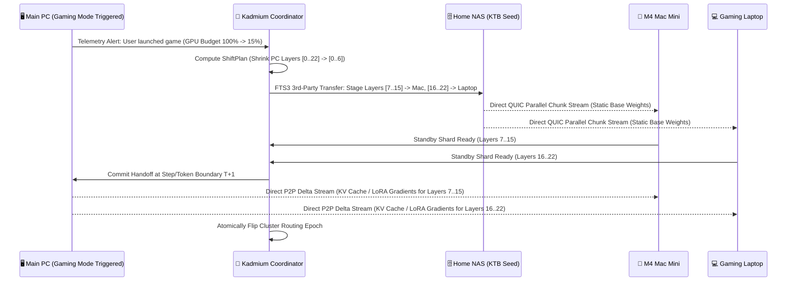

# Kadmium (`Cd`) — Technical Architecture Specification

**Status:** Draft v0.1.0  
**Language Stack:** 100% Pure Rust (`tokio`, `axum`, `quinn`/QUIC, `serde`)  
**Target Environments:** Windows, macOS (Apple Silicon Metal / AMX), Linux (x86_64, ARM64 SBCs, RISC-V), NAS appliances, and ephemeral Cloud GPU instances.

---

## 1. Design Philosophy & Motivation

Conventional distributed AI/ML frameworks (Megatron-LM, DeepSpeed, FSDP, vLLM multi-node) are built around three assumptions that fail outside hyperscale datacenters:
1. **Homogeneous Silicon:** Every worker is assumed to have an identical GPU with identical VRAM capacity and FLOPs.
2. **Uniform Low-Latency Fabrics:** Nodes are assumed to communicate over symmetric NVLink or RDMA/InfiniBand fabrics.
3. **Dedicated 100% Availability:** Nodes are assumed never to be shared with interactive desktop users, games, battery/thermal constraints, or intermittent WAN connections.

When run on real-world personal, academic, or community hardware—such as a desktop gaming PC, an M4 Mac Mini, two gaming laptops, older laptops, Linux SBCs, and a home NAS—traditional frameworks either refuse to initialize or bottleneck the entire cluster down to the speed of the slowest node.

**Kadmium** replaces these assumptions with a **Heterogeneity-Native Compute Fabric** built around four core mechanisms:
1. **Asymmetric Topology-Aware Model Sharding** (proportional to each device's actual compute, memory hierarchy, and link speed).
2. **Dynamic Compute Responsibility Shifting** (live migration of model shards, KV caches, and training states when nodes throttle, enter gaming mode, or when a burst cloud GPU attaches).
3. **Bandwidth-Adaptive Tiered Execution ($q^*$ Policy + NVMe Expert Streaming)** inspired by **FreeToken**, **Colibri**, and **Lumabri**.
4. **Scientific Grid Data Staging & Polite Scheduling** inspired by **CERN FTS3**, **Davix**, and **BOINC**.

---

## 2. Node Roles & Capability Vector (`kadmium-core`)

Every machine running the single `kadmium` binary discovers or joins a mesh and continuously advertises a **`HardwareProfile`** along with its **`PolitePolicy`** envelope.

### 2.1 Logical Node Roles
A single physical device can hold multiple roles simultaneously:
- **`Coordinator`:** Maintains the cluster topology matrix, runs the `ShardPlanner`, orchestrates FTS3 third-party transfers, and exposes the Dashboard & API Gateway. (Can fail over to any standby node).
- **`ComputeWorker`:** Executes assigned model shards (dense layers, MoE expert banks, vision encoders, or training backward stages).
- **`DraftAndUtilityWorker`:** Optimized for Linux SBCs and older CPUs—runs tokenization, speculative decoding draft generation, BPE dataset preparation, embedding table lookups, and validation scoring.
- **`StorageVault`:** Optimized for Home NAS units—stores canonical **Kadmium Tensor Banks (`KTB`)**, training datasets, and rolling checkpoints, seeding them directly to compute nodes via parallel QUIC streams.
- **`BurstAccelerator`:** Ephemeral high-FLOP node (e.g., rented cloud GPU for 2–4 hours) that dynamically absorbs heavy prefill or training pipeline stages and cleanly hands them back before termination.

### 2.2 Multi-Tier Memory Hierarchy
Rather than treating memory as a binary "fits in VRAM or OOM", Kadmium models five explicit memory tiers per node:

| Tier | Examples | Typical Bandwidth | Primary Kadmium Allocation |
| :--- | :--- | :--- | :--- |
| **Tier 0: Discrete VRAM** | NVIDIA RTX / AMD Radeon VRAM | 300 – 1,800 GB/s | Active dense transformer layers, hot MoE experts, active micro-batch activations |
| **Tier 1: Unified Memory** | Apple Silicon M1–M4 Pro/Max/Ultra | 120 – 800 GB/s | Large contiguous layer ranges, global KV-cache pools, un-checkpointed training activations |
| **Tier 2: System RAM** | DDR4 / DDR5 Host Memory | 30 – 90 GB/s | Warm MoE expert banks, frozen QLoRA base weights, pinned prefetch buffers, optimizer states |
| **Tier 3: Local NVMe** | PCIe Gen4/Gen5 SSD | 3.5 – 14 GB/s | Cold MoE expert banks (`colibri`-style on-demand streaming), activation swap, local shard cache |
| **Tier 4: Peer / NAS Fabric** | 1GbE / 2.5GbE / 10GbE / Thunderbolt | 0.1 – 5.0 GB/s | Third-party FTS3 shard staging, dataset streaming, asynchronous checkpoint archiving |

---

## 3. Custom Asymmetric Model Sharding (`kadmium-sharding`)

### 3.1 The Asymmetric Sharding Formulation
Given a model $M$ consisting of $L$ layers (where each layer $l \in \{1..L\}$ has dense parameter footprint $W_l^{\text{dense}}$, optional MoE routed expert pool $E_l = \{e_{l,1}, \dots, e_{l,K}\}$, and per-token FLOP requirement $F_l$) and a cluster of nodes $N = \{n_1, \dots, n_m\}$ with pairwise link bandwidth $B_{i,j}$ and latency $\lambda_{i,j}$:

Instead of assigning $L / m$ layers to each node, Kadmium computes an **Effective Capacity Score** $C(n_i)$ weighted by the workload type $w \in \{\text{Inference}, \text{Training}, \text{Batch}\}$:

$$C_{\text{eff}}(n_i, w) = \alpha_w \cdot \text{FLOPs}_{\text{avail}}(n_i) + \beta_w \cdot \text{Mem}_{\text{fast}}(n_i) + \gamma_w \cdot \text{BW}_{\text{tier}}(n_i)$$

Where:
- **`FLOPs_avail(n_i)`** is scaled by the node's current **Polite Availability Multiplier** $\rho(n_i) \in [0.0, 1.0]$ (e.g., $\rho = 1.0$ when idle, $\rho = 0.15$ when the user is actively gaming on their main PC).
- **`Mem_fast(n_i)`** combines Tier 0 (VRAM), Tier 1 (Unified Memory), and bandwidth-discounted Tier 2 (System RAM) via the **FreeToken-inspired $q^*$ policy**.

### 3.2 Bandwidth-Adaptive Execution ($q^*$ Policy)
Adopted from **FreeToken**, each node calculates its local split ratio $q^* \in [0, 1]$ between Accelerator (GPU/Metal) execution and Host (CPU/RAM/NVMe) execution so that accelerator compute time equals interconnect/streaming time:

$$T_{\text{accel}}(q^* \cdot W) \approx T_{\text{host + stream}}((1 - q^*) \cdot W)$$

- On a **Gaming Laptop** (high GPU FLOPs, limited 8–12 GB VRAM, 32 GB DDR5 RAM, fast Gen4 NVMe): dense attention runs 100% in VRAM while routed MoE experts are split across VRAM, RAM, and zero-copy NVMe `KTB` banks.
- On an **M4 Mac Mini** (Unified Memory): zero PCIe copy overhead ($q^* \to 1.0$ across unified memory), making it an ideal anchor for contiguous middle transformer blocks and large KV caches or training activation buffers.
- On **Linux SBCs**: assigned non-bottlenecking edge stages—tokenization, HTTP/SSE stream assembly, speculative draft token generation (small 0.5B–1.5B int4 model), or embedding lookup tables.

### 3.3 TPU / Systolic & Compute-in-Memory (CIM) Inspired Dataflow Modes (`DataflowStreamPlanner`)
In matrix multiplication $Y = X \cdot W$, either activations $X$ or weights $W$ must move across memory tiers and network links. Borrowing from Google TPU systolic arrays and Compute-in-Memory (CIM / Processing-in-Memory) designs, Kadmium provides programmable dataflow modes:
1. **`ComputeInMemoryTokenStreaming` (Weight-Stationary / CIM):**
   - Weights $W^{(l)}$ are permanently pinned across distributed VRAM, Apple Unified Memory, and dual-channel DDR System RAM banks.
   - Zero weight movement occurs during execution; instead, compact token activation micro-packets ($x_t \in \mathbb{R}^d$, $16\text{–}32\text{ KB}$) flow like a systolic wavefront directly to the memory controllers where the weights reside.
   - Optimal when batch size is small ($B \le 8$) and execution is memory-bandwidth bound.
2. **`TokenStationaryWeightStreaming` (Dynamic Weight Streaming):**
   - Large batches of token activations ($X \in \mathbb{R}^{B \times S \times d}$) stay stationary in fast GPU SRAM/VRAM while double-buffered `.ktb` weight tiles stream continuously from local NVMe, Home NAS, or peer RAM banks.
   - Optimal when $B \times S \ge 256$, where high arithmetic intensity ($\text{FLOPs/Byte}$) completely hides weight streaming latency behind tensor core execution.
3. **`DisaggregatedDualStream`:**
   - Executes prompt prefill using `TokenStationaryWeightStreaming` on high-FLOP discrete GPUs, then streams the resulting KV-cache and single-token decode wavefront through `ComputeInMemoryTokenStreaming` memory nodes.

### 3.4 Multi-Environment Pool Slicing (`SubClusterPartitioner`)
For larger deployments (e.g., a 100-node university, lab, or community pool), Kadmium supports partitioning the global hardware pool into $K$ isolated **Sub-Compute Environments (`ComputeSubCluster`)**—such as 5 sub-clusters of 20 nodes each:
- **`ProductionDeployment`:** Locked inference slice with strict SLA and dedicated `/v1/slices/slice-01-prod-deploy` gateway routing.
- **`StagingAndTesting`:** Isolated canary environment for testing new models, kernels, or sharding layouts without perturbing production.
- **`DistributedTrainingLab`:** Dedicated 1F1B + Sharded-Island DiLoCo + DeMo training slice.
- **`RlAndDreamRsiArena`:** Disaggregated RL sandbox + Dream-RSI offline replay slice.
- **`BatchAndEvalPool`:** High-throughput dynamic weight-streamed batch evaluation slice.
- Slices enforce hard resource/network fences by default, with optional **Elastic Borrowing** so training/batch slices can temporarily harvest idle nodes from staging/test slices and yield them back on demand.

---

## 4. Dynamic Compute Responsibility Shifting

A core innovation in Kadmium is **Live Compute Responsibility Shifting**—allowing the cluster to adapt in real time without restarting inference sessions or aborting multi-hour training jobs.

### 4.1 Shift Triggers (`MigrationTrigger`)
1. **`HostActivitySpike`:** User starts gaming, video editing, or compiling on a desktop/laptop.
2. **`ThermalOrBatteryConstraint`:** A laptop transitions to battery power or hits a thermal ceiling.
3. **`BurstNodeJoined`:** A rented cloud GPU or returning desktop joins the mesh, allowing Kadmium to offload heavy shards onto the new accelerator.
4. **`BurstNodeDraining`:** Cloud GPU rental timer reaches $T - 5\text{ min}$; Kadmium proactively drains its shards and checkpoints back to local hardware + NAS.
5. **`ThroughputBottleneckDetected`:** Pipeline bubble profiler notices a stage straggler and shifts $k$ layers to an adjacent underutilized peer.

---

## 5. Distributed & Decentralized Training Engine (`kadmium-runtime`)

Training on real-world personal, academic, and community hardware requires overcoming both **compute/memory asymmetry** (no single device fits a 70B+ model) and **network asymmetry** (Gigabit/Wi-Fi LANs and consumer WAN links cannot run datacenter `AllReduce`).

Kadmium synthesizes breakthroughs from **Prime Intellect (`OpenDiLoCo` / `prime-diloco`)**, **Nous Research (`DisTrO` / `DeMo` & `Psyche`)**, **Learning@Home (`Hivemind` / `Petals` SWARM)**, and **Gensyn (`RL-Swarm` / `Verde` / `SkipPipe`)** into a unified training architecture:

### 5.1 Mode A: Asymmetric 1F1B Pipeline Parallelism + Hivemind 8-Bit Boundaries (Intra-Island LAN)
For nodes on the same LAN (e.g., Main PC, M4 Mac Mini, 2 Gaming Laptops):
- The model is partitioned into asymmetric pipeline stages $S_1, S_2, \dots, S_k$ matched to each node's step time so that forward/backward micro-batch durations $t(S_i)$ are equalized.
- **8-Bit Blockwise Boundary Compression (`Hivemind`):** Forward activations and backward activation gradients crossing LAN/Wi-Fi node boundaries are dynamically quantized using 8-bit blockwise quantization with stochastic rounding, cutting inter-node pipeline wire traffic by $50\%$–$75\%$.
- **Per-Node Selective Activation Checkpointing:**
  - Nodes with tight VRAM but high FLOPs (e.g., Gaming Laptop with 8 GB VRAM) enable **Full Activation Recomputation** during the backward pass.
  - Nodes with abundant Unified/System Memory (e.g., M4 Mac Mini with 24–64 GB Unified Memory) **Cache Activations** in memory to save FLOPs.

### 5.2 Mode B: Distributed LoRA / QLoRA / DoRA
- Base weights are stored in compressed `KTB` banks (`NF4` / `INT4` / `FP8`) and sharded across nodes.
- Only compact low-rank adapter matrices ($A, B$) and micro-batch hidden states cross node boundaries, slashing memory footprint and network traffic by $>90\%$.

### 5.3 Mode C: Sharded-Island DiLoCo (`OpenDiLoCo` Generalized to Consumer Hardware)
Standard DiLoCo assumes every worker (or datacenter island) holds a full replica of the model and performs data-parallel inner steps. On consumer hardware, **no single machine can hold a full 70B–671B model**.
Kadmium introduces **Sharded-Island DiLoCo**:
1. **Pipeline-Sharded Compute Islands:** A local group of heterogeneous devices (e.g., Island 1 = your Home LAN cluster; Island 2 = a friend's PC + laptop mesh or a university lab rack; Island 3 = a burst cloud GPU) collectively holds one full model replica partitioned across pipeline stages $[L_0..L_a], [L_{a+1}..L_b], \dots$.
2. **Inner-Loop Local Optimization ($H$ Steps):** Each Sharded Island independently executes $H$ inner-loop steps (`AdamW` over asymmetric 1F1B micro-batches) on distinct dataset shards streamed from its local NAS/cache.
3. **Shard-Aligned Outer-Loop Synchronization:** Every $H$ steps (e.g., $H = 50..500$), nodes holding overlapping layer ranges across different islands directly exchange outer-loop pseudo-gradients ($\Delta \theta_l = \theta_l^{(0)} - \theta_l^{(H)}$) via peer-to-peer QUIC streams and apply an outer Nesterov momentum step.

### 5.4 Mode D: DeMo / DisTrO Frequency-Domain Momentum Compression (`NousResearch/DisTrO`)
Even outer-loop synchronization or cross-node gradient averaging can bottleneck slow home internet uploads (e.g., 20–50 Mbps upstream).
Inspired by **Nous Research's DisTrO / DeMo (Decoupled Momentum Optimization)**:
- Optimizer momentum states $m_t$ are transformed into the frequency domain via chunked **Discrete Cosine Transform (`DCT`)**.
- Only the **Top-$k$ fastest-moving frequency components** ($q_{\text{dct}}$) are extracted and transmitted across peers, while unselected frequencies remain in a local **Residual Error Feedback Accumulator** $e_t$:
  $$m_t = \beta m_{t-1} + g_t, \quad c_t = \text{TopK}(\mathcal{F}_{\text{DCT}}(m_t + e_{t-1})), \quad e_t = (m_t + e_{t-1}) - \mathcal{F}_{\text{DCT}}^{-1}(c_t)$$
- This achieves **$800\times$ to $3{,}000\times$ communication compression** compared to raw `AllReduce` without degrading training convergence.

### 5.5 Mode E: SWARM Stochastic Routing & SkipPipe Fault Tolerance
When training across opportunistic devices (laptops on Wi-Fi, volunteer lab machines):
- **SWARM Dynamic Stage Routing (`Hivemind`/`Petals`):** If multiple nodes or islands hold overlapping layer shards, micro-batches are routed stochastically inversely proportional to real-time queue latency.
- **SkipPipe Recovery (`Gensyn`):** If a non-critical peer drops or spikes in latency mid-micro-batch, Kadmium dynamically reroutes remaining micro-batches in the window to standby/adjacent peers without aborting the global step.

### 5.6 Mode F: Decentralized RL Post-Training Swarms (`RL-Swarm` / `Prime-RL` / GRPO)
Post-training reasoning and coding models via Reinforcement Learning (GRPO / PPO / RLOO) naturally decouples into three distinct hardware workloads that map onto a heterogeneous Kadmium cluster:
1. **Rollout Generation (Inference-Bound):** Gaming Laptops + M4 Mac Mini generate $G$ candidate reasoning/code completions per prompt using high-speed quantized `.ktb` shards.
2. **Verifiable Reward Sandboxes (CPU/Edge-Bound):** **Linux SBCs, older laptops, and NAS CPU cores** execute deterministic reward verifiers in parallel (compiling generated code, running unit test suites in lightweight sandboxes, checking math proofs/symbolic equivalence).
3. **Policy Gradient Update (Compute-Bound):** Main Desktop PC (and optional Burst Cloud GPU) consumes the verified `(prompt, rollout, advantage)` tuples to compute policy gradients and update adapter/model weights.

### 5.7 Mode G: Dream-RSI — Recursive Self-Improvement through Evolving Worlds (`kadmium-rl`)
Inspired by **[Dream-RSI](https://www.dream-rsi.com/) ([zhengkid/Dream-RSI](https://github.com/zhengkid/Dream-RSI), arXiv:2609.14858)**, Kadmium provides first-class architectural support for off-policy recursive self-improvement in long-horizon discovery domains (GPU kernel engineering, algorithm design, mathematical optimization, and self-tuning cluster heuristics):
1. **Online Waking Discovery (GPU/Metal Nodes):** Accelerator nodes execute the current active exploration policy $\pi_{\text{explore}}$ to propose and benchmark new code/kernel/math artifacts, logging the complete **Discovery Tree** $\mathcal{T}$ (visited states, parent-child mutations, prior novelty estimates, realized scores, and evaluation costs) to the **Home NAS**.
2. **Replay World Construction (Home NAS Vault):** Rather than discarding trial-and-error trajectories, the Home NAS indexes accumulated discovery trees into an empirical **Replay Simulator**.
3. **Offline "Dreaming" Policy Evolution (Linux SBCs, Legacy Laptops, & Idle CPUs):** Because outcomes on historical trees are already recorded, evaluating candidate meta-exploration policies $\pi'_{\text{explore}}$ (varying exploitation vs. novelty weights, parallel wave widths, and early-pruning thresholds) requires **zero live 70B LLM forward passes**. Kadmium offloads thousands of parallel "dream" replay rollouts onto Linux SBCs, older laptops, and NAS CPU cores to discover an exploration policy $\pi^*_{\text{explore}}$ that reaches breakthrough nodes with $>50\%$ fewer online evaluations—without having to retrain the underlying base model weights.

---

## 6. FTS3 / Davix Data Plane & `KTB` Weight Format (`kadmium-data`)

### 6.1 Kadmium Tensor Bank (`KTB`) Format
Inspired by **FreeToken (`FTW`)** and **Colibri**:
- Standard `safetensors` or `GGUF` files often store tensors in logical naming order, requiring expensive seeks or repacking when streaming specific MoE experts or layer shards.
- **`.ktb` (Kadmium Tensor Bank)** pre-aligns tensors into **4 KB / 64 KB page-aligned execution banks** grouped by `(LayerIndex, ExpertId, QuantFormat)` with Blake3 content-addressed chunk hashes.
- Enables direct `mmap` / `io_uring` / Windows `IoRing` reads straight from NVMe into DMA buffers or QUIC network streams with zero deserialization overhead.

### 6.2 Third-Party Transfer Scheduler (CERN FTS3 Pattern)
In naive distributed systems, the coordinator downloads and forwards weights to workers, becoming a severe bottleneck.
Following **CERN's FTS3** architecture:
1. The coordinator issues a **`TransferJob`** specifying `(SourcePeer, DestinationPeer, ChunkManifest, Priority, MaxBandwidthMbps)`.
2. `SourcePeer` (e.g., the Home NAS or a peer that already cached the shard) opens a direct multi-stream QUIC connection to `DestinationPeer` (Davix-style chunked streaming).
3. Both peers report progress, throughput, and checksum verification states back to the coordinator's state machine.

---

## 7. BOINC & Gensyn Verde: Polite Governance & Cross-Silicon Verification

To make it effortless for friends, family, academic labs, and decentralized peers to contribute idle machines without degrading their daily usage or corrupting training runs:

### 7.1 Zero-Interference Resource Governor (`BOINC`-Inspired)
- Monitors CPU/GPU load, foreground fullscreen/gaming processes, battery state, and time-of-day schedules.
- Drops compute budget within $<250\text{ ms}$ of user activity and triggers a `LiveRebalancer` responsibility shift.

### 7.2 Cross-Silicon Reproducible Verification (`Gensyn Verde` & `REE` Inspired)
Classic BOINC verification relies on bit-exact output matching across identical CPU binaries. In AI/ML, an NVIDIA RTX 4090 (`CUDA`), an Apple M4 Mac Mini (`Metal`), and an AMD/Linux laptop (`ROCm`/`Vulkan`) produce slightly different IEEE-754 floating-point results due to non-associative parallel FMA reductions.
Kadmium applies the two mechanisms Gensyn published for this, RepOps and Verde, to its work units; section 9.6 has the protocol and what it proves today.
1. **RepOps (reproducible operators, `kadmium-runtime::repops`):** every reduction in the reference math is a pairwise tree over the index space, every transcendental a fixed-order polynomial on IEEE basic operations, and every product is rounded once with no fused multiply-add. A backend may chunk, thread or reassociate as it likes; the bits do not change. A versioned manifest names the conventions, and its id is folded into every digest.
2. **Verde (refereed layer bisection, `GridDispatcher::referee_dispute`):** every result commits to the RepOps digest of each layer boundary it ran. When two untrusted copies of a unit disagree, the referee finds the first divergent layer from the two chains, has a disputant open the boundary before it, checks the opening against the digest both committed to, and re-runs that one layer. The disputant whose digest it reproduces wins; the other is penalised with the layer named.
3. **Contribution Ledger:** Tracks verified FLOP-hours, bytes staged via FTS3, RL rollouts verified, and tokens/steps contributed per node across the cluster.

---

## 8. Open-Core & Hybrid Cloud Architecture ("Supabase for AI Compute")

Kadmium's core technical primitives—asymmetric sharding, low-communication DeMo/DiLoCo synchronization, FTS3 third-party `.ktb` staging, and sub-second live responsibility shifting—unlock a natural **Open-Core + Managed Hybrid Cloud** architecture (`HybridCloudArbitragePlanner`):

### 8.1 Self-Hosted Open Source vs. Managed Kadmium Cloud
- **Self-Hosted Core (`MIT / Apache-2.0`):** Every feature required to run a personal, academic, or enterprise cluster is open-source in the single `kadmium` Rust binary.
- **Managed Control Plane:** Teams can optionally link their local clusters (`kadmium login`) to a managed coordinator that handles zero-config WAN mesh relays, sub-cluster RBAC, centralized observability, and encrypted `.ktb` checkpoint mirroring.

### 8.2 Multi-Datacenter Fragmented GPU & Spot Arbitrage
Hyperscalers charge premium rates for contiguous 8xH100 InfiniBand nodes because conventional frameworks cannot tolerate heterogeneous GPUs or cross-datacenter latency.
Because Kadmium shards asymmetrically and compresses inter-node gradients/activations by $1{,}000\times$, it can aggregate stranded single-GPU spot instances (`1x L40S`, `1x A100`), green stranded-energy datacenter GPUs, and cheap high-RAM bare-metal servers (`256 GB DDR5 + Gen5 NVMe` for warm/cold MoE expert banks) across multiple providers—reducing hourly compute costs by **60%–85%**.

### 8.3 Bidirectional Downtime Protection (`Local <-> Cloud Failover Shield`)
1. **Local-to-Cloud Outage Shield:** When a user's self-hosted node loses power, overheats, or drops its ISP connection, Kadmium Cloud's pre-warmed `.ktb` standby vault immediately spins up a spot GPU to take over only the missing layer range $[L_a..L_b]$ within $<350\text{ ms}$ RTO.
2. **Automatic Failback to Local ($0/hr):** Once local power/internet is restored, Kadmium drains the temporary cloud shard back to the user's local hardware so cloud billing stops immediately.
3. **Cloud Spot Preemption to Local/Multi-Cloud Fallback:** When a cloud spot instance emits a 30-second eviction warning or a provider suffers an outage, Kadmium's `LiveRebalancer` shifts the affected shards onto an alternate cloud provider or back onto the user's local M4 Mac Mini, Desktop PC, and Gaming Laptops without dropping a single training step or API request.

---

## 9. The Grid Substrate (`kadmium-grid`): One Computer Assembled From Parts

Everything above describes AI workloads. Underneath them sits a generic distributed-compute substrate, in the tradition of BOINC's work units and CERN's grid data management, so that a mesh of unequal machines behaves like one computer: nodes are the components, you add compute nodes for more compute and storage nodes for more storage, and computation tasks run on the whole.

| In the one-machine picture | In `kadmium-grid` | Heritage |
| :--- | :--- | :--- |
| A process | `WorkUnit`: one piece of computation with content-addressed inputs, placement constraints, a cost estimate, a deadline and a redundancy policy. Each attempt to run it is a `WorkInstance`. | BOINC workunits and results |
| A job with dependencies | `WorkGraph`: a DAG whose ready set is the wavefront the scheduler hands out | DAGMan, grid workflows |
| The disk map | `ReplicaCatalog`: which node holds which content in which memory tier, with `PlacementRule`s that diff against it into `StagingJob`s | Rucio rules, FTS3 staging |
| The process scheduler | `WorkQueue` and its `Matchmaker`: capability, locality, politeness, trust and deadline matching; pull or push dispatch; straggler duplication; retries | BOINC scheduler, pilot-job late binding |
| The audit trail | Quorum validation per trust tier (`Trusted`, `BitExactDigest`, `ScalarTolerance`, `VerdeBisection`) and a `CreditLedger` that credits only validated work and settles it into supply-grid receipts at the canonical clearing rates | BOINC redundancy and credit |
| The spec sheet | `PoolInventory`: the mesh summed as one machine | Grid information systems |

### 9.1 Lifecycle and Validation

A unit moves `Unsent -> Assigned -> Running -> Returned -> Validated -> Assimilated`, with `Invalid`, `Expired` and `Failed` as the other exits. Owned hardware (`TrustedCore`) validates on first return. Verified peers validate within a scalar tolerance, which absorbs cross-silicon floating-point drift. Untrusted nodes run two instances; agreement validates, disagreement opens a Verde dispute that the dispatcher settles with a trusted referee (a `TrustedCore` worker that was not a disputant, or the coordinator in-process). The referee locates the first divergent layer from the digest chains both results carry and re-runs that layer alone (section 9.6), or the whole unit when the unit is one step. The loser's instance is invalidated and penalised in the ledger with the layer named; when the referee reproduces neither disputant, both are penalised and the unit retries on other nodes. Stragglers running past their estimate are duplicated; the first validated result wins.

### 9.2 Execution Shapes Are Schedules, Not Executors

The per-layer reference in `kadmium-runtime::moe_layer` splits a transformer layer into the three pieces the grid schedules separately: the trunk (RMSNorm, RoPE, attention over the layer's KV page, the router), the expert contributions (each a function of the trunk output alone), and the combine (residual plus contributions in expert-id order, clamped, then INT8-quantized at the layer boundary whether or not the boundary crosses a wire). Partials cross the wire as exact `f32`.

- **Pipeline chain:** one `StageForward` unit per trunk range, each folding the three pieces over its layers; a hop only at stage boundaries.
- **Expert parallel:** per layer a `TrunkForward` unit on the trunk owner, one `ExpertSlice` unit per holder of the selected experts, and a `Combine` unit; nodes compute at the same time on the same step and the mesh's pooled fast memory holds a model no single node can.

Because both shapes run the same reference math with the same boundary quantization, they produce identical bytes, which the runtime's equivalence tests assert over real TCP workers for single rows and batches. The planner (`kadmium-sharding::grid_plan`) places weights by capacity and bandwidth, spreads cold experts across the mesh's NVMe drives so they stream concurrently, keeps boundary-layer experts on owned hardware, replicates hot experts into spare fast memory, and chooses the shape per model and link from a bandwidth-bound cost model whose figures are always labelled modelled.

Training is a bag of island units (`TrainForwardBackward`) fanning into one `DeMoReduce`; a Dream-RSI replay batch is a bag with no edges steered to CPU nodes; a Verde audit is a single unit under the untrusted redundancy policy.

### 9.3 Transport

Frames carry a request id (`KDM2` header, 21 bytes; the legacy 13-byte `KDMF` header still decodes). One persistent multiplexed channel per peer carries pipelined work dispatches and demultiplexes out-of-order replies, so a fan-out layer costs one round trip rather than one connection per unit. Work units travel as `WorkDispatch` frames whose envelope holds the unit as JSON plus named binary activation blobs; results come back as `WorkResult` envelopes. Workers execute units through an `ExecutorRegistry` keyed by app kind, and the coordinator's `GridDispatcher` carries the activation one unit produces to the units that depend on it.

### 9.4 Endpoints

`GET /api/v1/grid/inventory` reports the mesh as one machine, with the measured telemetry per worker. `GET /api/v1/grid/plan` reports the shape choice, the placement in force, how it fits every node's offer, the staging it needs and the usage it learned from. `POST /api/v1/grid/plan/approve` records an owner's approval of that placement. `POST /api/v1/grid/run`, `/train` and `/replay` run a decode step, a training step and a replay batch as graphs on the live mesh. `POST /api/v1/grid/repin` applies one re-pin boundary and `POST /api/v1/grid/calibrate` measures the placement in force. `GET /api/v1/grid/credits` returns the cumulative ledger and receipts. The OpenAI, Anthropic and pipeline endpoints run their decode step through the same dispatcher.

### 9.5 Allocation: Measured, Learned and Approved

The matchmaker and the planner allocate from four sources, in this order of authority. The mechanisms come from the two projects Kadmium's tiering is modelled on: lumabri's segment routing, calibration and donor settings, and colibri's usage file, learned pins and live re-pin.

| Source | What it is | Where it lives |
| :--- | :--- | :--- |
| **Residency** | A unit goes to the node that already holds its weights before anything else is considered. A measured speed never pulls a unit away from the node that holds its inputs. | `Matchmaker::rank` under `SchedulerPolicy::residency_first` |
| **Measured completion cost** | Every validated result carries the worker's own `exec_ms`. The queue turns it into a sample per unit of work (never a failed, invalid or cancelled instance), the worker's profile folds it into a bounded moving average per kind of work, and once a worker has eight fresh samples the matchmaker scores it by expected completion: the hop latency plus the measured cost of the unit behind everything already queued on it. The same estimate sets straggler timeouts and chooses which copy of a replicated expert serves a step. The coordinator keeps the averages between runs and restarts. | `ComputeEwma`, `WorkerProfile::completion_estimate_ms`, `TelemetryStore`, `target/kadmium-state/grid_telemetry.json` |
| **Offers** | What a node's owner lets the grid use: fast memory, RAM, NVMe, slots and allocations, with a reserve of RAM (a quarter, bounded to 1 to 4 GiB) that is never offered. The default offer comes from the capability vector and the canonical fractions; an explicit offer is sent on `kadmium join` and clamped to the machine. The planner spends offers and reports the fit: whether every trunk and KV reservation sits in fast or warm memory on its owner, what streams from the vault, and one line per shortfall. A node whose offer requires approval has its staging held until its owner approves the exact placement. | `ResourceOffer`, `PlacementFit`, `PlanApproval`, `ReplicaCatalog::plan_staging_gated` |
| **Learned usage** | Stage and trunk units report which experts every layer routed to. The coordinator folds them into a per-model usage ledger beside the cluster state: a long-term count that is never decayed and a session count that halves every ten minutes. A fresh plan orders and replicates experts by that heat, and the placement in force is kept between runs so the pins stay put; a re-pin boundary swaps at most four hot streamed experts for the coldest pinned ones of their layers, only when the heat difference clears a 25% hysteresis. Replica eviction in the catalog counts reads before recency. | `UsageLedger`, `RepinPlanner`, `CachedPlacement`, `Replica::hits`, `target/kadmium-state/usage/<model>.usage.json` |
| **Calibration** | A measurement of the placement in force: at most eight decode steps of one shape within twenty seconds, recorded as milliseconds per token bound to the placement's digest, the node set, the versions that ran and the batch width. A fan-out measurement also runs one chain step on the same prompt and keeps whether the bytes matched; a record that fails that gate never steers a choice. Once both shapes carry a trusted record on the same mesh, the measurements decide the shape and the plan says `decided_by: measured`. Every record names the kernels it measured, which today are the synthetic references. | `CalibrationRecord`, `CalibrationStore`, `StrategyChoice::apply_measurements`, `target/kadmium-state/grid_calibrations.json` |

A worker also measures its own memory streaming rate when it joins (a single-thread copy, a floor rather than the DRAM's peak), and the cost model uses that figure in place of the nominal RAM bandwidth for that node. All of this changes speed, never bytes: the equivalence tests still assert that chain, fan-out and replica-served fan-out produce the same output.

### 9.6 RepOps and Verde: What Is Deterministic, What Is Committed, What Is Audited

The two ideas come from Gensyn: RepOps, a library of operators that produce the same bits on any hardware by fixing the order of floating-point operations, and Verde, refereed delegation in which a neutral referee settles a dispute between two providers by re-running only the step where they first disagree. Kadmium borrows the fixed reduction order, the re-implemented transcendentals, the one-multiply-add convention, the commitment to intermediate states and the one-step referee. It leaves out the Merkle trees over operator graphs and Verde's two-level game, because a Kadmium unit is one forward over a layer range and the chain of layer digests is the whole commitment; it leaves out on-chain referees and token incentives, which it rejects elsewhere too.

**What is deterministic.** `kadmium-runtime::repops` is the numerics the reference math is built on:

| Primitive | Convention |
| :--- | :--- |
| Reduction | A pairwise tree over `next_power_of_two(n)` leaves, split at the midpoint of each node, leaves past the end absent rather than added as zeros. The value depends on the operands and their indices only, so a chunked, threaded or reassociated reduction merges its partials through the same tree and produces the same bits (`TreeReducer`). |
| Dot product and norm | Every product rounded once (Rust never contracts to a fused multiply-add), then the tree; the norm is the IEEE square root of the tree sum of squares. |
| INT8 boundary energy | Squared codes summed in integers per block, exact in any order; one tree over the block scales. |
| `exp`, `ln`, `pow`, `sin`, `cos` | Fixed-order polynomials on IEEE basic operations, because the platform `libm` is allowed to differ in the last bit between CUDA, Metal, glibc and the MSVC runtime. Measured against the platform functions in the unit tests on this machine: `exp` and `ln` within 4e-7 relative, `sin` and `cos` within 2e-6 absolute on `|x| <= 100`. |
| Manifest | Version 1 names these conventions; its id is the FNV-1a 64 of that text and is folded into every digest, so results computed under different conventions never compare equal. |

Rebuilt on it: the fused RMSNorm and RoPE kernel, the paged attention kernel (a two-pass softmax over tree reductions rather than an online rescaling recurrence, which a split-KV backend could not reproduce), the SwiGLU expert, the router, the per-layer reference (trunk, expert contributions, combine), the DeMo DCT and its inverse (every coefficient contributes a term, zeros included, so the tree has the same shape for every packet), the Q4K matvec and QLoRA adapter, the DiLoCo outer step (islands reduced in canonical order, their bytes ascending) and the reduce's summaries. The tests prove bit-exactness across chunk sizes 1 to n, arrival orders and six simulated backends; chain, fan-out and replica-served fan-out still produce identical bytes; every layer boundary carries the same digest in both shapes; a DeMo reduce over three islands is bit-identical in any contributor order; the legacy pipeline and the grid chain agree digest for digest.

**What is committed.** Every result record carries `layer_digests`: 12 bytes per layer, in layer order.

| Unit | Each digest covers |
| :--- | :--- |
| `StageForward` | The manifest id, the layer and the exact INT8 codes and block scales of the layer boundary; for a batch, the rows' digests folded in row order. |
| `TrunkForward` | The exact `f32` trunk output, or the boundary when the layer is dense. |
| `ExpertSlice` | The holder's partials. |
| `Combine` | The layer boundary, which equals the chain stage's digest for that layer. |
| `TrainForwardBackward`, `DeMoReduce` | The exact bits of the shipped update, and of the master weights. |
| `VerdeAudit` | The exact `f64` state after each layer of the synthetic challenge. |

A unit's digest is the fold of its chain. A hardware bridge (K230, reTerminal CM4, M4 Mac mini) runs its stage on the device and returns one boundary, so its chain has one entry and a dispute over it re-runs the whole stage.

**What is audited.** On a `VerdeBisection` disagreement the dispatcher runs the protocol below and settles through `WorkQueue::resolve_dispute_with_reason`; the run report lists every dispute.

1. The referee is a `TrustedCore` worker that is online and was not a disputant, else the coordinator's in-process executor; with neither, the unit is cancelled.
2. It compares the two chains and takes the first position where they differ (Verde's first phase, and the referee's only work so far: `digest_comparisons`, at most `L`). Chains of different lengths, or chains that agree while the result digests differ, are not bisectable and the referee re-runs the whole unit instead.
3. The divergent layer's input is the boundary both disputants committed to at the layer before. The referee asks a disputant to open it: a probe that re-runs the unit's layers up to that boundary and returns it. An opening that does not reproduce the agreed digest is discarded (`openings_requested`, `openings_verified`). With no verified opening the referee reconstructs the boundary itself from the unit's input, which costs it the layers before the divergent one. When the divergent layer is the unit's first, the input is the unit's own, which the coordinator holds.
4. The referee runs the divergent layer alone from that input, as a probe, and compares the digest it gets with each disputant's claim at that position: `referee_layers_run` is 1 when an opening verified.
5. The disputant whose claim the referee reproduces wins and is credited; the other is invalidated with the reason `Verde: layer <l> digest not reproduced by referee`, which the ledger penalises. When the referee reproduces neither claim, both are penalised, both nodes are excluded from the unit, and it retries while the replica ceiling allows. The winner's output replaces whichever disputant returned last.

The literature's `O(log L)` is the number of interactive rounds a bisection needs when the referee must query the parties for each intermediate hash. Here the chain travels with the result, so those rounds collapse into one message and what the referee re-executes is one layer. Measured in `cargo test` over three loopback TCP workers (two untrusted disputants, one trusted referee), an eight-layer stage with a fault injected at layer 5 settled with 6 digest comparisons, 1 opening and 1 referee layer, and faults at layers 0 and 7 were named exactly; the same holds for the synthetic audit unit with a tamperer at layer 4. These are counts of work, not timings; nothing here has been timed across real silicon.

**What it does not prove.** The kernels are synthetic references on 64-float tensors. RepOps proves the mechanism and the bit-exactness of these references under any chunking; it proves nothing about the numerics of a real model until real kernels are rebuilt on the same primitives, with the manifest version bumped. The digest is FNV-1a 64, the content-addressing primitive the rest of Kadmium uses; it is not collision resistant, and the protocol does not depend on which hash it is. The trust assumption is Verde's: at least one honest disputant. The legacy audit endpoint (`/api/v1/verde/audit`) and the challenge the device scripts mirror are unchanged.
