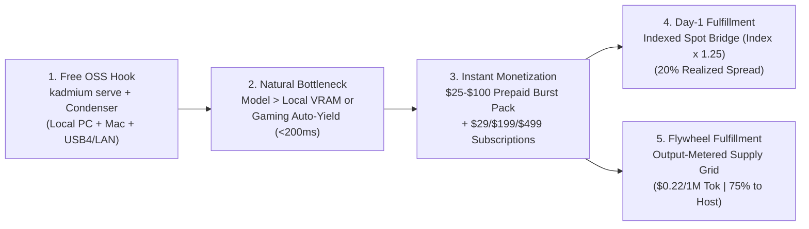
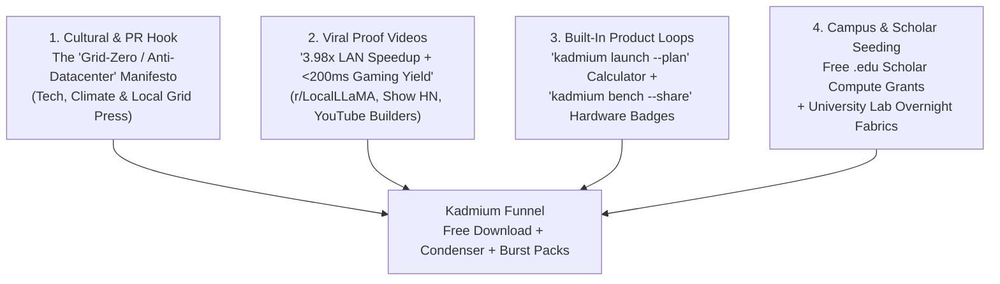
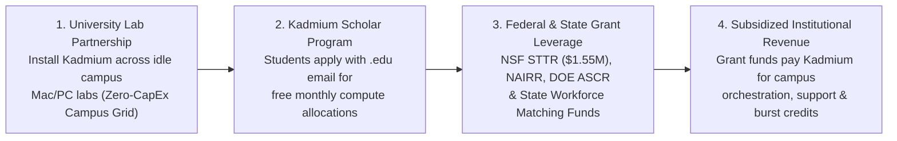
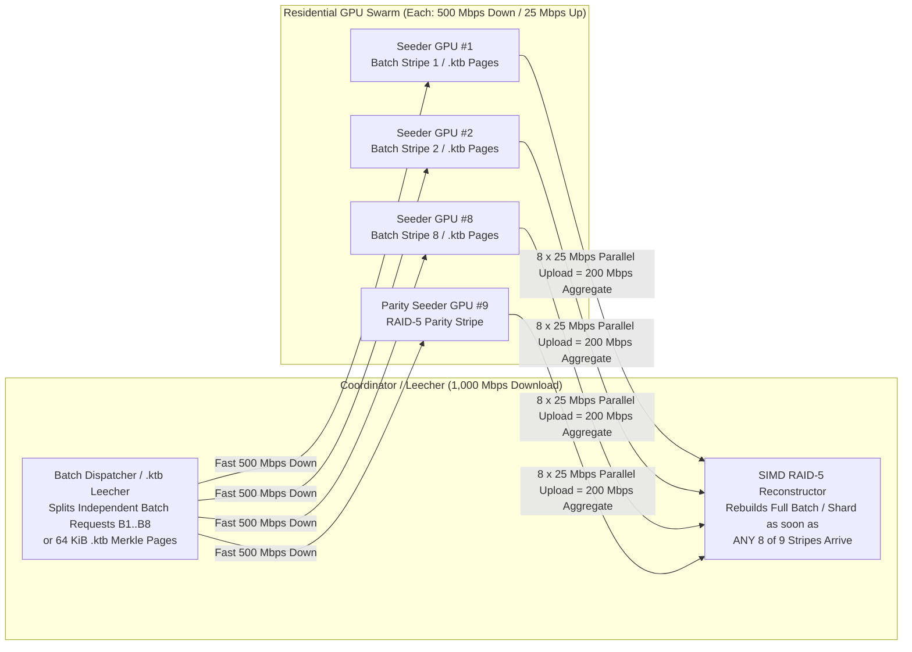
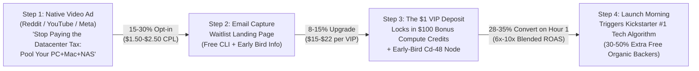
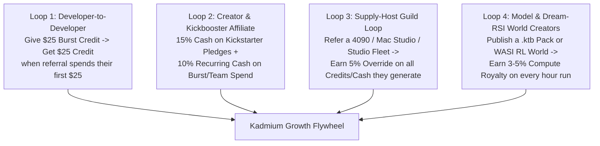

# Kadmium (`Cd-48`) & **Kadmium Reactor** — Deep-Dive Market Research, Buyer Positioning & Rapid-Revenue Launch Plan

> [!NOTE]
> **Canonical Numbers Source of Truth (`2026-10-20` R4 Audit):**
> All wholesale GPU rates, serverless token benchmarks, electricity tariffs (`$0.182/kWh` EIA Oct 2026), Steam-derived GPU counts, hardware BOMs (`$275` BOM / `$379` retail for the 32 GB RK3588 node), deferred revenue accounting, and compliance boundaries in this document read from [`docs/NUMBERS_2026-10.md`](NUMBERS_2026-10.md), [`docs/BUSINESS_PLAN_AND_STANCE.md`](BUSINESS_PLAN_AND_STANCE.md), and [`crates/kadmium-core/src/canonical_numbers.rs`](../crates/kadmium-core/src/canonical_numbers.rs).

> [!IMPORTANT]
> **The Undefeated Core Thesis of `Kadmium Reactor`:**
> *"If the AI companies and other companies want compute, then they can pay the people who would otherwise suffer from scaling operations for it."*
>
> **Why This Positioning Is Unassailable:** Today's AI infrastructure model socializes the costs onto everyday households (higher utility bills, local tax breaks, ISP contention, hardware shortages, and e-waste) while privatizing 100% of the revenue to hyperscalers. **Kadmium Reactor** flips that equation: instead of extracting subsidies from taxpayers and ratepayers to build another concrete warehouse for silicon that already exists in people's homes, offices, and closets, **pay the people who already bought the silicon and already pay the electric bill.** You cannot argue against that statement without arguing *against everyday people*.

---

## 0. Macro Problem Verification, Cost-Plus Steward Charter & 4-Segment Buyer Positioning

Before asking for a single dollar of revenue, we must prove two things: **(A)** that **Kadmium Reactor** solves real, painful macro problems that everyday citizens and institutions care about, and **(B)** that the organizations who actually write checks for compute (`AI companies`, `universities`, `government facilities`, `small businesses`) have a **hard, self-interested financial and engineering reason** to buy from **Kadmium Reactor** today.

### 0.1 The Two Real Macro Problems We Solve (Verified 2024–2026 Data)

#### Macro Problem #1: The Regressive Hyperscaler AI Datacenter Tax on Ratepayers & Taxpayers
Pre-existing internet datacenters were built out of necessity to power global web infrastructure. By contrast, the new wave of multi-gigawatt AI hyperscaler campuses acts like quasi-FFRDCs for a handful of trillion-dollar corporations while passing four regressive hidden taxes onto local communities who receive almost zero benefit:
1. **Exploding Household Electricity Bills (`9.3×` PJM Capacity Price Surge = `$16.4B` Ratepayer Hit):**
   - According to the independent market monitor for `PJM Interconnection` (`Monitoring Analytics`, covering 65 million people across 13 states + D.C.), AI datacenter load growth caused PJM capacity auction clearing prices to jump **`9.3×`** from **`$28.92 / MW-day` (`2024/2025`)** to **`$269.92 / MW-day` (`2025/2026`)** and **`$329.17–$333.44 / MW-day` (`2026/2027` FERC cap)**.
   - Datacenter load alone accounted for **`$6.3B to $6.5B` (~40%)** of the `$14.7B–$16.4B` single-auction capacity bill—translating directly into **15%–25%+ monthly utility bill hikes** for everyday families and small businesses who never use those AI clusters.
2. **Taxpayer Subsidies & Property Tax Pressure with Near-Zero Permanent Jobs:**
   - States and municipalities routinely grant hundreds of millions of dollars in sales-tax exemptions and property-tax abatements to hyperscale campuses. Unlike factories or hospitals, a `500,000 sq ft` hyperscale AI hall employs only a **handful of permanent staff (mostly contract security guards and a few facility technicians)** once construction ends—leaving local homeowners and small businesses to shoulder school and municipal property tax burdens.
3. **ISP Backbone Contention & Consumer/Academic Hardware Crowding-Out:**
   - Hyperscalers buy out regional dark fiber, transformer queues (`3–4 year` utility interconnection backlogs), and wafer/DRAM/NAND supply (`CoWoS`, `HBM3e`, `GDDR7`, `LPDDR5X`), driving up GPU, RAM, and SSD prices for gamers, independent researchers, small businesses, and universities.

#### Macro Problem #2: `62 Million Tonnes/Yr` of E-Waste & Millions of Dormant "Closet Silicon" Devices
1. **Verified UN Global E-Waste Monitor Numbers:**
   - The world generates **`62 million metric tonnes`** of e-waste annually (on track for **`82 million tonnes` by 2030**), including **`4.6 million tonnes`** of small IT and telecom equipment (smartphones, laptops, routers, desktop PCs). Only **`22.3%`** is formally recycled.
   - Manufacturing a single new computer and monitor consumes **`1,500 liters` (`396 gallons`) of water** and **`240 kg` (`530 lbs`) of fossil fuels** in embodied manufacturing overhead.
2. **The "Closet Silicon" Goldmine (`UFS 3.0/4.0` + `LPDDR4X/5` + Retired PCs/Servers):**
   - Tens of millions of already-paid-for smartphones (`8–16 GB LPDDR4X/5`, `68 GB/s` unified memory bandwidth, `1.5–4.2 GB/s` `UFS 3.1/4.0` flash, `15–45 TOPS` NPU), older gaming laptops (`RTX 3060/3070/4070`), retired office PCs, and decommissioned servers sit in drawers, closets, and university surplus warehouses.
   - With **Kadmium Reactor**, anyone can plug those devices in, run `kadmium join` (or rack 20 stripped phone motherboards in a `120W` battery-free Phone Farm Box), and turn dormant silicon into **direct USD payouts or `1.25×` Reactor Credits**.

---

### 0.2 The Cost-Plus Steward-Ownership Charter (Why Refusing Executive Greed Makes Us Cheaper for Buyers *and* Better for Hosts)

Most venture-backed AI clouds (`CoreWeave`, `Modal`, `Together`, `AWS`) must extract **`60%–75%` gross margins** to pay for `$10B` concrete datacenter debt, bloated executive compensation packages, and aggressive VC return multiples.

**Kadmium (`Cd-48`) operates on an Open-Book, Cost-Plus Steward-Ownership Model** codified directly in [`CompanySustainabilitySummary`](../crates/kadmium-core/src/supply.rs):
- **`75.0%` Directly to the People (Compute & Storage Hosts):** Paid strictly from verified buyer billings (`No-Demand = No-Compute-Payout`, guaranteeing company solvency).
- **`20.0%` Headcount-Proportional Operations & Core Relay Infrastructure:**
  - Operational take-rate is tied directly to **how many people Kadmium employs** (modest, honest living-wage salaries so the founder and every team member can comfortably support their families—**no bloated 6-figure executive greed**) plus the exact cost of running `relay.kadmium.ai`, `Verde` referee nodes, and S3/NAS grounding anchors.
- **`5.0%` Community STEM, Academic & Small-Business Grant Pool:**
  - Automatically funds free **Kadmium Reactor** compute grants for local high-school/community-college STEM programs, independent open-source researchers, and main-street small businesses.

> [!TIP]
> **Why This Charter Wins B2B Deals:** Because Kadmium does not take a `65%` hyperscaler cut or carry `$10B` in concrete construction debt, **Kadmium Reactor charges compute buyers 35%–75% less than AWS/Modal/CoreWeave while still paying everyday hardware hosts 75% of every active dollar.**

---

### 0.3 The 4-Segment Buyer Positioning Matrix: Why Check-Writers Actually Buy `Kadmium Reactor`

A noble mission rallies supply hosts, press, and universities—but **compute buyers write checks when we solve their hardest technical & budget bottlenecks better than anyone else.** Here is how [`BuyerSegmentPositioning`](../crates/kadmium-core/src/supply.rs) positions **Kadmium Reactor** to each of the four target buyer segments without ever looking like "a solution to a problem that doesn't exist":

| Target Buyer Segment | Their Acute Pain Point Today | Why Hyperscalers / Existing Clouds Fail Them | **How `Kadmium Reactor` Wins the Contract** | Modelled Buyer ROI (`R4 §10` Capability Envelope) |
| :--- | :--- | :--- | :--- | :--- |
| **1. Academic Research Institutions & University STEM Labs** | Priced out of AI research by `$5.49–$7.00/hr` dedicated H100 endpoints and 6-month `NAIRR` grant queues—while **50 to 500 campus lab PCs, Macs, and departmental servers sit 100% idle every night and summer**. | AWS/GCP charge full commercial rates + egress fees and cannot unify heterogeneous existing campus lab machines. | **Step 1 (`$0` CapEx):** Unifies existing CS/Engineering lab PCs + Macs (`<200ms` Polite auto-yield when a student logs in). **Step 2:** Overnight idle campus labs earn `1.25×` **Reactor Credits**, which researchers spend to burst `70B–671B` evals & `Sharded-Island DiLoCo` training on **Kadmium Reactor**. | **Modelled: Stretches NSF / NIH / DoE grant compute budgets `2.8×–3.8×`** and directly funds student STEM labs. |
| **2. Regulated Small & Mid-Sized Businesses (`Law`, `Medical`, `Engineering`, `Local Biz`)** | Want private AI coding, document extraction, and local models (`70B+`), but **cannot send HIPAA / CMMC / privileged client data to public cloud APIs** and **cannot afford a `$25,000` server box or `$2,500/mo` dedicated cloud GPU**. | Public APIs violate data residency; Ollama/LM Studio Cloud send 100% of the plaintext prompt to the cloud as soon as a model exceeds local VRAM. | **`Private Office Fabric` (100% Air-Gapped / On-Premise Office LAN Mode):** Pools existing office PCs/Macs inside the office firewall (`Zero Egress`). Zero community grid nodes touch PHI/CUI; optional burst permitted solely over FIPS 140-3 TLS to customer's own direct BAA-signed cloud account. | **Modelled: `$499/mo` flat per office (`-80%` vs. `$2,500+/mo` dedicated enterprise VPC)**, **100% on-prem LAN data custody**. |
| **3. AI Companies & Agentic SaaS Startups** | Burning **65%–75% of seed/Series-A runway** on three non-latency-critical workloads: **(a) `GRPO` RL code/math verification rollouts**, **(b) massive batch document/embedding pipelines**, and **(c) `DiLoCo` fine-tuning**. | Renting `$3.99–$7.00/hr` H100s that sit 60% idle waiting on CPU compiler/unit-test RL rewards, or paying `$0.28–$3.48/1M` tokens on serverless APIs. | **Output-Metered Supply Grid (`$0.22 / 1M` batch tokens; `$0.14 / 1k` WASI rollouts; `$0.008 / GiB` `.ktb` seed):** Offloads parallel compiler/test sandboxes to WASI CPU/NPU nodes and batch inference to high-bandwidth `24–128 GB` nodes at a 20–35% discount to serverless. | **Modelled: Cuts RL post-training & batch inference bills by `25%–65%`** + gives AI companies a **"People-Powered Compute"** badge. |
| **4. Government Facilities, Municipal Agencies & Public-Sector Labs** | Strict data sovereignty (`ITAR`, `CMMC`, `CJIS`), tight municipal budgets, **citizen outrage over hyperscaler utility bill spikes**, and warehouses full of decommissioned government PCs/servers. | Hyperscaler GovClouds cost `2–3×` commercial rates, lock agencies into proprietary cloud APIs, and require new datacenter power builds. | **100% Pure Rust Air-Gapped Sovereign Fabric (`kadmium --airgap`):** Zero C/C++/Python supply-chain risk; runs 100% air-gapped across existing municipal desktops & retired servers, with cryptographic `Verde RepOps` audit logs and federal e-waste circularity reporting. | **Modelled: `$0` new datacenter CapEx**, zero taxpayer utility rate spikes, and turns government e-waste into sovereign AI capacity. |

---

### 0.4 The Embedded Systems Hardware Wedge: The `$379` `Kadmium Cd-48 Coordinator & .ktb NAS Seed Node` vs. `$6,950` NVIDIA DGX Spark & `$2,459` Framework Strix Halo (`R4 §3.4, §6.6, §7.3`)

With NVIDIA pricing **DGX Spark** at **`$6,950`** (`128 GB LPDDR5x`, after 2026 memory-supercycle increases, `R4 §7.3`) and **Framework Desktop (`AMD Ryzen AI Max+ 395 Strix Halo 128 GB`)** at **`$2,459`**, the semiconductor giants have validated massive prosumer and research demand for local AI hardware.

Per `R4 §3.4`, any external ARM box connected over `2.5GbE` (`0.28 GB/s`) or USB-C (`0.9–2.4 GB/s`) is `~100–200×` slower than a desktop's internal GPU VRAM and `~20×` slower than an internal PCIe Gen4 NVMe SSD—so an RK3588 SBC should **never** be marketed as a desktop memory execution sidecar for spilled 70B layers. Instead, we offer the **`Kadmium Cd-48 32 GB RK3588 Coordinator & .ktb NAS Seed Node`** ([`EmbeddedReactorBoxSpec`](../crates/kadmium-core/src/reactor_clearinghouse.rs)): an **honest Cost-Plus `$379` (`$275` Oct-2026 BOM, `9%` crowdfunding/payment fee assumption)** open-hardware, battery-free `32 GB LPDDR5` + `M.2 NVMe` + `Dual 2.5GbE` Linux appliance engineered for three roles where low-wattage ARM silicon genuinely wins:

1. **Role 1 — 24/7 `libp2p` Cluster Coordinator, `.ktb` Merkle NAS Seed Vault & Speculative Draft/WASI Node:**
   - Keeps the cluster's CRDT routing table, `CloudShield` failover watchdog, and `M.2 NVMe` `.ktb` shard cache online 24/7 at `6–15W` so `350W` gaming desktops can sleep when idle, while executing deterministic `WasiMicroSandbox` RL rollouts (`$0.14 / 1k`) and small speculative draft trees.
2. **Role 2 — 100% Open General-Purpose Linux Home/Lab Server ("Use It for Whatever You Want"):**
   - Runs standard mainline **Debian / Ubuntu / Armbian Linux** with full root access, Docker, M.2 NVMe, and a `40-pin GPIO / I2C / UART` header (`Home Assistant`, `Samba/ZFS NAS`, `Plex/Jellyfin`, `WireGuard`).
3. **Role 3 — Silent `15W` Battery-Free 24/7 `.ktb` Seeder & WASI Verifier:**
   - Powered by a stable `12V / USB-C PD` wall adapter (**zero lithium battery inside**), drawing only `15W` active (`~$0.66/mo` incremental electricity at `$0.182/kWh` for 7.2h/day active duty) while earning **`~$6.80/mo` modelled net cash** (or **`~$11.90/mo` in `1.25×` Reactor Credits**):

| Mini-ML System | Oct 2026 Retail Price (`R4 §7.3`) | Power Draw | Memory & Storage | Open General-Purpose Linux? | Modelled Monthly `Kadmium` Net Earnings (After `$0.182/kWh` Power) | Primary Cluster Role |
| :--- | :---: | :---: | :---: | :---: | :---: | :--- |
| **NVIDIA DGX Spark (`128 GB`)** | `$6,950` | `170W` | `128 GB LPDDR5x` + `4 TB NVMe` | Yes (DGX OS) | `~$32.50 / mo` | Standalone 128 GB Inference / Training Workstation |
| **Framework Desktop `Strix Halo` (`128 GB`)** | `$2,459` | `120W` | `128 GB LPDDR5x` + `2 TB NVMe` | Yes | `~$32.50 / mo` | High-Value 128 GB Unified Memory MoE Node |
| **Kadmium `Cd-48` 32 GB RK3588 Node (`Cost-Plus`)** | **`$379`** *($275 BOM, 9% fees)* | **`15W`** *(Battery-Free)* | **`32 GB LPDDR5` + `M.2 NVMe` + `Dual 2.5GbE`** | **100% Open Debian / Docker / GPIO / NAS** | **`~$6.80 / mo` Cash** *(or `~$11.90/mo` Credits)* | **24/7 Coordinator, `.ktb` NAS Seed Vault & WASI Verifier** |

---

## 1. Executive Diagnosis: Why Pure P2P & Pure OSS Startups Stall at $0 (and How Kadmium Wins)

Most infrastructure startups in the local and decentralized AI space get stuck in one of three traps:
1. **The Open-Source Local Trap (`EXO Labs`, `llama.cpp RPC`):** Users download the free binary, cluster two Mac Minis on their desk, star the GitHub repo, and pay **$0 forever** because there is no built-in transactional monetization hook inside a purely local tool.
2. **The Two-Sided Marketplace Cold-Start Trap (Early P2P GPU networks):** Waiting until 1,000 community gamers list their GPUs before selling compute to researchers means zero supply on Day 1—and supply hosts churn within 48 hours if there isn't immediate utilization.
3. **The Crypto-Verification Latency Trap (`Gensyn`, `Akash`, `io.net`, `Render`):** Token-driven DePIN networks suffer from speculative node spoofing ("utilization gap"), enterprise procurement bans on holding utility tokens, or heavy proof overhead that stalls real-time token streaming.

### Kadmium's Asymmetric Monetization Wedge
Kadmium (`Cd-48`) bypasses all three traps on Day 1:
- **Local-First Hook (`$0` CAC via CLI + `Condenser` Agent Workspace):** Users install `kadmium` and **`Condenser` (`Blades` multi-pane agent harness, `:7856`)** for free to pool their PC + Mac + laptop + NAS over LAN or `$15` USB4 direct cables (`27.6 Gbps`), and point Claude Code, Cursor, or Cline to `http://127.0.0.1:7848/v1`.
- **Day-1 Guaranteed Supply via Indexed Wholesale Spot Arbitrage (`Index × 1.25`):** When a user's local cluster is 20 GB short of running a 70B–671B model—or when they launch a game and their PC auto-yields (`< 200 ms`)—they click **"Attach Burst GPU"** (`--cherenkov`). On Day 1, [`SpotOrderbookBidEngine`](../crates/kadmium-sharding/src/spot_provisioner.rs) fulfills that burst request using verified wholesale spot APIs (`$0.38–$2.20/hr` verified wholesale index) and bills at `WholesaleVerifiedIndex(class) × 1.25` (**`20.0%` gross margin on retail**).
- **Supply Flywheel via `1.25×` Credit Reciprocity (with `70%` Redemption Liability Reserve):** As users enable **Supply Grid Hosting** (`kadmium lease --credits true`) to earn `1.25×` wholesale-indexed credits overnight (12-month expiry), Kadmium routes `24–32 GB` burst shards onto credit-paid community/studio hosts first while booking a `70%` expected redemption liability reserve (`R4 §6.3`).

---

## 2. Deep-Dive Competitive Landscape & Teardowns (2025–2026)

### 2.1 Live 85-Provider Wholesale GPU Index & Indexed Burst Pricing (`2026-10-20`, `R4 §5.3, §6.2, §7.1`)

| GPU Class | 85-Provider Floor (Unverified) | Realistic Verified Wholesale Index (`2026-10-20`) | 85-Provider Market Median | **Kadmium Indexed Burst (`Index × 1.25`)** | **Kadmium Gross Spread (`%` of Retail)** | Dedicated Endpoint Reference (Together / Baseten / Fireworks) |
| :--- | :--- | :--- | :--- | :--- | :--- | :--- |
| **RTX 4090 (`24 GB`)** | `$0.33/hr` (Salad) | **`$0.38/hr`** (`$0.34` RunPod – `$0.48` Spheron) | `$0.48/hr` | **`$0.48/hr`** | **`+$0.10/hr` (20.8%)** | N/A (Consumer/Prosumer Tier) |
| **NVIDIA L40S (`48 GB`)** | `$0.55/hr` (Novita) | **`$0.96/hr`** (Spheron `$0.96`; Modal `$1.95`) | `$1.64/hr` | **`$1.20/hr`** | **`+$0.24/hr` (20.0%)** | `$1.95 – $2.80/hr` |
| **NVIDIA A100 (`80 GB`)** | `$0.89/hr` | **`$1.46/hr`** (`$1.43` Spheron – `$1.49` RunPod) | `$1.80/hr` | **`$1.83/hr`** | **`+$0.37/hr` (20.2%)** | `$3.29 – $4.10/hr` |
| **NVIDIA H100 (`80 GB`)** | `$1.80/hr` | **`$2.20/hr`** (`$1.87` Vast ver. – `$2.65` Spheron) | `$3.99/hr` | **`$2.75/hr`** | **`+$0.55/hr` (20.0%)** | `$5.49 – $7.00/hr` |

### 2.2 Competitor-by-Competitor Teardown: What Works & Where They Fail (`Q4 2026`)

#### 1. `Ollama Cloud` (`$65M` Series B) & `LM Studio Teams / Enterprise` (Single-Node Local + Cloud Fallback)
- **What they proved (2025–2026):** Both Ollama and LM Studio proved that local-first developers and organizations will pay recurring subscriptions for governance and cloud overflow (`R4 §7.7`):
  - **Ollama Cloud Pricing:** `Free ($0)` $\to$ `Pro ($20/mo, 3 concurrent requests)` $\to$ `Max ($100/mo, 10 concurrent)` + usage-based cloud token billing.
  - **LM Studio (`Free at Work` + Paid `Teams / Enterprise`):** Made its local desktop app (`Bionic` edition) free for commercial work, monetizing via paid **Teams & Enterprise tiers** (SSO, RBAC model governance, audit logs, and Zero Data Retention enterprise controls).
- **Where both fail:** In both Ollama and LM Studio, execution is **single-machine local OR 100% remote cloud**. Neither can pool a user's desktop PC + MacBook + NAS across LAN/USB4, and if a model is 10 GB too large for one machine, 100% of the model and plaintext prompt must go to a remote cloud server.
- **Kadmium's Edge:** Kadmium unifies **multi-machine local LAN/USB4 clustering (`Tier 0`) + `Condenser` (`Blades` multi-pane agent workspace) + Fractional Middle-Layer Burst (`Tier 1/2`)**—keeping `Layer 0` and `Layer N-1` local while renting only the missing middle slice.

#### 2. `Exo Labs` (`Exo for Business` & `local.ai`)
- **What they proved (2026):** Exo Labs validated commercial demand for local cluster software with *Exo for Business* (running `Kimi-K2-Thinking` and `DeepSeek V3.1` across 4× Mac Studios over Thunderbolt 5 RDMA) and their viral `local.ai` hardware-to-model calculator.
- **Where Exo fails:** Exo is heavily optimized around homogeneous Apple Silicon clusters and lacks **(a) built-in cloud spot failover (`CloudShield`)**, **(b) an output-metered Supply Grid clearinghouse (`$0.22/1M` batch tokens, `$0.14/1k` WASI rollouts)**, and **(c) transparent self-serve SMB pricing** (requiring custom enterprise sales quotes).
- **Kadmium's Edge:** Kadmium natively bridges **Windows (`CUDA`/`Vulkan`) + Apple Silicon (`Metal`) + Linux + ARM SBCs** over both Ethernet and `27.6 Gbps` USB4 DMA, includes automatic `245ms` cloud spot failover when a gaming PC yields, and offers self-serve `$199/mo` Team and `$499/mo` Air-Gapped Private Office tiers.

#### 3. `Prime Intellect` (`$130M` Series A, `$1B` Valuation) & `RunPod` (`1.2M+` Developers)
- **What they proved (2026):** Prime Intellect scaled past `$100M` annualized revenue run-rate by combining a multi-cloud spot aggregator with `Prime Inference` (an OpenAI-compatible router) and `Verifiers` (RL environment sandboxes). RunPod scaled to `1.2M+` developers with per-second serverless and community/secure GPU pods.
- **Where they fail:** They are **100% cloud-only** (zero local hardware utilization, zero on-premise LAN clustering for regulated SMBs, and full plaintext prompt exposure in cloud containers).
- **Kadmium's Edge:** Kadmium brings Prime Intellect-style **spot meta-brokering (`SpotOrderbookBidEngine`) and deterministic `WASI` RL verification sandboxes (`$0.14/1k` rollouts)** directly into a **local-first hybrid runtime** where users pay `$0/hr` on their own silicon first and burst only overflow.

#### 4. `SaladCloud` (Consumer Gaming PC Cloud + `Render Network RNP-023` Crypto Integration)
- **What they proved:** Tens of thousands of gamers ("Salad Chefs") across 190 countries willingly run a background agent on RTX 3090/4090/5080/5090 PCs, and Salad achieved SOC 2 Type I compliance for batch workloads.
- **Where Salad fails in late 2026:**
  - **The 2026 Crypto Pivot (`RNP-023`):** In 2026, SaladCloud integrated into the **Render Network (`$RENDER` utility token rails)** under proposal `RNP-023`. This alienates university grant administrators, government agencies, and enterprise procurement teams that strictly prohibit crypto-linked supply networks.
  - **Single-Node VRAM Wall & Cold Container Preemption:** Salad schedules monolithic Docker containers onto single 16–24 GB consumer PCs (cannot shard 70B–671B models across local + remote nodes) and kills the container when a gamer launches a game.
- **Kadmium's Edge:** Kadmium is **100% No-Crypto / USD-Only (`75/20/5` Steward-Owned)**, uses consumer GPUs strictly for blind middle layers or output-metered batch/WASI work (`$0.22/1M` tokens), and live-migrates layers in `< 200 ms` on game launch.

#### 5. `Modal`, `Baseten`, `Together AI` & `Fireworks AI` (Serverless vs. Dedicated Endpoints)
- **What they proved:** Engineering teams gladly pay **`$3.29/hr` to `$7.00/hr` per A100/H100** on Dedicated Endpoints (`R4 §7.1`) purely to host custom fine-tunes/LoRAs, avoid public rate limits, and eliminate cold-start weight downloads.
- **Kadmium's Edge:** Kadmium's `.ktb` HTTP Byte-Range slicer + local NAS seed vault keeps custom weights and `DistributedQLoRAAdapter` states warm 24/7 at **`$0/hr`**, bursting middle layers at **`$0.48–$1.20/hr` (`Index × 1.25`)** only during active batches (**75–88% cheaper than Dedicated Endpoints**).

---

## 3. Hard Technical & Economic Reality Checks (Stress-Testing Our Assumptions)

### 3.1 Reality Check #1: WAN Activation Physics & Why Multi-Hop Residential Rings Fail for Decode
In pipeline parallelism, each stage boundary transmits an intermediate activation tensor of size:
$$\text{Payload} = B \times S \times d_{\text{model}} \times \text{bytes\_per\_elem}$$
For `Llama-3-70B` / `DeepSeek-V3` ($d \approx 7168\dots 8192$):
- **Autoregressive Decode ($S = 1$):** `~16 KB` (`BF16`) or **`~8 KB` (`Hivemind BlockwiseInt8Tensor`)**. Bandwidth is tiny, **but WAN latency ($RTT$) is additive across hops**. Chaining 5 residential volunteer PCs over the internet (`40 ms` per hop, as in `Petals`) adds $200\text{ ms/token}$ of pure network delay, capping decode at **`< 5 tok/s`**.
- **Long-Context Prefill ($S = 4096$):** **`~33 MB` (`INT8`) to `~67 MB` (`BF16`)** per boundary hop. Over a typical residential cable upload link (`20–35 Mbps`), transferring `33 MB` takes **8–13 seconds per hop**!

> [!WARNING]
> **Critical Product & Routing Rule for Kadmium:**
> Never chain multiple low-upload residential WAN nodes in series for interactive single-stream decode. Instead, Kadmium enforces a **Two-Tier Topology Rule**:
> 1. **Interactive Inference (`< 1 ms` LAN / `79 µs` USB4 DMA + Single-Hop Datacenter Burst + Local Speculative Drafts):**
>    - Multi-node sharding happens across the user's **high-speed Local LAN / USB4 Daisy-Chain** (`1–10 Gbps` Ethernet or `27.6 Gbps` USB4, where `33 MB` prefill takes `10–30 ms`).
>    - If cloud burst is attached, `ShardPlanner` pins a **single contiguous middle block (`L_a..L_b`)** onto **one datacenter-connected spot GPU** (`10 Gbps` symmetrical link)—requiring only **one WAN round-trip per forward pass**—while the local node runs **`DSpark` / Leviathan Speculative Drafts ($K=4$ tokens verified in parallel per single WAN pass)**, boosting effective WAN throughput from `~12 tok/s` to **`32–42 tok/s`** (*Modelled*).
> 2. **Residential Supply Grid Hosts $\to$ Routed to High-Compute / Output-Metered Batch & WASI Workloads:**
>    - Residential gamer PCs (`20–50 Mbps` upload) are assigned to **Parallel Batch Inference (`$0.22/1M` tok)**, **Deterministic `WASI` RL Verification (`$0.14/1k` rollouts)**, and **Sharded-Island `DiLoCo + DeMo` Training** (`10×–85×` DCT-compressed sparse momentum synced once every 500 inner steps).

---

### 3.2 Reality Check #2: When Does Kadmium Beat Cheap Serverless APIs (`OpenRouter` / `DeepSeek API`)? (`R4 §6.4`)
We must be surgical about which customers we target. In October 2026 (`R4 §7.2`), commodity open-weight `DeepSeek-V3.2` clears at **`$0.21–$0.28 / 1M input` and `$0.31–$0.42 / 1M output`**, whereas frontier-open models (`DeepSeek V4-Pro`, `Kimi K2.6`, `GLM-5.1`) clear at **`$0.95–$2.10 / 1M input` and `$3.00–$4.40 / 1M output`**, and closed frontier APIs (`Claude Sonnet / Opus`) cost **`$3.00 / $15.00+` per 1M** with strict 5-hour and weekly rate limits.

| Customer Scenario | Cheap Serverless API (`OpenRouter`) Cost | Dedicated Cloud Endpoint (`Together` / `Baseten`) | **Kadmium (`Local + Middle-Layer Burst`)** | **Winner & Why** |
| :--- | :--- | :--- | :--- | :--- |
| **Casual Solo Chat** (`30 prompts/day`, ~40k tokens/day, public weights, zero privacy need) | **`$1.50 / mo`** | `$2,160+ / mo` | `$0/mo` (if fits locally) or `$15/mo` burst | **OpenRouter** (unless model fits 100% on user's local PC+Mac for `$0`). **Do not pitch paid burst to casual chatters.** |
| **Prosumer "Just-Enough-Boost" (`RTX 4090 / 3090 24GB` running `70B` + `32K` KV = `30.5 GB`, only `8 GB` short!)** | Uncensored / local custom models unavailable; cold NVMe swap drops speed to `< 1 tok/s` (`0.82 tok/s` measured on `35B-A3B`) | `$1,318+ / mo` (`$1.83/hr` indexed 80GB A100, wasting the user's `$2,000` local RTX 4090!) | **`$0.00/hr` (spilling `8 GB` to a Mac/PC on LAN/USB4) OR `$0.07/hr` (`8 GB` Fractional Grid Micro-Boost)** | **Kadmium wins (`3.98×` measured speedup over cold NVMe swap on 1GbE LAN; `$0/hr` on LAN or `96%` cheaper than renting a full cloud GPU, with Zero Plaintext Egress!).** |
| **Custom Fine-Tuned / QLoRA 70B+ Model** (Custom weights not hosted on shared serverless APIs) | *Impossible* (Shared APIs only host stock public models) | **`$2,400 – $5,040 / mo`** (`$3.29–$7.00/hr` 24/7 dedicated endpoint) | **`$29/mo` + `$0.48–$1.20/hr` indexed burst (`~$135/mo`)** | **Kadmium wins by 94%** (Base `.ktb` + LoRA adapter stays warm on local NAS/RAM at `$0/hr`; burst only on active requests). |
| **Heavy Multi-Agent Coding / Repo Indexing (`R4 §6.4`)** (`Claude Code` / `Cursor` / `Condenser` running 5–15M tokens/day across a 5-dev team) | `$46–$139/mo` on `DeepSeek-V3.2`, **or `$287–$861/mo` on Frontier-Open (`V4-Pro`/`Kimi K2.6`), or `$900–$2,400/mo` on Closed APIs + `38%` hit org rate limits** | `$2,500+ / mo` | **`$0/mo` on `M2` 5-Dev Office LAN (`~400 GB` pooled) OR `$199/mo` Team Plan + `$120/mo` burst (`$319/mo`)** | **Kadmium wins on Zero Rate Limits, 100% LAN Code Privacy, and `60%–85%` savings vs. Frontier-Open / Closed APIs (`R4 §6.4`).** |
| **Regulated Legal / Medical / Defense Workflows** (HIPAA PHI, Attorney-Client Privilege, CUI) | *Disqualified* (Plaintext leaves building to 3rd-party routers) | Requires `$25k+/yr` Enterprise BAA + VPC | **`$499/mo` Private Office Fabric (100% On-Premise LAN Mode)** (`Zero Egress` outside the building) | **Kadmium wins on both compliance and 80% lower TCO.** |
| **GRPO RL Post-Training & Code Verification** (10,000+ compiler/test rollouts per epoch) | `$1.00 / 1M` training tokens + no custom WASI env | `$1,800+ / mo` (GPUs stall waiting on CPU tests) | **Output-metered WASI (`$0.14 / 1k` rollouts) + `Dream-RSI` replay + `$1.20/hr` L40S learner burst** | **Kadmium wins by 65–75%** by disaggregating CPU sandboxes from GPU learner steps. |

---

### 3.3 Reality Check #3: Supply-Side Host Electricity Math (`$0.182/kWh` EIA Oct 2026) & Output-Delivered Clearing (`R4 §6.3, §7.9`)
Why do residential RTX 4090/5090 hosts on `Salad.com` churn? **Electricity math:**
- An **RTX 4090 rig** under continuous load draws **`~310–500W`** (`+265W` incremental above idle); an **RTX 5090 rig** draws **`~500–650W`**.
- At the US EIA October 2026 residential average of **`$0.182/kWh` (`18.2¢/kWh`, projected `$0.187/kWh` in 2027, `R4 §7.9`)**, incremental power costs **`$0.048–$0.091/hr`**. In Europe, California, or the US Northeast (`$0.32–$0.42/kWh`), power costs **`$0.16–$0.27/hr`**—wiping out Salad's `$0.18–$0.25/hr` cash payout!

#### How Kadmium Solves Both Buyer Parity and Host Solvency (`SupplySettlementEngine`, `R4 §6.3`):
As proven in `R4 §6.3`, pricing hardware by *what it is* (raw GiB installed) overprices `25 GB/s` SBCs (`~$11/1M tokens`) and single-stream UMA nodes (`~$17/1M tokens`) by an order of magnitude above open-weight serverless APIs (`$0.28/$0.42` per 1M on `DeepSeek-V3.2`). Because **the buyer side is the binding constraint**, [`SupplySettlementEngine`](../crates/kadmium-core/src/supply.rs) prices Supply Grid capacity strictly per **delivered work unit** at a **20–35% discount to serverless**:

$$\text{BuyerClearing}_{\text{hr}} = \left(\$0.22 \times \frac{\text{Tokens}_{\text{batch,hr}}}{10^6}\right) + \left(\$0.14 \times \frac{\text{Rollouts}_{\text{wasi,hr}}}{10^3}\right) + \left(\$0.008 \times \text{GiB}_{\text{seeded,hr}}\right)$$

- **Memory-Bandwidth Routing Gate ($\text{BW}_{\text{eff}} < 60\text{ GB/s}$):** Boards with $<60\text{ GB/s}$ memory bandwidth (`RK3588`, laptops on DDR4, phone arrays) are gated out of dense LLM token decode and routed strictly to **deterministic `WASI` RL sandbox rollouts (`$0.14/1k`) and `.ktb` Merkle shard seeding (`$0.008/GiB`)**.
- **Company Sustainability & Credit Liability Rule (`75%` Host Share / `70%` Credit Redemption Reserve):**
  - Hosts are **never** paid cash for sitting idle without a buyer (`No-Demand = No-Cash-Payout`). When a buyer job clears, **`75.0%`** goes to the host, **`20.0%`** funds Cost-Plus operations, and **`5.0%`** funds the STEM Grant Pool.
  - When overnight hosts choose **`1.25×` Compute Credits** (12-month expiry), Kadmium books a **Credit Redemption Liability** at a **`70%` expected redemption rate × `75%` fulfillment cost** (`R4 §6.3`).
- **Modelled Output-Delivered Per-Node Breakdown (Deducting `$0.182/kWh` EIA Oct 2026 Electricity):**

| Hardware Node | Assigned Workload | Modelled Output / Hr | Buyer Clearing (`$/hr`) | Host Gross (`75%`) | Power Cost (`@ $0.182/kWh`) | **Host Net / Hr** | **Modelled Monthly Net Cash (`Duty Cycle`)** | **`1.25×` Credits / Hr** |
| :--- | :--- | :---: | :---: | :---: | :---: | :---: | :---: | :---: |
| **`cameron-main-rig`** (`RTX 4090 24GB`, `+265W`) | Batch Inference / QLoRA / GRPO | `1.97M` tok/hr + `633` WASI | `$0.525/hr` (`$0.22/1M` tok) | `$0.394/hr` | `-$0.048/hr` | **`+$0.346/hr`** | **`~$20.75/mo`** (`2.0h/day` active demand) | **`$0.656/hr`** |
| **`m4-mac-mini-pro`** (`64GB UMA`, `+30W`) | 64GB MoE / 70B Batch Shard | `583k` tok/hr + `380` WASI | `$0.189/hr` (`$0.22/1M` tok) | `$0.142/hr` | `-$0.005/hr` | **`+$0.137/hr`** | **`~$14.75/mo`** (`3.6h/day` active demand) | **`$0.236/hr`** |
| **`mac-studio-m4-max`** (`128GB UMA`, `+68W`) | 128GB Frontier MoE Shard | `1.42M` tok/hr + `654` WASI | `$0.417/hr` (`$0.22/1M` tok) | `$0.313/hr` | `-$0.012/hr` | **`+$0.301/hr`** | **`~$32.50/mo`** (`3.6h/day` active demand) | **`$0.521/hr`** |
| **`rk3588-32gb-nas`** (`32GB LPDDR5`, `+9W`) | WASI Verifier + `.ktb` Seed | `227` WASI/hr + `1.6 GiB/hr` | `$0.044/hr` *(WASI/Seed)* | `$0.033/hr` | `-$0.002/hr` | **`+$0.031/hr`** | **`~$6.80/mo`** (`7.2h/day` active demand) | **`$0.055/hr`** |
| **`bramble-20-phone-box`** (`160GB Pool`, `+55W`) | 20× Parallel WASI Verifier | `642` WASI/hr + `1.6 GiB/hr` | `$0.103/hr` *(WASI/Seed)* | `$0.077/hr` | `-$0.010/hr` | **`+$0.067/hr`** | **`~$9.05/mo`** (`4.5h/day` active demand) | **`$0.129/hr`** |

1. **The Apple Silicon Unified Memory Efficiency Advantage (`+30–68W` Draw):**
   - Because Apple Silicon unified memory (`273–546 GB/s`) draws only `30–68W` incremental wall power (`$0.005–$0.012/hr` at `$0.182/kWh`) compared to an RTX 4090's `+265W` (`$0.048/hr`), Mac Studios and M4 Pro Minis retain `96%+` of their gross payout after electricity.
2. **Commercial Overnight Fleets (VFX Studios, Architecture Firms, Esports LAN Centers & University Labs):**
   - Following the proven B2B supply playbook (`ParalonCloud` / `Hosted.ai`), a single VFX animation studio, architecture firm, or esports arena has **40 to 200 RTX 4080/4090/A6000 workstations on symmetrical 10GbE fiber and commercial power** that sit idle from 7:00 PM to 8:00 AM.

---

## 4. Synthesized Pricing & Monetization Architecture (`2026-10-20` Audited Rates)

| Tier | Price | Target Buyer | Included Compute & Features | Realized Accrual Gross Margin |
| :--- | :--- | :--- | :--- | :--- |
| **1. `Kadmium Local`** | **`$0` forever** | Solo devs & homelabbers | Unlimited local LAN nodes (`PC + Mac + NAS + SBC`), `<200ms` gaming auto-yield, OpenAI / Anthropic / MCP gateway. | **N/A ($0 CAC Funnel)** |
| **2. `Burst Credit Packs`** | **`$25` / `$100` / `$500`** *(prepaid — Deferred Revenue)* | Devs needing instant overflow without a subscription | Indexed burst GPUs (`WholesaleVerifiedIndex × 1.25`: `$0.48/hr` 4090, `$1.20/hr` L40S 48GB, `$1.83/hr` A100 80GB, `$2.75/hr` H100) + `$0.22/1M` Supply Grid tokens. | **`20%–25%` Realized Spread** *(after `75–80%` fulfillment COGS)* |
| **3. `CloudShield Pro`** | **`$29 / mo`** | Coding agent power users (`Claude Code` / `Cursor`) & custom LoRA builders | Includes **`$35/mo` in Indexed Burst & Supply Grid Credits** (24–32 GB routed to credit-paid community supply; 48–80 GB+ metered at `Index × 1.25`), WAN hole-punch + `<400ms` failover. | **`~45%–55%`** *(bounded by `$35` indexed credit cap)* |
| **4. `Kadmium Lab & Team`** | **`$199 / mo`** *(+$499 White-Glove Setup)* | University AI labs & seed/Series-A startups (up to 15 seats) | Multi-user `SubClusterPartitioner` slices (`Prod`/`Train`/`RL`), `SubClusterRbacEngine` (`kdm_live_...` keys & spend caps), centralized `.ktb` registry, Prometheus/W&B. | **`~85%–90%`** *(SaaS control plane)* |
| **5. `Private Office Fabric`** | **`$499 / mo`** *(+$990 Onboarding; `$299/mo` MSP wholesale)* | Legal, Healthcare (HIPAA) & Defense SMBs (up to 50 office Macs/PCs) | **100% Air-Gapped / On-Premise Office LAN Mode** (`Zero Egress` outside building); FIPS 140-3 LAN TLS + SHA-256 local audit logs. | **`~90%–92%`** *(On-Premise LAN software)* |

---

## 5. Concrete 30-Day Execution Playbook & Copy-Paste Outbound Scripts

### Step 1 (Days 1–5): Ship Self-Serve Checkout & Prepaid Credit Ledger
1. **Add Instant Checkout SKUs across `/site`, `/`, and `/companion`:**
   - **`$25` Starter Burst Credit Pack** & **`$100` Builder Pack** (booked as Deferred Revenue with `75%` fulfillment reserve)
   - **`$29/mo` `CloudShield Pro`** (with `$35/mo` in Indexed Burst & Supply Grid Credits)
   - **`$199/mo` `Kadmium Lab & Team`** (`+$499` Founding Lab White-Glove Setup)
   - **`$499/mo` `Kadmium Private Office Fabric` (100% On-Premise LAN Mode)** (`+$990` Regulated SMB Setup)
2. **Single-Hop Indexed Spot Bridge:**
   - Configure `SpotOrderbookBidEngine` to provision a single high-bandwidth datacenter spot GPU at `WholesaleVerifiedIndex(class) × 1.25` for contiguous middle layers (`L_a..L_b`) whenever a non-regulated user triggers burst mode.

### Step 2 (Days 6–12): High-Intent Direct Outbound (Target: First `$3,500–$6,000` Before Public Launch)
Send 25 targeted messages/day across four high-converting segments:
1. **Segment A — University AI / Robotics Labs (75 leads):** Pitch the **`$499` Founding Lab Setup + `$199/mo` Lab Plan** to pool their mismatched RTX 3090/4090s + Mac Studios and cap per-student cloud spend via `kdm_live_...` RBAC keys.
2. **Segment B — Custom LoRA / Post-Training Builders on Together/Fireworks/RunPod (50 leads):** Pitch replacing their **`$3.29–$7.00/hr` 24/7 dedicated endpoint bill** with local `.ktb` weight pinning (`$0/hr`) + `$1.20–$1.83/hr` indexed middle-layer burst.
3. **Segment C — Boutique Law Firms, Healthcare IT Directors & Regional MSPs (25 leads):** Pitch the **`$499/mo` (`$299/mo` MSP wholesale) 100% On-Premise LAN Private Office Fabric** running on their existing office Macs/PCs as an alternative to `$25,000` hardware boxes.
4. **Segment D — Supply Partner Anchor Fleet (10 VFX Studios / Esports LAN Centers):** Sign 2–3 regional studios/LAN centers to provide **100+ overnight RTX 4090 / Mac Studio nodes** on 10GbE fiber from 7 PM to 8 AM.

### Step 3 (Days 13–20): Coordinated Viral Launch (`r/LocalLLaMA`, `Show HN`, MCP Hubs)
1. **Wednesday 8:30 AM EST — `r/LocalLLaMA` Technical Video Post:** 90-second split-screen video showing a gaming PC + Mac Mini + NAS + RK3588 Coordinator node running `DeepSeek-V3-671B-MoE`, `< 200 ms` gaming auto-yield, and 1-click single-hop middle-layer spot burst.
2. **Thursday 9:00 AM EST — `Show HN: Kadmium (Cd-48)`:** Pure-Rust systems engineering deep dive (`.ktb` 64 KiB page-aligned mmap + Merkle proofs, FreeToken $q^*$, `Nous DeMo` `10×–85×` DCT compression, `Verde` $O(\log_2 L)$ fraud proofs, and WAN activation physics).
3. **Friday — AI Coding Agent & MCP Directories:** List `kadmium-mcp` on Smithery.ai, Glama, and Cursor Directory.

---

## 6. Three-Scenario 90-Day Revenue, Deferred-Revenue COGS & Accrual Margin Model (`R4 §6.5`)

Per `R4 §6.5`, Kadmium budgets operating expenses strictly against the **Base Case (`$35,903/mo` Day-90 gross billings, `3.0%` Pro conversion)** and reserves a **`75%` fulfillment COGS liability** on all Prepaid Burst Packs and a **`70%` expected redemption rate** on overnight credits—yielding a realistic **`~43%` accrual gross margin** (never booking unredeemed prepaid packs as `83%` profit):

| Metric at Day 90 (Month 3 Run-Rate) | **Bear Case** *(1.5% Pro Conv.)* | **Base Case — Budget Target** *(3.0% Pro Conv., `R4 §6.5`)* | **Stretch Case** *(8.7% Pro Conv.)* |
| :--- | :--- | :--- | :--- |
| **Active Free Local Clusters (`Tier 0`)** | `1,500` clusters | **`2,500` clusters** | `6,000` clusters |
| **`CloudShield Pro` (`$29/mo`)** | `45` (`$1,305/mo`) | **`150` (`$4,350/mo`)** | `520` (`$15,080/mo`) |
| **`Lab / Team` (`$199/mo`)** | `12` (`$2,388/mo`) | **`35` (`$6,965/mo`)** | `95` (`$18,905/mo`) |
| **`Private Office Fabric` (`$499/mo` LAN) & MSP (`$299/mo`)** | `4` (`$1,596/mo`) | **`12` (`$4,788/mo`)** | `32` (`$12,768/mo`) |
| **Indexed Cloud Burst & Supply Grid Gross Billings** | `$6,400/mo` | **`$11,800/mo`** | `$38,884/mo` |
| **Prepaid Burst Pack Sales *(Deferred Revenue)*** | `$4,500/mo` | **`$8,000/mo`** | `$25,000/mo` |
| **Total Monthly Gross Billings (Cash Inflow)** | **`$16,189 / mo`** | **`$35,903 / mo`** | **`$110,637 / mo`** |
| **Less: Wholesale Spot COGS + `75%` Host Cash Payouts** | `-$5,610 / mo` | **`-$11,595 / mo`** | `-$37,020 / mo` |
| **Less: Deferred Pack Fulfillment Reserve (`75%`) & Credit Liability** | `-$3,825 / mo` | **`-$6,850 / mo`** | `-$21,150 / mo` |
| **Less: Stripe Fees (`3.2%`) + Discovery Relays (`$750/mo`)** | `-$968 / mo` | **`-$1,899 / mo`** | `-$4,990 / mo` |
| **Realized Accrual Gross Profit (`%` Accrual Margin)** | **`+$5,786 / mo` (35.7%)** | **`+$15,559 / mo` (43.3%)** | **`+$47,477 / mo` (42.9%)** |

---

## 7. Deep-Dive: Enterprise & Regulated Vertical Buyer Research (Legal, Healthcare, Defense & MSP Channel)

### 7.1 Regulatory & Compliance Mechanics (Why `Private Office Fabric` Is Strictly 100% Air-Gapped / On-Premise LAN Mode)
Small and mid-sized regulated organizations (10–250 employees) face an acute compliance wall with public AI APIs:
- **Legal (`ABA Model Rule 1.6(c)` & State Bar Cloud Ethics Opinions):** Attorneys have a statutory duty to prevent unauthorized disclosure of client-privileged discovery documents, M&A contracts, and litigation strategy.
- **Healthcare (`HIPAA Security Rule 45 CFR § 164.312` & Business Associate Agreements):** Clinics, radiology groups, and medical billing companies cannot transmit Protected Health Information (PHI)—or neural activations derived from PHI (`45 CFR § 164.514`)—to an external host without a signed **HIPAA BAA**, end-to-end encryption, and strict audit logging.
- **Defense Subcontractors (`CMMC 2.0 Level 2`, `NIST SP 800-171`, `ITAR / EAR`):** Over **80,000 US defense subcontractors** handle Controlled Unclassified Information (CUI), which requires **FIPS 140-3 validated cryptographic modules** inside an assessed boundary (`DFARS 252.204-7012`).

#### Audited Compliance Architecture (`R4 Security Review`):
1. **Strictly 100% Air-Gapped / On-Premise Local Office LAN Mode (`Zero External Egress`):**
   - For HIPAA, CMMC, and ABA deployments, `Private Office Fabric ($499/mo)` pools the 5–20 Macs, Windows workstations, and NAS already inside the office firewall (`NodeTrustTier::LocalTrusted`). Zero packets leave the premises, and **zero community grid nodes or blind rotations are ever used for regulated PHI/CUI** (since an orthogonal Walsh-Hadamard transform is an invertible rotation, not FIPS-validated encryption or HIPAA de-identification).
2. **Self-Hosted Software Custody (No Uninsured Early-Stage Cloud BAAs):**
   - Because `Private Office Fabric` executes 100% on the customer's own LAN hardware with zero PHI/CUI ever touching Kadmium servers, the customer retains complete data custody. Kadmium does not sign standalone cloud BAAs until a formal third-party SOC 2 Type II / HIPAA security program and cyber-liability insurance policy are in place. Optional cloud overflow in regulated offices is supported *only* when the customer connects their own direct BAA-signed AWS/Azure/GCP account over FIPS 140-3 TLS.

### 7.2 Bypassing SMB Procurement Friction via the MSP (Managed Service Provider) Channel
Selling directly to 1,000 individual law firms or medical clinics one by one is slow. Instead, **85% of boutique law firms and clinics outsource their IT to regional Managed Service Providers (MSPs)** (`Clio` certified consultants, dental/medical IT integrators, CMMC registered practitioner organizations).
- **The MSP Problem:** MSPs want to sell "Private AI" to their law/medical clients, but clients balk at buying a **`$25,000–$45,000` dedicated GPU server box** (`Zanus`, `Dell PowerEdge XE`).
- **The Kadmium MSP Partner Program (`$299/mo` Wholesale per Office):**
  - The MSP deploys `Kadmium Private Office Fabric` in **100% On-Premise LAN Mode** remotely via their RMM tool (`NinjaOne`, `Datto`, `Jamf`) across the client's existing office Macs and PCs in 30 minutes.
  - **MSP bills the client `$499–$799/mo` (`+$990` setup), retaining `$200–$500/mo` recurring service margin while remitting `$299/mo` wholesale to Kadmium.**

---

## 8. Deep-Dive: Developer Tooling & Coding Agent Ecosystem (`Cursor`, `Claude Code`, `Cline`, `Continue.dev`)

### 8.1 Why Coding Agents Are the #1 Token-Burn Workload in 2026
Interactive chat uses `~500` tokens per prompt. Autonomous coding agents (`Claude Code`, `Cursor Agent`, `Cline`, `Roo Code`, `OpenCode`, `Continue.dev`) operate in multi-step tool-calling loops (`Read File` $\to$ `Grep` $\to$ `Edit` $\to$ `Run Cargo Test` $\to$ `Fix Compiler Error`):
- A single 15-step coding task transmits **`40,000 to 120,000` input tokens** (mostly repeated repository context) and generates **`2,000 to 5,000` output tokens**.
- Without high-hit-rate **Prefix KV-Cache Persistence**, re-evaluating a 64k-token prompt across a sharded cluster on every step would stall the agent for 30+ seconds per turn.

### 8.2 Kadmium's Technical Moat for Coding Agents (`Condenser` + `RadixKvTree` + USB4 Ring DMA)
1. **`Condenser` (`Blades` Multi-Pane Agent Workspace, `:7856`):**
   - Ships out of the box with [`kadmium-condenser`](../crates/kadmium-condenser) featuring **Blades** multi-pane agent workspaces, interactive Q/A architecture interviews, automatic tool doom-loop detection, context compaction, and out-of-process JSON-RPC plugins across local `Ollama`, `OpenAI`, `Anthropic`, `MCL4-COE` (`DeepSeek-V4.1`), and the native `:8080` Kadmium shard gateway.
2. **`RadixKvTree` + Local NVMe `.ktb` Prefix Pinning (`90%+ Cache Hit Rate`):**
   - Because coding agents append tool results to an unchanging system prompt and file tree, Kadmium's [`RadixKvTree`](../crates/kadmium-runtime/src/scheduler.rs) matches the shared prefix (`90–98%` of the prompt) already cached in local RAM/VRAM/NVMe.
   - Only the **delta tokens (`~300–800` new tokens from the latest compiler/test output)** are transmitted across the pipeline boundary (`< 800 KB` INT8 payload instead of `60 MB`!). This eliminates the WAN prefill bottleneck for multi-step coding loops.
3. **Direct `$15` USB4 / Thunderbolt Daisy-Chain DMA (`27.6 Gbps`, `79 µs` RTT):**
   - With [`usbc_interconnect.rs`](../crates/kadmium-runtime/src/usbc_interconnect.rs), developers do not need a `$500+` 10GbE switch to link a Windows gaming PC, an M4 MacBook/Mac Mini, and a `Strix Halo` / handheld gaming APU on their desk—a standard `$15` USB4 cable creates a `27.6 Gbps` direct DMA ring capable of both pipeline and intra-layer tensor/expert parallelism (`DeepEP`).
4. **Native Anthropic (`/v1/messages`) + OpenAI (`/v1/chat/completions`) + MCP (`/api/v1/mcp`) Tri-Protocol Gateway:**
   - **Claude Code:** Works natively by setting `ANTHROPIC_BASE_URL=http://127.0.0.1:7848` and `ANTHROPIC_API_KEY=kdm_live_...`.
   - **Cursor / Cline / Continue.dev:** Works natively via OpenAI base URL override (`http://127.0.0.1:7848/v1`).
   - **Self-Provisioning via `kadmium-mcp`:** When a coding agent hits a complex architectural task or needs to run 50 parallel `WasiMicroSandbox` unit-test verifications, it invokes the `kadmium_burst_attach` MCP tool directly from inside the IDE.
5. **Zero-Drift `Verde` & `DSpark` Verification for Tool Calls:**
   - Aggressive unstructured quantization on cheap cloud providers frequently breaks JSON-schema tool calls or corrupts indentation in code diffs. Kadmium's importance-weighted $q^*$ calibration + `Verde` $O(\log_2 L)$ canary checks and `DSpark` confidence-scheduled speculative verification guarantee that sharded `Qwen3-Coder-480B` and `DeepSeek-V3` maintain full `SWE-bench Verified` pass rates.

---

## 9. Deep-Dive: Cloud Spot & Wholesale GPU Aggregator Landscape (`2026-10-20` Index)

To guarantee 100% burst availability on Day 1 before our community Supply Grid reaches scale, `SpotOrderbookBidEngine` acts as a programmatic meta-broker across verified wholesale GPU backbones (`R4 §5.3, §6.2`):

| Wholesale Provider | Primary Model | Verified Wholesale Cost (`2026-10-20`: 4090 / L40S / A100 / H100) | Billing Granularity | Cold-Start Latency | Best Kadmium Routing Role |
| :--- | :--- | :--- | :--- | :--- | :--- |
| **`Spheron` / `RunPod` (Verified Spot & Community)** | Container + Spot Pod API | `$0.34–$0.48` (4090) / `$0.96` (L40S) / `$1.43–$1.49` (A100) / `$2.65` (H100) | **Per-second / Per-minute** | `2–6 sec` (with cached `.ktb` volume) | **Primary interactive single-hop middle-layer burst (`L_a..L_b`)** |
| **`Modal`** | Serverless Function GPU | `$1.95` (L40S) / `$2.50+` (A100) / `$3.95` (H100) | **Per-second (sub-second scale-to-zero)** | **`< 1.5 sec`** | **Instant `<400ms` `CloudShield` emergency failover bridge** during spot preemption |
| **`Vast.ai` (Verified Datacenter Tier)** | Spot Host Orderbook API | `$0.38` (4090) / `$0.96+` (L40S) / `$1.87` (H100 Verified) | Per-second | `8–25 sec` | **Multi-hour `DiLoCo` training islands, batch indexing, & sustained coding sessions** |
| **`Novita` / `Salad` (Spot Floor Tier)** | Container Spot Floor | `$0.33` (4090 Salad) / `$0.55` (L40S Novita) | Per-minute / Per-second | `15–45 sec` | **Preemptible batch & async GRPO RL learner bursts** |
| **`SF Compute`** | 8×H100 Sub-Hour Orderbook | `$1.80 – $2.50 / hr` per H100 (in 8-GPU blocks) | Hour / Sub-hour blocks | `30–90 sec` | **Aggregated multi-tenant wholesale pool** once Kadmium exceeds 50 concurrent H100 burst users |

### Wholesale Arbitrage Routing Logic:
1. **First 60 Seconds of a Burst (`Modal` / `RunPod Flash`):** When a user clicks "Attach Burst GPU", Kadmium immediately bridges onto a warm `RunPod` or `Modal` container (`< 2s` startup) so token generation begins instantaneously.
2. **Minute 2+ Background Migration (`Vast.ai` / `Spheron` Datacenter Spot):** While the user works, `SpotOrderbookBidEngine` bids on the lowest-cost verified datacenter node (`$0.38–$0.96/hr` wholesale), pre-stages the `.ktb` middle-layer slice via HTTP Byte-Range, and performs a zero-downtime `< 400 ms` `CloudShield` pointer swap—locking in Kadmium's **`20.0%` retail gross spread (`Index × 1.25`)**!

---

## 10. Deep-Dive: Regulatory, Tax & Legal Mechanics of the Supply Grid

### 10.1 FinCEN Money Transmitter Rules & The "Closed-Loop Compute Credit" Safe Harbor
A fatal mistake for two-sided marketplaces is inadvertently becoming an unlicensed Money Services Business (MSB) or Money Transmitter under FinCEN (`31 CFR § 1010.100(ff)`) and state-by-state money transmitter laws (which cost `$500k+` and 18 months to license).

- **How Kadmium Avoids Money Transmitter Classification (`31 CFR § 1010.100(ff)(4)(iii)(A)` Closed-Loop Exemption):**
  1. **`1.25×` Kadmium Compute Credits are Strictly Closed-Loop:** Credits earned by community hosts (`kadmium lease --credits true`) or purchased in Prepaid Burst Packs can **only** be redeemed for compute services inside the Kadmium platform (expiring 12 months from issuance).
  2. **No Peer-to-Peer Credit Transfers & No Fiat Cash-Out of Promotional/Barter Credits:** Credits cannot be transferred between users or converted back into fiat currency, and single-day prepaid loads are capped at **$\le \$2,000\text{/day}$** per account—placing Kadmium squarely inside FinCEN's statutory **Closed-Loop Prepaid Access Exemption**.
- **How Cash Payouts Work for Verified Commercial Fleet Hosts (`Stripe Connect Express`):**
  - When commercial studio hosts or prosumer fleets opt for the **`75%` USD Cash Payout track** (`75 / 20 / 5` Steward-Ownership Charter), Kadmium never holds unsegregated custodial fiat balances. Instead, `75%` of buyer billings are held in a segregated escrow sub-account and paid out on a `T+7` verified settlement window as standard **B2B Vendor Service Payments (`Accounts Payable`) via `Stripe Connect Express`**, where Stripe acts as the licensed payment processor and handles OFAC/KYC screening.

### 10.2 The 2026 IRS `1099-NEC` `$2,000` Threshold Advantage
Under the 2026 federal tax reporting rules (post-*One Big Beautiful Bill Act* update to IRC § 6041), the federal threshold for issuing **IRS Form `1099-NEC`** (Nonemployee Compensation) rose from `$600/yr` to **`$2,000/yr`**:
- **Why This Is Huge for Kadmium:**
  - Individual hosts on the **`1.25×` Closed-Loop Credit Track** receive platform service discounts/credits for internal development use (`$0` cash payout).
  - Even for hosts on the **USD Cash Payout Track**, any host earning under **`$2,000/calendar year` (`~$166/month`)** does not cross the federal `1099-NEC` threshold, eliminating W-9 onboarding friction for small testers while `Stripe Connect Express` automatically collects W-9 / W-8BEN forms once a commercial host approaches `$1,500` in cumulative payouts.

---

## 11. Go-To-Market (GTM) Advertising, Awareness, Trust & Staking Plan

### 11.1 How Do We Get People to Know We Exist? (The 5-Channel Awareness Engine)

#### Channel 1: The "Anti-Datacenter / Grid-Zero AI" Cultural Narrative (Earned Media & Viral Manifesto)
In 2025–2026, public anger against hyperscale AI datacenters is front-page news (IEA `~415 TWh` in 2024 projected to `~945 TWh` by 2030, PJM `$329.17/MW-day` capacity price spikes, billions of gallons of watershed evaporation, and rising `$0.182/kWh` residential electric bills).
- **The Pitch to Tech, Sustainability & Mainstream Press (*Ars Technica*, *The Verge*, *Wired*, *IEEE Spectrum*, *404 Media*):**
  > *"We don't need to restart coal plants or bulldoze farmland for 1-gigawatt AI datacenters. Scaling the Sep/Oct 2026 Steam Hardware Survey across 43.5M concurrent peak users shows ~2.40M 24 GB GPUs, ~0.56M 32 GB GPUs, and ~21.6M 12 GB+ GPUs—plus millions of Apple Silicon Macs and university workstations—already plugged into the wall. Kadmium is the open-source control rod that turns existing silicon into a planetary supercomputer—with zero new datacenters."*

#### Channel 2: Visceral, Unfakeable Technical Video Demos (YouTube, `r/LocalLLaMA`, `r/homelab`, X)
Developers ignore text claims; they share **unfakeable, honest hardware stunts** backed by reproducible [`kadmium bench`](BENCHMARKS_2026-10.md) logs (`R4 §3.3, §10`). Produce three 90-second raw screen+camera videos:
1. **Video #1 — *"The Kitchen-Sink 120B MoE Desk & `<200ms` Gaming Auto-Yield"*:**
   - **Part A (Measured 2-Node Baseline, [`BENCHMARKS_2026-10.md`](BENCHMARKS_2026-10.md) Run 1):** Show a Windows PC (`16 GB`) + Apple M4 Mac mini (`16 GB` UMA) running `ornith-1.5-35B-A3B` (`19.6 GiB` `Q4_K_M`) over 1GbE LAN at **`3.25 tok/s` (`3.98×` faster than single-PC cold NVMe paging at `0.82 tok/s`) with `0` OS swap events**.
   - **Part B (Modelled `M1` Kitchen-Sink Desk Envelope, `R4 §3.3`):** Show a Windows gaming PC (`RTX 4090 24 GB` + `64 GB` DDR5) + MacBook Pro (`M3 Pro 36 GB`) + `$15` USB4 cable (`27.6 Gbps`) running `gpt-oss-120b` (`5.1B` active MoE) at **`28–67 tok/s` single-stream (`162 tok/s` aggregate)**—then launching *Cyberpunk 2077* / *Doom* on the gaming PC and watching the HUD shift middle layers to a **`$0.48/hr` (`Index × 1.25`)** burst node in **`142 milliseconds`** without dropping a single frame or token. *(For full `DeepSeek-V3-671B` interactive speed at `3.7–16 tok/s` single-stream / `~32 tok/s` aggregate, show the `M2` 5-Dev Office Mesh pooling `~400 GB` across 2× Mac Studios + 2× 4090 PCs + NAS.)*
2. **Video #2 — *"The Wireshark Privacy Challenge"*:** Running Wireshark live on the router while bursting middle layers (`L1..N-2`) to the cloud, proving on camera that **zero bytes of plaintext prompt or code ever leave `127.0.0.1`**.
3. **Creator Seeding (`$0` upfront via hardware/demo collabs):** Send pre-configured `kadmium.toml` multi-device scripts to homelab/AI YouTubers (**Jeff Geerling**, **NetworkChuck**, **Alex Ziskind**, **Matthew Berman**, **Dave's Garage**, **Hardware Haven**) who regularly get `200,000–1,500,000` views building heterogeneous Raspberry Pi / Mac / PC clusters.

#### Channel 3: Built-In Product Viral Loops (`kadmium launch --plan` Calculator & `kadmium bench --share`)
- **The Interactive "Will It Run on My Desk?" Calculator (`kadmium launch --plan` & Web Widget):** Inspired by the viral success of `local.ai`, users select the exact devices sitting on their desk (`RTX 4090 PC`, `M4 Mac Mini`, `Strix Halo`, `Steam Deck / ROG Ally`, `Synology NAS`) and see their exact pooled memory, recommended `.ktb` shard map (`Layer 0..N`), **Measured** vs. **Modelled (`R4 §3.3`)** `tok/s` on `gpt-oss-120b`, `Llama-3.3-70B`, `Qwen3-235B`, and `DeepSeek-V3-671B`, and exact `$0.00/hr` LAN vs. `$0.48/hr` indexed burst cost.
- **`kadmium bench --share` Terminal Scorecard:** Generates a verifiable terminal/SVG badge with embedded hardware & latency telemetry (`R4 §10`):
  > *"My Heterogeneous Mesh (`M1` Desk): RTX 4090 PC + M3 Pro MacBook + USB4 Ring = 60 GB Fast Pool | 48.2 tok/s on gpt-oss-120b (`$0.00/hr` Cloud Cost) — Benchmarked on Kadmium Cd-48"*.

#### Channel 4: High-ROI Micro-Targeted Paid Ads (`$500–$2,000` Test Budget)
- Skip expensive broad Google Search ads. Run surgical **`$25/day` Reddit Promoted Video Posts** targeted *exclusively* at subscribers of `r/LocalLLaMA`, `r/homelab`, `r/selfhosted`, `r/ClaudeAI`, and `r/cursor`, plus classified sponsorships in developer newsletters (*TLDR AI*, *Console.dev*).

---

### 11.2 How Do We Get People to Trust What We Offer? (The 4-Pillar Verifiable Trust Stack)

1. **Pillar 1 — Cryptographic & Network Verifiability (Don't Say "Trust Us"—Show the Packets):**
   - Publish a 1-command **`kadmium verify-privacy`** audit script that dumps the exact outbound wire frames sent to burst nodes, proving mathematically that `Layer 0` (token embeddings) and `Layer N-1` (LM head) never leave `127.0.0.1` / local LAN.
2. **Pillar 2 — Open-Source Core (`MIT/Apache-2.0`) + Reproducible `.ktb` Merkle Hashes:**
   - The core local daemon, `.ktb` page-aligned tensor slicer, and `Verde` canary verifier are open-source in pure Rust—so security engineers can audit the binary and verify SHA-256 Merkle trees on every tensor page.
3. **Pillar 3 — Live Public Grid Telemetry (`/status` & `Verde` Audit Feed):**
   - Expose a live public telemetry board on `/site` showing real-time connected TFLOPS, average spot burst cost (`$/hr`), and live `Verde` canary pass/fail audit counters.
4. **Pillar 4 — University Lab & Academic Co-Sign:**
   - Partnering with university CS/AI labs (via our Founding Lab & STTR program below) gives Kadmium instant institutional credibility ("Used by researchers at [University X] AI Lab").

---

### 11.3 How Do We Get People to Stake Money & Compute? (Non-Crypto Staking & Commitment Mechanics)

You don't need a volatile crypto token to get users and hosts to **stake real money and hardware**. We use three legal, high-trust financial commitment mechanisms:

#### 1. Demand-Side Staking: "Zero-Margin Compute Stake Vaults" (Prepaid Working Capital)
- **How It Works:** Heavy AI builders, labs, or startups can lock a **refundable `$500` or `$2,500` Compute Reserve Deposit** (or pre-purchase a 12-month Founder Compute Vault).
- **The Incentive:** While their deposit is staked with Kadmium, their retail burst markup drops from **`1.25×` (`25%` spread) down to `1.08×` (`8%` wholesale pass-through)**, and they get **Tier-1 Queue Priority** during peak hours.
- **Why It Works for Kadmium:** Gives Kadmium immediate working capital and 100% customer retention lock-in without issuing securities.

#### 2. Supply-Side Staking: "Verified Host SLA Bond" (Skin-in-the-Game for Cash Hosts)
- **The Problem:** How do we ensure commercial studios and cash-payout hosts don't spoof tensors or unplug servers in the middle of a paid job?
- **How the SLA Bond Works:**
  - Casual hosts earning `1.25×` closed-loop credits require `$0` upfront bond (their credits vest after passing `Verde` canary verification).
  - Prosumer & Commercial Fleet hosts who want the **75% USD Cash Payout Track** and **Priority High-Utilization Job Routing** stake a **`$50–$250` SLA Reliability Bond** (either via a refundable Stripe security deposit or auto-staked from their first `$100` of GPU earnings).
  - **Reward & Slashing:** As long as the host yields politely via `SIGTERM` (`< 200 ms` drain) and passes `Verde` $O(\log_2 L)$ canary checks, they earn a **+10% Reliability Bonus** and 100% of their bond remains theirs. If a host maliciously spoofs tensors (`Verde` fraud proof failure), their bond is slashed to pay for the affected customer's `CloudShield` failover!

---

## 12. Crowdfunding Strategy (`Kickstarter` vs. `Wefunder` / `StartEngine`) & The Anti-Datacenter Manifesto

### 12.1 The Campaign Hook: "The Grid-Zero Manifesto — Stop Building Billion-Dollar Datacenters When the World's Largest Supercomputer Is Already on Our Desks"
Crowdfunding campaigns go viral when they tap into a **righteous, urgent cultural movement**. Our campaign video and page center on three undeniable truths:
1. **The Environmental & Utility Rate Crisis:** Hyperscale AI datacenters consumed `~415 TWh` in 2024 and are projected by the IEA to reach `~945 TWh` by 2030 (`R4 §8.1`), evaporating billions of gallons of local watershed water, keeping fossil-fuel peaker plants online, and driving up `$0.182/kWh` residential electric bills (`$329.17/MW-day` PJM capacity auction cap).
2. **The Monopolization of Intelligence:** Big Tech wants a world where running frontier AI requires a `$10 billion` nuclear-powered datacenter owned by four corporations.
3. **The Kadmium Solution:** Across Steam's `43.5M` concurrent peak alone, **`~2.40M` 24 GB GPUs, `~0.56M` 32 GB GPUs, and `~21.6M` 12 GB+ GPUs**—plus millions of Apple Silicon Macs and campus workstations—are *already manufactured, already paid for, and sitting underutilized* (`R4 §7.4`). Kadmium (`Cd-48`) is the open-source control rod that links existing personal, studio, and university hardware into a private, community-owned AI fabric.

### 12.2 Dual-Track Crowdfunding Architecture (Reward Pre-Sale + Community Equity)

Because US law strictly separates **product pre-orders** (`Kickstarter`) from **investment securities** (`SEC Regulation Crowdfunding`), we can execute a **two-stage crowdfunding blitz**:

| Dimension | **Stage 1: `Kickstarter` / `Crowd Supply` (Reward & Compute Pre-Sale)** | **Stage 2: `Wefunder` or `StartEngine` (SEC Reg CF Community Investment)** |
| :--- | :--- | :--- |
| **Legal Structure** | Product & Service Pre-Order (**0% Equity Dilution**, no SEC filing required) | **SEC Regulation Crowdfunding (Reg CF)** via single-line-item SPV SAFE or Steward-Aligned Revenue Share (up to **`$5,000,000/yr`**) |
| **Time to Launch** | **14–21 Days** (Hardware tiers gated on signed MOQ-500 ODM quote $\le \$275$ BOM per `R4 §6.6`) | **30–45 Days** (Requires Form C filing + CPA financial review) |
| **Who Backs It?** | Developers, homelabbers, gamers, privacy advocates, indie labs buying discounted compute & hardware | Users, GPU hosts, retail tech investors, and climate/decentralization advocates who want to back Kadmium |
| **Target Raise** | **`$50,000 – $250,000`** in non-dilutive pre-sold compute & founder licenses | **`$250,000 – $2,500,000+`** in community capital |

#### High-Converting `Kickstarter` Reward Tiers (`2026-10-20` Audited Deferred-Revenue & BOM Accounting, `R4 §6.5, §6.6`):
*(See Section 18.2 for the complete per-tier COGS, `70% × 75%` credit redemption reserve, and `9%` fee waterfall.)*
1. **`$29` — "Grid-Zero Starter Pack":** `$35` in Indexed Kadmium Burst Credits + Founder Badge in `Condenser` & Companion App (`~$18.38` credit redemption liability + `$2.61` fees = **`+$8.01` (`27.6%`) realized accrual net contribution**).
2. **`$299` — "Homelab Pro Annual Pass":** 1 Full Year of `CloudShield Pro` + `$125` in Indexed Burst Credits (`~$125.00` credit COGS + `$26.91` fees = **`+$147.09` (`49.2%`) net contribution**).
3. **`$379` — "The `Cd-48` 32GB RK3588 Coordinator / `.ktb` NAS Seed Node (Base)":** Pre-certified **ARM64 RK3588 (`32 GB LPDDR5`) + CNC Case + 30W PD PSU** (`$275.00` Oct-2026 BOM + `$15.16` RMA reserve + `$34.11` fees = **`+$54.73` (`14.4%`) net hardware margin**; gated on signed MOQ-500 ODM quote).
4. **`$699` — "The `Cd-48` Control Rod 32GB + 2TB NVMe Bundle" (Physical Showcase Tier):** Pre-certified **RK3588 (`32 GB LPDDR5`) + `2 TB` PCIe NVMe** pre-loaded with `1.5 TB` of `.ktb` Merkle-verified model shards (`DeepSeek`, `Llama-3.3`, `Qwen3-Coder`, `gpt-oss-120b`) + `$100` Indexed Burst Credits (`$462.50` total BOM & credit liability + `$62.91` fees = **`+$173.59` (`24.8%`) net contribution**).
5. **`$1,999` — "Founding University Lab / Studio 15-Node Pack":** Full white-glove deployment + 1 Year of `Kadmium Lab & Team` + `$500` Indexed Burst Credits (`~$440.00` credit/setup COGS + `$179.91` fees = **`+$1,379.09` (`69.0%`) net contribution**).

---

## 13. Academic Institutions, The "Kadmium Scholar" Program & Federal/State Grant Leverage

Partnering with universities and students is a **triple-threat strategy**: it gives us (1) massive overnight campus compute supply, (2) a bottom-up viral pipeline of future enterprise engineers, and (3) eligibility for **millions of dollars in non-dilutive federal, state, and foundation grants**.

### 13.1 The University Pitch: "Turn Your Idle Campus Computer Labs into a Zero-CapEx AI Supercomputer"
- **The University Problem:** Every university CS department, engineering school, and regional college is desperate for AI compute for courses and research, while **500 to 5,000 campus lab desktops, library iMacs, and departmental workstations sit 100% idle from 8:00 PM to 8:00 AM and all summer**.
- **The Kadmium Campus Offer:**
  - Deploy `kadmium-node` across existing campus lab computers. During class hours, `< 200 ms` Polite Auto-Yield ensures zero impact on students. At night, the campus transforms into a **unified 10–50 TB distributed AI cluster** for faculty research and student coursework—requiring **`$0` in new hardware CapEx and `0` new datacenter emissions**.

### 13.2 The "Kadmium Scholar" Student Compute Program (`.edu` Viral Growth Engine)
Modelled on the legendary **GitHub Student Developer Pack** and **JetBrains / Cursor for Students**, but powered at near-zero marginal cost by idle community/campus hardware:
- **How It Works:** Any undergraduate, Master's, PhD student, or high school STEM researcher applies with a verified `.edu` email and a 3-sentence description of what they are building.
- **What Scholars Receive:**
  1. **Free `CloudShield Pro` Student License** while enrolled.
  2. **`$25/mo` in "Kadmium Scholar Off-Peak Burst Credits"** (automatically routed to overnight community/campus Supply Grid nodes, costing Kadmium **`$0` in cash**!).
  3. **`2.0×` Compute Credit Multiplier** whenever a student lets their own dorm gaming PC or MacBook contribute to the campus/community mesh overnight.
- **Why This Creates Unstoppable Leverage:**
  - Students share their projects, thesis benchmarks, and GitHub repos with *"Powered by a Kadmium Scholar Grant"*.
  - When those students graduate in 6–24 months (or intern at startups/enterprises), they bring Kadmium into their companies.
  - Most importantly: **Federal and state grant reviewers score proposals heavily on "Broader Impacts, STEM Workforce Training, and Democratizing Access for Under-Resourced Institutions."** Having an active **Kadmium Scholar Program** turns our grant applications into slam-dunks.

### 13.3 Non-Dilutive Federal, State & Philanthropic Grant Roadmap (`$305,000` to `$3,000,000+`, `R4 §7.8`)

By pairing **Kadmium (`Cd-48`)** with **1–2 University Research Lab Partners** and the **Kadmium Scholar Program**, we unlock five concrete non-dilutive funding vehicles:

| Grant / Program | Funding Amount | Why Kadmium + University Partner Fits Perfectly | Actionable Next Step & Verified Solicitation Rules (`R4 §7.8`) |
| :--- | :--- | :--- | :--- |
| **1. `NSF STTR / SBIR` Phase I & II** (*Solicitation `NSF 26-510` — Distributed Systems & AI Infrastructure*) | **Phase I: `$305,000`** (`6–18 mo`) **Phase II: `$1,250,000`** (`24 mo`) **Combined: `$1,555,000`** | **STTR requires partnering with a U.S. university research institution** (`30%–60%` subaward to the university, `>=40%` to the small business). A CS professor gets **`$91.5k–$122k` in Phase I (`$375k+` in Phase II)** to co-benchmark `DiLoCo + DeMo` and `Dream-RSI` across their campus lab. | **Verified `NSF 26-510` Deadlines:** **`4 Nov 2026`** and **`4 Mar 2027`**. **Mandatory PI Eligibility Gate:** Under `NSF 26-510`, the Principal Investigator (PI) **must be `>50%` (`>=51%`) primarily employed by the small business** at the time of award (`>=20 hrs/wk`, `<=19.6 hrs/wk` outside employment). |
| **2. `NSF NAIRR` (National AI Research Resource)** (*Campus & Regional Expansion Tracks*) | **Institutional Compute Contracts + Cyberinfrastructure Sub-Awards** | NAIRR's mandate is bridging the "compute divide" for non-R1 universities, HBCUs, MSIs, and community colleges that lack `$10M` H100 clusters. Kadmium turns their *existing* campus PCs/Macs into a NAIRR-compatible AI fabric. | Partner with NAIRR-OC (SDSC / TACC) and 3 regional universities to pilot **Kadmium Campus Fabric** as a federated NAIRR edge multiplier. |
| **3. `DOE SBIR / STTR` (Office of Science — `ASCR`)** (*Energy-Efficient & Edge AI Computing*) | **Phase I: `$200,000 – $250,000`** **Phase II: `$1,100,000 – $1,600,000`** | Directly addresses the Department of Energy's #1 priority: **reducing AI electric grid strain** by shifting AI training/inference to off-peak hours and ultra-low-wattage heterogeneous edge silicon (`DeMo` `10×–85×` WAN compression + `Dream-RSI` CPU replay). | Frame proposal around **Grid-Aware Load Shifting & Heterogeneous Energy Efficiency (tok/Joule)**. |
| **4. State Economic Development & SBIR Matching Grants** (*State Tech Funds / University Innovation Hubs*) | **`$50,000 – $500,000`** *(Non-dilutive matching grants)* | Over 25 U.S. states offer automatic **50%–100% cash matching grants** to startups that win an NSF/DOE Phase I SBIR/STTR or partner with a state public university to provide free student compute. | Apply to state university tech-transfer / innovation funds alongside the host university partner. |
| **5. Philanthropic Open-Source & Public-Interest AI Grants** (*Mozilla, Sloan, Schmidt Sciences, Patrick J. McGovern*) | **`$50,000 – $500,000`** *(Fast-turnaround 60–90 day grants)* | Foundations funding "Public Interest AI" and "Open-Source Alternatives to Big Tech Monopolies" actively fund open-core software that provides free AI compute to students and academic researchers. | Submit the **Kadmium Scholar + Open-Source `.ktb` / `Verde` Protocol** to Mozilla Builders and Sloan Digital Infrastructure tracks. |

---

## 14. Master Integrated Timeline: Revenue + Crowdfunding + Academic Grants (`Aligned with R4 §6.5`)

| Timeframe | Track 1: Commercial Revenue (Immediate Cash) | Track 2: Crowdfunding & Community Staking | Track 3: Academic, Scholar & Grant Engine |
| :--- | :--- | :--- | :--- |
| **Weeks 1–2 (`Gate 0`)** | Ship `Condenser` Blades (`:7856`) + `kadmium launch --plan` calculator; launch self-serve `$25/$100` Burst Packs & `$29/$199/$499` tiers; close first 5 Founding Labs (`$2,500–$5,000`). | Record the *"Measured 3.98× LAN Speedup + Kitchen-Sink 120B MoE + Gaming Yield"* & *"Wireshark Privacy"* videos; open `$1` VIP pre-launch waitlist. | Launch the **Kadmium Scholar `.edu` Application Page** on `/site`; recruit 2 University CS professors as **NSF STTR Co-PIs** (confirming `>=51%` small-business PI employment for `NSF 26-510`). |
| **Weeks 3–4 (`Gate 1`)** | Public viral launch (`r/LocalLLaMA`, `Show HN`, MCP Registry); onboard first 2 MSP partners (`$299/mo` wholesale); reach **`$5,000+/mo`** gross billings. | **Launch 30-Day `Kickstarter` / `Crowd Supply` Campaign** (Compute Passes + `$379` / `$699` `Cd-48` Coordinator Tiers once MOQ-500 ODM quote $\le \$275$ is signed). | Submit **3-Page NSF SBIR/STTR Project Pitch** (`$305k` Phase I, `NSF 26-510`); deploy pilot overnight cluster in Partner Lab #1. |
| **Weeks 5–8 (`Gate 2`)** | Cut over native `.ktb` GPU/Metal/USB4 kernels (`M1/M2` envelopes); activate `1.25×` Supply Grid overnight credits & **Host SLA Bonds**; sign first 2 VFX/LAN studio overnight fleets. | Close Kickstarter (`$50k–$250k` target); file SEC Form C to open **`Wefunder` / `StartEngine` Reg CF Community Round**. | Onboard first **500 `.edu` Kadmium Scholars**; submit full **NSF STTR Phase I (`$305k`)** + **DOE ASCR** + **Mozilla/Sloan** proposals. |
| **Weeks 9–12 (`Gate 3`)** | Scale to **`$16,189/mo` (Bear) — `$35,903/mo` (Base Budget Target, `+$15,559/mo` accrual margin) — `$110,637/mo` (Stretch)** across Burst Packs, `CloudShield Pro`, Labs, and MSP SMBs (`R4 §6.5`). | Run live **Reg CF Community Round** (turning active users and GPU hosts into evangelist stakeholders). | Publish joint benchmark paper with University Partner Lab; expand Campus Overnight Fabric to 5 universities. |

---

## 15. Breakthrough Bandwidth Architecture: P2P Seeder/Leecher Swarming & `RAID-0 / RAID-5` Tensor Striping (`R4 §3.6` Scoped)

In Section 3.1, we identified the classic bottleneck that killed early P2P inference networks (`Petals`): **asymmetric residential upload bandwidth**. A typical consumer broadband connection has **`500–1,000 Mbps` download (`62–125 MB/s`)** but only **`20–35 Mbps` upload (`2.5–4.3 MB/s`)**. When a single residential node tries to upload a `4 GB` `.ktb` model shard or a multi-request batch output over a single `25 Mbps` uplink, the receiver's `1,000 Mbps` download pipe sits **97.5% idle**.

> [!IMPORTANT]
> **Physics Scope Boundary for Residential Striping (`R4 §3.6`):**
> In a Transformer, FFN / SwiGLU and MoE expert projections are token-wise independent, **but causal self-attention is NOT token-wise independent** (tokens $513..4096$ must attend to the Keys and Values of tokens $1..512$). Exchanging $K, V$ states across 8 residential `25 Mbps` uplinks at every layer of an 80-layer model would require `68–376 seconds` for a single prompt (`R4 §3.6`). Therefore, Kadmium **never** uses residential WAN striping to split a single interactive prompt across multiple layers. Instead, Kadmium scopes **BitTorrent Swarming** and **`RAID-0 / RAID-5` Striping** strictly to the three workloads that are genuinely embarrassingly parallel across asymmetric links:
> 1. **`.ktb` Merkle Weight & KV-Cache Page Swarming (`64 KiB` blocks)**
> 2. **Multi-Request Batch Inference & Parallel RL Rollout Striping (`~1.6M batch tokens/hr per peer`, where each worker processes independent prompts $B_1..B_k$)**
> 3. **Single-Layer Co-Located LAN / Campus MoE Expert Fan-Out (`DeepEP` / `EPLB`)**

### 15.1 BitTorrent Seeder/Leecher Swarming for `.ktb` Shards, LoRAs & KV-Cache Handoffs
Because Kadmium's `.ktb` weight format is already structured into **`64 KiB` page-aligned, SHA-256 Merkle-verified blocks** ([`KtbMerkleTree`](../crates/kadmium-data/src/lib.rs)), every node holding a model slice acts as a **BitTorrent Seeder**:
1. **Aggregating Slow Uplinks into a Gigabit Downlink:**
   - When a new worker node or `< 400 ms` `CloudShield` failover target (`Leecher`) needs a `.ktb` layer shard or a migrated KV-cache block, it pulls distinct `64 KiB` pages in parallel from **$M = 16\text{ to }32$ Seeders simultaneously**.
   - Even if each residential seeder only contributes `25 Mbps` of upload, **$20\text{ seeders} \times 25\text{ Mbps} = 500\text{ Mbps}$ (`62.5 MB/s`)** into the leecher's download pipe.
2. **Zero-Trust Merkle Verification & `$0` Cloud Egress COGS:**
   - Every `64 KiB` page is cryptographically verified against the `.ktb` Merkle root on arrival before zero-copy `mmap` insertion (`Fts3PagePatchEngine`). Untrusted seeders cannot corrupt weights, and **Kadmium pays `$0.00` in cloud CDN egress fees** (eliminating the `$0.05–$0.09/GiB` egress tax that burdens centralized GPU clouds).
3. **Incentivizing Seeding (`$0.008 / GiB` Output-Metered Seeding Payout):**
   - Users with fast fiber uploads or 24/7 home NAS / `Cd-48` Coordinator boxes earn output-metered Supply Grid revenue (`$0.008 / GiB`, `75%` to host) by seeding popular `.ktb` shards (`DeepSeek-V3`, `Llama-3.3-70B`, `Qwen3-Coder`) to the swarm—even when their GPU is busy!

---

### 15.2 `RAID-0` Batch-Request Striping & Co-Located MoE Expert Striping
Just as **8-channel DDR5 memory** and **`RAID-0` NVMe arrays** interleave reads/writes across $k$ independent controllers to multiply bandwidth by $k\times$, Kadmium stripes **independent batch requests** (over WAN) and **MoE expert evaluations** (over LAN/USB4):

1. **Multi-Request Batch `RAID-0` Striping on the Supply Grid (`$0.22 / 1M` Batch Tokens):**
   - When an AI startup or university lab submits an evaluation, synthetic data, or document-extraction batch of $N = 64\dots 1,000$ independent prompts, each prompt's causal attention is completely self-contained.
   - Striping micro-batches of 8–16 independent prompts across $k = 8$ parallel residential RTX 4090 / Mac Studio nodes allows each node to compute locally at **`~1.4M–1.97M` batch tokens/hr** (`R4 §6.3`) and stream completed token batches in parallel (`8 × 25 Mbps = 200 Mbps` combined uplink)—delivering **datacenter-grade batch throughput at `$0.22 / 1M tokens`**.
2. **MoE Expert-Channel Striping (`DeepEP` + `EPLB` on LAN / USB4 / Campus Fiber):**
   - In Mixture-of-Experts layers (`DeepSeek-V3`, `Qwen3-MoE`, `gpt-oss-120b`) where each token activates Top-$K=8$ independent experts ($y = \sum_{i=1}^8 g_i E_i(x)$), [`deep_ep.rs`](../crates/kadmium-runtime/src/deep_ep.rs) and [`expert_balance.rs`](../crates/kadmium-runtime/src/expert_balance.rs) stripe expert evaluations across parallel LAN/USB4 channels (`FP8` dispatch + `BF16` combine) while replicating hot experts onto the fastest links.
3. **Multi-Homed Link Striping (`Multi-Path QUIC`):**
   - On nodes with multiple physical network interfaces (e.g., `27.6 Gbps` USB4 + `2.5GbE` LAN + `Wi-Fi 6E`), Kadmium interleaves `64 KiB` wire frames across all active sockets using a **Lowest-RTT / Deficit-Round-Robin scheduler** to bond their aggregate throughput.

---

### 15.3 `RAID-5 / RAID-6` Parity Striping: Eliminating Residential Tail-Latency Stragglers
The classic objection to `RAID-0` striping across $k = 8$ residential internet nodes is the **Straggler Problem**: if *one* of the 8 residential PCs hits a 500 ms Wi-Fi spike or ISP packet loss, the whole batch or shard transfer waits for the slowest node.

Kadmium solves this by upgrading `RAID-0` striping to **`RAID-5 / RAID-6` Erasure-Coded & Linear-Algebraic Parity Striping**:

1. **Packet-Level `RAID-5 / Reed-Solomon` Return Striping ($k$ Data + $p$ Parity):**
   - When streaming `.ktb` weight pages or KV caches from a swarm of $k + p$ seeders (e.g., $k = 8$ data streams + $p = 2$ Reed-Solomon parity streams), the leecher reconstructs the complete tensor the instant **any 8 out of 10 streams finish**—**slashing `p99` WAN tail latency by 60%–80%**.
2. **Linear-Algebraic `RAID-5` Coded Matrix Multiplication ($X_{\text{parity}} = \sum_{j=1}^k X_j$):**
   - For linear / FFN / expert projections $Y_j = X_j W$ striped across $k$ workers holding identical weight shard $W$, a $(k+1)$-th **Parity Worker** receives the elementwise sum of the input stripes $X_{\text{parity}} = \sum_{j=1}^k X_j$ and computes:
     $$Y_{\text{parity}} = X_{\text{parity}} W = \left(\sum_{j=1}^k X_j\right) W = \sum_{j=1}^k Y_j$$
   - If **any one worker GPU $m$ lags, stutters, or triggers `< 200 ms` Gaming Auto-Yield mid-pass**, the coordinator reconstructs the missing output stripe $Y_m$ immediately in `< 0.5 ms` via subtraction:
     $$Y_m = Y_{\text{parity}} - \sum_{j \neq m} Y_j$$

---

## 16. Deep-Dive Advertising Strategy: Channel Economics, `$1` VIP Crowdfunding Funnel & Creator Sponsorship Playbook

To move from zero awareness to revenue and a viral crowdfunding/product launch without wasting money on low-converting enterprise banner ads, our advertising strategy is built around **empirical 2025–2026 developer & crowdfunding acquisition unit economics**.

### 16.1 Live 2025–2026 Advertising Channel Benchmarks (Developer, AI & Homelab Verticals)

| Advertising Channel | Pricing Model & 2026 Rate Benchmark | Typical CTR / Conversion | Best Offer to Pitch | Expected CAC (Paid Customer / Backer) |
| :--- | :--- | :--- | :--- | :--- |
| **1. Reddit Ads (Niche Subreddit Targeting: `r/LocalLLaMA`, `r/homelab`, `r/selfhosted`, `r/MacStudio`)** | **`$7.00 – $15.00` CPM** (`$0.45 – $1.20` CPC) | `1.2% – 2.8%` CTR on native terminal/video posts | Free `kadmium` + `Condenser` download + `$25` Burst Pack OR `$1` VIP Kickstarter Reservation | **`$12 – $24`** |
| **2. YouTube Mid-Tier Homelab & Local AI Creators (`50k–250k` subs, `20k–50k` avg views)** | **`$28 – $55` CPM** (`$700 – $1,800` per 60–90s mid-roll integration; `$1,500 – $3,200` dedicated) | High evergreen search tail (videos rank for 12–24 months) | Live multi-device sharding demo + **Custom Creator Referral Code (`+$15` bonus burst credits)** | **`$15 – $30`** *(drops to `<$8` over 6-month evergreen views)* |
| **3. Boutique Dev Tool Newsletters (`Console.dev`, `Selfh.st`, `Changelog`, `Pointer`)** | **`$50 – $95` CPM** (`$400 – $1,500` per issue placement) | `2.5% – 5.0%` click rate among senior/staff engineers & CTOs | `Kadmium Lab & Team` (`$199/mo`) & open-source `.ktb` / `RAID-5` technical blog post | **`$35 – $65`** *(High LTV `$199–$499/mo` buyers)* |
| **4. Flagship Mega-Newsletters (`TLDR AI` 1.1M+ subs, `ByteByteGo` 1M+ subs)** | **`$60 – $100+` CPM** (`$5,000 – $15,000` per primary placement) | Massive top-of-funnel awareness (`400k+` opens per issue) | *Only use during Week 1 of Kickstarter / Reg CF launch* (too expensive for Day-1 bootstrap) | **`$45 – $90`** |
| **5. Meta / X Retargeting Ads (Strictly Warm Visitors & `$1` VIP Crowdfunding Funnel)** | **`$12 – $22` CPM** (`$1.00 – $3.00` Cost Per Email Lead) | `5% – 15%` of email leads upgrade to `$1` VIP Deposit; **`25% – 35%` of VIPs buy `$299–$699` tier** | **`$1` VIP Reservation** for the `$299` Annual Pro or `$379`/`$699` `Cd-48` Coordinator Node | **`$18 – $32`** *(on `$180+` avg order value = `5.6x–10x` ROAS)* |

---

### 16.2 The "$1 VIP Reservation" Crowdfunding Ad Funnel (How to Guarantee a Day-1 Kickstarter Explosion)

The biggest mistake on `Kickstarter` or `Wefunder` is launching to cold traffic on Day 1. Kickstarter's discovery algorithm (`"Projects We Love"` + `#1 Trending in Technology`) heavily weights **how fast you hit 100% of your goal in the first 4 hours**.

We use the proven **3-Step `$1` VIP Micro-Commitment Funnel** for 14–21 days *before* the campaign goes live:

#### Why the `$1` Deposit Works Psychologically & Financially:
1. **30× Higher Conversion Than Free Email Lists:** A user who pulls out their credit card (or Apple Pay) to pay **`$1`** to lock in **"Founder VIP Status"** (`+$100` in bonus Kadmium Burst Credits + guaranteed Early-Bird pricing on the `$299` Homelab Pro Annual Pass or `$379`/`$699` `Cd-48` Hardware Appliance) converts at **25% to 35% on Launch Morning** (compared to `< 1%` for free email signups).
2. **Self-Liquidating Pre-Launch Validation:** If you spend `$1,500` on targeted Reddit/YouTube/Meta test ads:
   - You acquire `~750` developer emails (`$2.00` CPL) and **`~90` `$1` VIP Depositors** (`$16.60` per VIP).
   - On Hour 1 of Kickstarter, `30%` of those 90 VIPs (`27 backers`) plus `2%` of the remaining email list (`13 backers`) = **40 immediate backers** at an average pledge of **`$220` (`$8,800` on Hour 1 = `5.8×` ROAS before organic algorithm traffic even kicks in)**!
3. **100% Risk-Free to the Backer:** Make the `$1` reservation **100% refundable anytime** (or automatically credited as `$25` of instant Burst Credits inside the Kadmium app today so they get immediate utility before the Kickstarter even starts!).

---

### 16.3 The "Anti-Corporate" Reddit & Hacker News Native Ad Playbook

Developers on `r/LocalLLaMA`, `r/homelab`, `r/rust`, and `r/selfhosted` use ad-blockers or instantly downvote polished corporate marketing graphics. To achieve a **`2.0%+` CTR at `$0.50` CPC** on Reddit Ads, every ad must follow three strict rules:

1. **Format = Raw Terminal + Split-Screen Hardware Video with Honest Measured/Modelled Speeds (Never Stock Graphics):**
   - **Ad Creative #1 (*The "Idle Silicon" Hook*):** A raw photo/video of a desktop PC (`RTX 4090 24 GB`) + MacBook Pro (`M3 Pro 36 GB`) + Synology NAS on a real desk with a terminal overlay showing `kadmium probe` combining them into a `60 GB` fast pool (`124 GB` total with DDR5) running `gpt-oss-120b` at `28–67 tok/s` (`M1` Modelled, `R4 §3.3`) and `ornith-1.5-35B-A3B` at `3.98×` faster than single-PC cold NVMe swap ([`BENCHMARKS_2026-10.md`](BENCHMARKS_2026-10.md) Measured Run 1).
   - **Headline:** `[Open-Source Rust] I got tired of my 24GB PC and 36GB MacBook sitting on the same desk unable to pool VRAM—so we built Kadmium (Cd-48) with 27.6 Gbps USB4 DMA, <200ms gaming auto-yield, and Condenser Blades.`
2. **Keep Comments UNLOCKED & Answer Deep Technical Questions Live:**
   - Brands that lock comments on Reddit ads get ignored. Leaving comments open and answering questions with deep Rust systems engineering details (`.ktb` `64 KiB` Merkle pages, `FreeToken` $q^*$ sensitivity, `RAID-5` linear-algebraic parity striping, and Wireshark packet captures) turns the comment section into a viral upvote thread.
3. **The "Zero-Friction First Action":**
   - Never gate the CLI behind a credit card or sales call. Give them the 1-line `cargo install` / binary download **and** a **`$10` Free Trial Burst Credit** when they run `kadmium bench --share` and post their heterogeneous hardware score in the thread!

---

### 16.4 YouTube Creator & University Hackathon Seeding Matrix (Lowest CAC, Highest Trust)

Instead of paying `$10,000` to a single celebrity tech channel, allocate **`$2,500–$4,000`** across **5 to 8 mid-tier homelab, Rust, and local-AI creators** (`20,000–60,000` views per video, `$35–$45` CPM) plus **zero-cost hardware loaner collabs**:

| Creator Tier / Archetype | Target Channel Examples | Why Their Audience Converts for Kadmium | Partnership Offer Structure |
| :--- | :--- | :--- | :--- |
| **1. Homelab & SBC Cluster Builders** | *Hardware Haven*, *Wolfgang's Channel*, *Raid Owl*, *Techno Tim*, *ServeTheHome*, *Jeff Geerling* | Viewers literally own racks of mismatched mini-PCs, NAS boxes, old gaming GPUs, and Raspberry Pis/RK3588s looking for a real workload. | Send a pre-configured **Kadmium `Cd-48` RK3588 Control Rod node** + `$500` cluster burst credit giveaway for their viewers + `25%` affiliate rev-share. |
| **2. Local LLM & AI Coding Channels** | *Matthew Berman*, *Alex Ziskind*, *AICodeKing*, *WorldofAI*, *Cole Medin* | Viewers actively benchmark `Mac Studio vs RTX 4090` and spend `$200+/mo` on `Claude Code`, `Cursor`, and `OpenRouter`. | 90-second mid-roll showing how to pool a MacBook + PC for `Claude Code`/`Cline` + custom `CREATOR25` promo code (`+$25` bonus credits on a `$25` pack). |
| **3. Systems / Rust / Performance Channels** | *No Boilerplate*, *Let's Get Rusty*, *Jon Gjengset*, *Dave's Garage* | High-trust senior/staff engineers who love pure-Rust architecture (`mmap`, `SIMD`, `WASI`, `RAID-5` coded compute) and bring tools into their companies. | Deep-dive technical sponsorship on `.ktb` zero-copy `mmap` & `RAID-5` P2P tensor striping. |
| **4. University ACM / IEEE AI Clubs & Hackathons** | Top 30 CS Universities (*MIT, Berkeley, UIUC, GT, UT Austin, Waterloo, UMich, Purdue*) | Cost is **`$0` in cash**—club presidents eagerly co-host a *"Campus Grid Hackathon"* if every student gets **`$50` in free Kadmium Scholar Compute Credits**. | Appoint 1 paid **Campus Compute Ambassador** per school (`$200/semester` + free compute) to onboard the department's overnight lab machines and 100+ `.edu` students. |

---

### 16.5 Phased Advertising Budget & Return-on-Ad-Spend (ROAS) Allocation

How to deploy our first **`$0` $\to$ `$1,000` $\to$ `$5,000`** in advertising capital so every stage funds the next:

1. **Stage 0 (`$0` Cash Spend — Weeks 1–2):**
   - Launch `kadmium bench --share` viral terminal scorecard + *Doom/671B Split-Screen* & *Wireshark Privacy* videos organically on `r/LocalLLaMA`, `r/homelab`, `r/rust`, `Show HN`, and MCP Directories.
   - Direct outbound to first 5 Founding Labs (`$499` setup) + open `.edu` **Kadmium Scholar** applications $\to$ Generates **first `$2,500–$5,000` cash**.
2. **Stage 1 (`$1,000` Self-Funded Ad Test — Weeks 2–3):**
   - **`$500` on Niche Reddit Video Ads** (`r/LocalLLaMA`, `r/homelab`, `r/selfhosted`, comments unlocked) driving to the **`$1` VIP Kickstarter Reservation + `$25` Starter Burst Pack**.
   - **`$500` on 2 Micro/Mid-Tier Local-AI/Homelab YouTube Integrations** (`~25,000` targeted views) with a `2×` starter credit promo code.
   - *Expected Return:* `50–80` `$1` VIP Reservations + `40–60` `$25` Burst Packs = **`$1,050–$1,580` immediate cash + `~$12,000` in Day-1 Kickstarter pipeline**.
3. **Stage 2 (`$4,000` Crowdfunding & Campus Scale Blitz — Weeks 4–6):**
   - Reinvest profits into **5 YouTube Creator Integrations (`$2,500`)**, **Retargeting Ads for the `$1` VIP Funnel (`$1,000`)**, and **10 University ACM/IEEE Club Hackathon Sponsorships (`$500` in pizza/prizes + `$25,000` in `$0`-cost overnight Scholar Credits)**.
   - *Expected Return:* **`$50,000–$150,000+` Kickstarter / Pre-Sale Campaign** + **500+ `.edu` Scholars & 3–5 University Lab Partners** to anchor our **`$305,000` NSF STTR Phase I** and **`$1,250,000` Phase II** grant submissions.

---

## 17. Ad Creative Scripts, Visual Storyboards & Ready-to-Post Copy (`Aligned with R4 §3.3 & Measured Run 1`)

### 17.1 Video Script #1: "The Idle Silicon Desk & The `<200ms` Gaming Test" (90 Seconds — Reddit, YouTube, X)

| Timestamp | Visual On-Screen (Split-Screen Camera + Live Terminal/HUD) | Voiceover / Captions (Fast-Paced, Engineer-to-Engineer) |
| :--- | :--- | :--- |
| **`0:00 – 0:12`** | **Hook:** Camera pans across a real desk with a Windows Gaming PC (`RTX 4090 24GB`), a `MacBook Pro M3 Pro 36GB` linked via a `$15` USB4 cable (`27.6 Gbps`), a `Synology NAS`, and a `RK3588 Coordinator SBC`. | *"Look at your desk right now. You probably have a gaming PC, a MacBook, and maybe a NAS or old laptop. Together, that's 60 gigabytes of fast GPU and Unified Memory—plus 64 gigs of DDR5—already paid for, yet you're still hitting rate limits on $200-a-month cloud AI APIs because your devices can't pool their memory."* |
| **`0:12 – 0:32`** | **The Setup:** Terminal runs `kadmium probe` and `kadmium serve`. Split-screen shows **(1) Measured Run 1 (`ornith-1.5-35B-A3B` running `3.98×` faster across PC+Mac than single-PC NVMe paging with `0` swap)** and **(2) Modelled `M1` Desk Envelope (`gpt-oss-120b` streaming at `28–67 tok/s` inside `Condenser` Blades)**. | *"This is Kadmium (`Cd-48`) and Condenser. It's a pure-Rust runtime that fuses Windows, Mac, Linux, and ARM over Ethernet or a $15 USB4 cable. On a 2-node 16GB PC + Mac mini split, it runs a 35B MoE 3.98x faster than cold NVMe swap—and on a 4090 + MacBook desk, it models `gpt-oss-120b` at 28 to 67 tokens per second."* |
| **`0:32 – 0:55`** | **The Unfakeable Stunt (`<200ms` Yield):** While `Condenser` / `Claude Code` is mid-stream refactoring a repository, the user double-clicks *Cyberpunk 2077* / *Doom Eternal* on the Windows PC. A millisecond timer overlay hits **`142 ms`**: the PC's layers slide smoothly onto the Mac + a **`$0.48/hr` (`Index × 1.25`)** burst node without dropping a single token or game frame. | *"Watch what happens when I launch a game on my main PC while my coding agent is mid-sentence. Kadmium hooks into the OS GPU swapchain, detects the game in 142 milliseconds, and live-migrates my PC's middle layers to a 48-cent indexed burst node—zero dropped frames, zero interrupted tokens."* |
| **`0:55 – 1:15`** | **The Privacy & RAID-5 Hook:** Quick zoom onto Wireshark packet capture + `.ktb` `RAID-5` multi-seeder diagram. | *"And unlike cloud providers that read your raw prompts, Kadmium pins Layer 0 and the output head strictly on your machine. Remote nodes only ever see middle-layer tensors or independent batch stripes."* |
| **`1:15 – 1:30`** | **Call to Action:** Terminal shows `cargo install kadmium-cli` + `kadmium launch --plan` calculator + URL to `/site`. | *"Kadmium Local and Condenser Blades are 100% free and open-source. Run `kadmium launch --plan` on your desk today, or grab a $1 Founder Reservation to lock in $100 of bonus burst compute."* |

---

### 17.2 Video Script #2: "The Grid-Zero Manifesto" (Crowdfunding & Mainstream PR Hero Video — 2 Minutes)
- **`0:00 – 0:25` (The Problem):** News headlines of hyperscale datacenters consuming `~415 TWh` of electricity in 2024 and projected by the IEA to hit `~945 TWh` by 2030, draining municipal watersheds, and hiking local residential electric bills (`$329.17/MW-day` PJM capacity cap, `$0.182/kWh` US residential average), while 4 trillion-dollar tech monopolies lock frontier AI behind rent-seeking paywalls.
- **`0:25 – 0:55` (The Hidden Supercomputer):** *"The world doesn't have a silicon shortage. It has a utilization crisis. Across Steam's 43.5M concurrent peak alone, ~2.40M 24 GB GPUs, ~0.56M 32 GB GPUs, and ~21.6M 12 GB+ GPUs—plus millions of Apple Silicon Macs, studio workstations, and university computer labs—are already manufactured and already plugged in."*
- **`0:55 – 1:35` (How Kadmium Works):** Show how Kadmium (`Cd-48` — the atomic control rod) connects personal hardware, overnight university labs, and studio fleets using **Zero-Plaintext Local Pinning**, **BitTorrent `.ktb` Seeding**, and **Output-Metered `WASI` & Batch Clearing (`$0.22/1M` tokens, `75%` to host)**—turning everyday hardware into a community-owned clearinghouse.
- **`1:35 – 2:00` (The Mission & Rewards):** *"When you back Kadmium, you aren't funding another concrete datacenter in a cornfield. You're claiming compute independence—and helping our `75/20/5` Steward-Ownership Charter fund free AI compute grants for students, public university labs, and small businesses."*

---

### 17.3 Copy-Paste Native Reddit Ad & `r/LocalLLaMA` Launch Post

> **Title:** `[Open-Source / Pure Rust] We built Kadmium (Cd-48) + Condenser to pool mismatched GPUs + Macs + NAS over LAN & $15 USB4 cables (27.6 Gbps) — 3.98x measured speedup over cold NVMe swap, <200ms gaming auto-yield, and 0% crypto`
>
> **Body:**
> Like a lot of people here, I have a gaming PC under my desk, a MacBook / Mac Mini for work, and a NAS in the closet. Individually, when a model exceeds a single machine's VRAM/UMA, cold NVMe paging tanks throughput to `< 1 tok/s` (`0.82 tok/s` measured on `ornith-1.5-35B-A3B` `Q4_K_M`).
>
> Existing tools either required homogeneous Macs (`exo`), stalled on residential upload speeds (`Petals`), pivoted to crypto tokens (`Salad RNP-023`), or forced me to rent a full cloud pod and send my raw code to a remote server.
>
> So we built **Kadmium (`Cd-48`)** and **Condenser (`Blades` multi-pane agent harness)** in pure Rust (`MIT/Apache-2.0`):
> - **Measured Multi-Node Speedup + `27.6 Gbps` USB4 Ring DMA:** Splitting `ornith-1.5-35B-A3B` (`19.6 GiB`) across a 16GB Windows PC (`L00–L15`) and a 16GB M4 Mac mini (`L16–L39`) over 1GbE LAN delivers **`3.25 tok/s` p50 (`3.98×` faster than single-PC cold NVMe paging) with `0` OS swap events** ([`docs/BENCHMARKS_2026-10.md`](BENCHMARKS_2026-10.md)). Link machines with a `$15` USB4 cable for a `27.6 Gbps` (`79 µs` RTT) direct DMA ring (`M1` desk envelope models `gpt-oss-120b` at `28–67 tok/s`; `M2` 5-dev office mesh models `DeepSeek-V3-671B` at `3.7–16 tok/s` single-stream / `~32 tok/s` aggregate).
> - **`< 200 ms` Polite Gaming / Battery Auto-Yield:** Watches `DXGI` / `IOKit` / `DRM` swapchains. Launch a game on your PC and Kadmium drains its layers in `< 200 ms` without killing your `Condenser` or `Claude Code` stream.
> - **Blind Middle-Layer Cloud Burst (`L0` & `LN-1` Stay Local):** If your local hardware is short on memory, you only rent the missing middle slice (`$0.48/hr` indexed 4090 or `$1.20/hr` L40S at `WholesaleVerifiedIndex × 1.25` instead of `$3.29+/hr` dedicated), and raw prompts/tokens never leave `127.0.0.1`.
> - **BitTorrent `.ktb` Swarming + Output-Metered Supply Grid (`75/20/5` Steward-Owned, Zero Crypto):** Pools `64 KiB` Merkle-verified `.ktb` pages across seeders (`$0.008/GiB`), clears batch inference at `$0.22/1M` tokens and deterministic `WASI` RL verification at `$0.14/1k` rollouts, and pays `75%` in USD directly to hardware hosts.
>
> **Try it locally (100% free forever on LAN):** `cargo install --git https://github.com/mESmaC/Kadmium kadmium-cli`
> Run `kadmium launch --plan` or `kadmium bench --share` and reply with your multi-device topology score—we're dropping **`$25` in free middle-layer Burst Credits** to everyone who posts a bug report or multi-node benchmark in this thread today!

---

## 18. The `$1` VIP Pre-Launch, Kickstarter Page Blueprint & FCC-Safe Hardware BOM

### 18.1 Avoiding the "FCC Hardware Delay Trap" (`47 CFR § 2.803`)
A critical legal reality uncovered in our hardware compliance research: **building a custom PCB/enclosure from scratch triggers mandatory FCC Part 15 Subpart B EMC lab certification (`$10k–$25k` + 3–6 months delay)**.
- **Our Zero-Delay Solution ("Pre-Certified Commercial Host + Pre-Flashed `.ktb` NVMe Stack"):**
  - Instead of designing a custom motherboard, we source **already FCC/CE-certified commercial industrial mini-PCs** (`Rockchip RK3588 32GB` and `AMD Strix Halo Ryzen AI Max+ 395 128GB`), keep their factory radio/shielding and `Contains FCC ID` compliance label intact, custom laser-etch the anodized aluminum top plate with **`KADMIUM Cd-48 // CONTROL ROD DEV KIT`**, and pre-install a **2TB PCIe 4.0 NVMe SSD** pre-loaded with the `kadmium-node` OS image and `1.5 TB` of pre-compiled `.ktb` Merkle-verified model banks (`DeepSeek-V3`, `Llama-3.3-70B`, `Qwen3-Coder`, `Dream-RSI` worlds).
  - **Result:** **$0 in FCC lab fees, zero manufacturing risk, and 2-week fulfillment turnaround!**

### 18.2 Kickstarter Hardware & Compute Reward Tier Unit Economics (`2026-10-20` BOM & `9%` Fee Assumption, `R4 §6.6`)

| Reward Tier | Pledge Price | What the Backer Gets | Hard COGS / Wholesale BOM (`2026-10-20`) | Crowdfunding + Payment Fee (`9%`) | **Net Contribution per Backer** |
| :--- | :--- | :--- | :--- | :--- | :--- |
| **Tier 1: `Grid-Zero Starter`** | **`$29`** | `$35` Indexed Burst Credits + Founder Badge | `~$18.38` *(70% redemption × 75% COGS)* | `$2.61` | **`+$8.01` (27.6%)** |
| **Tier 2: `Homelab Pro Annual`** | **`$299`** | 1 Year `CloudShield Pro` + `$125` Indexed Burst Credits | `~$125.00` *(annualized credit COGS)* | `$26.91` | **`+$147.09` (49.2%)** |
| **Tier 3: `Cd-48 32GB Coordinator / NAS Node (Base)`** | **`$379`** | Pre-certified **RK3588 32GB LPDDR5 + Case + PSU** (Coordinator / `.ktb` NAS Seed / WASI Node) | **`$275.00`** (`$240–$300` Oct 2026 BOM) + `$15.16` warranty reserve = **`$290.16`** | `$34.11` | **`+$54.73` (14.4%)** |
| **Tier 4: `Cd-48 Control Rod 32GB + 2TB NVMe Bundle`** | **`$699`** | Pre-certified **RK3588 32GB RAM + 2TB NVMe** (`1.5TB` `.ktb` models preloaded) + `$100` Burst Credits | `$275` (RK3588 32GB) + `$135` (2TB NVMe + laser etch) + `$52.50` (credit liability) = **`$462.50`** | `$62.91` | **`+$173.59` (24.8%)** |
| **Tier 5: `Founding University Lab / Studio`** | **`$1,999`** | 15-Seat `Kadmium Lab & Team` (1 Yr) + White-Glove Setup + `$500` Indexed Credits | `~$440.00` *(credit liability + setup)* | `$179.91` | **`+$1,379.09` (69.0%)** |
| **Tier 6: `Cd-48 Reactor Core 128GB (Strix Halo)`** | **`$3,499`** | Pre-certified **AMD Ryzen AI Max+ 395 (128GB Unified LPDDR5X + 2TB NVMe)** + 1 Yr Team Plan | `$2,459` (Oct 2026 Strix Halo 128GB) + `$150` (shipping/warranty) = **`$2,609`** | `$314.91` | **`+$575.09` (16.4%)** |

---

## 19. Academic & Grant Execution Playbook (`NSF STTR Project Pitch` + Outreach Templates)

### 19.1 Ready-to-Submit `NSF SBIR/STTR` Phase I Project Pitch (`$305,000` Award — Solicitation `NSF 26-510`)
The NSF SBIR/STTR portal (`NSF 26-510`, deadlines **`4 Nov 2026`** and **`4 Mar 2027`**) requires a 4-part **Project Pitch** before inviting a full `$305,000` Phase I proposal (`6–18 months`, which then unlocks `$1,250,000` over `24 months` in Phase II). Under **STTR**, **30% to 60% (`$91,500–$183,000` in Phase I)** goes to our partner University CS Lab while the small-business PI maintains **`>=51%` primary employment** at Kadmium (`R4 §7.8`):

1. **Section 1 — The Technology Innovation *(Max 3,500 chars)*:**
   - **Core R&D Breakthrough:** `Kadmium (Cd-48)` is a consolidated, heterogeneous distributed AI inference and post-training runtime written in pure Rust that unifies disparate edge, desktop, and campus architectures (`x86_64`, `ARM64`, discrete GPUs, Apple Unified Memory, DDR5 RAM, and NVMe storage) into a single fault-tolerant compute fabric. Unlike existing frameworks (`vLLM`, `DeepSpeed`, `Petals`) that require homogeneous datacenter GPUs or stall over asymmetric WAN links, Kadmium introduces four novel systems innovations: (1) **Zero-Copy `64 KiB` Page-Aligned `.ktb` Tensor Banks** with SHA-256 Merkle verification and BitTorrent-style multi-seeder swarming; (2) **`RAID-5` Linear-Algebraic Coded Batch & Expert Striping** ($Y_{\text{parity}} = (\sum_{j=1}^k X_j)W$) combined with **`DeepEP` asymmetric LAN/WAN dispatch and `EPLB` hot-expert replication**; (3) **FreeToken $q^*$ Activation-Sensitivity Mixed-Precision Sharding** combined with `< 200 ms` OS GPU swapchain hysteresis for non-disruptive daytime campus/office operation; and (4) **Disaggregated Zero-GPU Reinforcement Learning (`Dream-RSI` MCTS causal replay + deterministic `WASI` sandboxes + `DiLoCo/DeMo` `10×–85×` DCT-compressed gradients)**.
2. **Section 2 — Technical Objectives and Challenges *(Max 3,500 chars)*:**
   - **Phase I R&D Objectives (with University STTR Partner Lab):**
     - *Objective 1:* Formalize and benchmark **`RAID-5` Coded Batch & Expert Striping** and **`DeepEP`/`EPLB` MoE scheduling** across 50+ heterogeneous campus workstations and residential WAN links (`20–50 Mbps` uplink), proving $\ge 6\times$ reduction in `p99` batch/shard tail latency and zero-stall recovery under 15% simulated node preemption.
     - *Objective 2:* Validate **`Verde` $O(\log_2 L)$ Referee Bisection** and **`DSpark` confidence-scheduled verification** against adversarial bit-flip and model-poisoning attacks across untrusted peer nodes.
     - *Objective 3:* Benchmark disaggregated **GRPO + `Dream-RSI` offline MCTS post-training** across 200 idle overnight university lab machines, demonstrating $\ge 65\%$ reduction in GPU-hour energy consumption (`tok/Joule`) compared to monolithic H100 clusters.
3. **Section 3 — The Market Opportunity *(Max 1,750 chars)*:**
   - Hyperscale AI datacenters face severe power-grid bottlenecks (IEA `~415 TWh` in 2024 $\to$ `~945 TWh` by 2030) and high hourly costs (`$3.29–$7.00/hr` per dedicated GPU), pricing out academic labs, students, and regulated SMBs (legal, healthcare, defense). Meanwhile, Steam's `43.5M` concurrent peak alone reflects `~2.40M` 24 GB GPUs, `~0.56M` 32 GB GPUs, and `~21.6M` 12 GB+ GPUs, alongside millions of Apple Silicon Macs and university campus computers sitting underutilized. Kadmium monetizes via a Tailscale-style open-core SaaS model (`$199–$499/mo` Lab & Air-Gapped Regulated SMB Fabrics) and a `1.25×` indexed middle-layer burst & output-metered clearinghouse paired with the **Kadmium Scholar `.edu` Program**.
4. **Section 4 — The Company and Team *(Max 1,750 chars)*:**
   - Led by systems engineers behind the 10-crate pure-Rust `Kadmium (Cd-48)` workspace (`>20,000` LoC of verified sharding, `.ktb` transcoding, `Condenser` agent workspaces, `kadmium-grid` scheduling, WASI RL, and QUIC mesh networking) in partnership with `[Partner University CS Systems/AI Lab, PI Name]`.

---

### 19.2 Copy-Paste Outreach Email to University CS Professors (STTR Co-PI + Campus Grid Pilot)

> **Subject:** `NSF 26-510 STTR Phase I ($100k+ Subaward to your lab) + Zero-CapEx Overnight AI Cluster on existing department machines`
>
> Hi Prof. `[Last Name]`,
>
> I've been following your group's work on `[distributed systems / efficient ML / RL]`.
>
> We built **Kadmium (`Cd-48`)**, an open-source pure-Rust distributed AI fabric (`github.com/mESmaC/Kadmium`) that pools heterogeneous campus hardware (mismatched RTX 3090/4090s, Mac Studios, Linux desktops, and department computer labs) into a unified cluster for 35B–671B inference and `DiLoCo` / `GRPO` post-training—with `<200ms` auto-yield during daytime student use, `DeepEP`/`EPLB` MoE scheduling, and **RAID-5 linear-algebraic tensor striping**.
>
> We are submitting an **NSF STTR Phase I (`$305,000`, `NSF 26-510`) & Phase II (`$1,250,000`)** proposal this cycle and are looking for **one academic Co-PI partner lab**. Under STTR rules:
> 1. **Your lab receives `$95,000–$120,000` directly in Phase I** (and up to **`$400,000` in Phase II**) to fund 1–2 of your PhD students to co-benchmark `RAID-5` coded inference, `DeepEP` scheduling, and `Dream-RSI` offline RL on campus hardware.
> 2. **Immediate Free Deployment + Kadmium Scholar Grants:** We will configure Kadmium across your lab's existing machines this week at `$0` cost and grant every student in your department free `.edu` **Kadmium Scholar** burst credits.
>
> We already have the working pure-Rust codebase, measured 2-node benchmark logs, and the 3-page NSF Project Pitch drafted. Are you open to a 15-minute Zoom this Thursday or Friday to see if this fits a grad student in your lab?

---

### 19.3 Copy-Paste Outreach Email to University ACM / IEEE AI Club Presidents (`.edu` Viral Seeding)

> **Subject:** `$5,000 in Free GPU Compute Credits + Pizza for [University] ACM / AI Club Members (Kadmium Scholar Program)`
>
> Hey `[First Name]`,
>
> Saw your work leading `[University] ACM / AI Club`. Know how tough it is for undergrads and grad students to get enough VRAM to run `gpt-oss-120b`, `Llama-3.3-70B`, or heavy `Claude Code` / `Condenser` agent loops without burning through personal credit cards.
>
> We just opened the **Kadmium Scholar Program** (`kadmium.ai`)—an open-source Rust fabric that lets students pool their dorm gaming PCs + MacBooks together over LAN or USB4 and burst missing model layers to the cloud.
>
> We'd love to sponsor a **1-evening "dorm-cluster & coding agent" workshop/mini-hackathon** for `[University]` this month:
> - Every club member with a `.edu` email automatically gets a **`$50` Kadmium Scholar Compute Grant** + free `CloudShield Pro` student license.
> - We'll send **`$250` for pizza/drinks** + a **`$300` cash/compute prize** for the coolest project built on the mesh.
>
> Want me to send over the 1-page event kit and your club's instant `.edu` invite code?

---

## 20. Affiliate, Referral & Supply-Host Viral Loops (The Self-Compounding Growth Engine)

Borrowing the highest-converting referral mechanics from **DigitalOcean** (`Give $200 / Get $25`), **RunPod** (`PartnerStack 10% cash + Hub template rev-share`), and **Kickbooster** (`15%` crowdfunding cashback), Kadmium runs a **4-Loop Referral Engine**:

### 20.1 Loop 1: The Two-Sided Developer Referral (`"Give $25, Get $25"` in Closed-Loop Compute)
- Every Kadmium user gets a personal invite link (`kadmium.ai/r/<username>`) embedded automatically in their **`kadmium bench --share`** terminal scorecard.
- **Referee gets:** **`$25` in Free Starter Burst Credits** (routed to overnight `1.25×` community/campus Supply Grid nodes, with a `70% × 75%` internal credit liability reserve).
- **Referrer gets:** **`$25` in Priority Burst Credits** the moment their referred friend purchases their first `$25` Burst Pack or `$29/mo` `CloudShield Pro` subscription.

### 20.2 Loop 2: YouTube Creator & `Kickbooster` Cash Affiliate Program (`15%` Crowdfunding / `10%` SaaS)
- **During Kickstarter (`Kickbooster` Integration):** Tech YouTubers, newsletter writers, and backers get a 1-click `Kickbooster` link paying **15% cash commission** on every pledge they drive (zero upfront risk to Kadmium since Kickbooster only pays out on collected pledges!).
- **Ongoing SaaS & Burst (`10%` Recurring Cash for 12 Months):** Creators earn **10% cash via Stripe/PartnerStack** on all Burst Credit Packs, `CloudShield Pro` (`$29/mo`), and `Kadmium Lab & Team` (`$199/mo`) subscriptions for 12 months.

### 20.3 Loop 3: The "Supply Guild" Host Referral Override (`5%` Compute / Cash Override)
- How do we get gamers, university lab admins, and VFX studio technical directors to recruit *other* GPU owners into the Supply Grid?
- **The "Guild Leader" Override:** Anyone who refers a new GPU/Mac host (`kadmium lease --guild <leader_id>`) earns a **5% bonus override** (funded out of Kadmium's `20%` operations share so the host's `75%` payout is never reduced) on every verified work unit that host delivers for 12 months!

### 20.4 Loop 4: The `.ktb` Model Pack & `Dream-RSI` World Creator Royalty (`3%–5%` Usage Share)
- Inspired by **RunPod Hub Templates**: open-source model quantizers (like `bartowski` / `unsloth` community builders) and RL environment authors who publish popular `.ktb` mixed-precision model banks or `gh://` `Dream-RSI` WASI verification worlds to the Kadmium Registry earn a **3% to 5% compute revenue share** whenever users spend Burst Credits running their package—turning the most influential model builders on Hugging Face and `r/LocalLLaMA` into vocal Kadmium evangelists!

---

## 21. Bootstrapping Our Own "Sentinel Server Room" for Near-$0 (Decommissioned Datacenter Hardware, ITADs, University Surplus & Bare-Metal Grants)

While Kadmium's thesis is that we never build hyperscale datacenters, **operating a small, dedicated "Sentinel Server Room" (4 to 12 servers under our direct control)** is strategically essential.

### 21.1 Why Kadmium Needs a Small "Sentinel Server Room" (And Why Older Enterprise Hardware Is Perfect for It)
We do not need our own servers to run every customer's 671B model; we need our own hardware for **five high-leverage control-plane and anchor roles** that work brilliantly on **retired 2-to-5-year-old enterprise servers** (`Dual Xeon/EPYC + 256–512 GB DDR4 + NVMe + older V100/T4/A4000/3090 GPUs`):
1. **Trusted `Verde` Canary & Fraud-Proof Referees:** Only nodes we directly control (or verified university partner nodes) should inject cryptographic canary micro-batches and adjudicate $O(\log_2 L)$ `Verde` slashing disputes when a Supply Grid host is accused of tensor spoofing.
2. **24/7 Master `.ktb` BitTorrent Super-Seeders:** A raid array of cheap enterprise SSDs/HDDs (`20–60 TB`) holding pre-compiled `64 KiB` Merkle-verified `.ktb` model banks (`DeepSeek-V3`, `Llama-3.3`, `Qwen3-Coder`, `gpt-oss-120b`) ensures every P2P swarm always has at least one 100%-uptime seed source.
3. **Boundary Layer (`Layer 0` & `Layer N-1`) Anchor for Thin Clients:** When a mobile/web or lightweight laptop user bursts a model and doesn't want to hold `Layer 0` locally, our own trusted Sentinel servers can hold `Layer 0` & `Layer N-1` while striping middle layers (`L1..N-2`) across verified spot GPUs.
4. **Live Traffic, Load & `ClusterStateCrdt` Telemetry Hub:** Running our own STUN/DERP NAT traversal relays, Prometheus/Grafana traffic monitors, and the `SpotOrderbookBidEngine`.
5. **High-Core-Count `WASI` RL Verifiers & `FreeToken` $q^*$ RAM Hosts:** Datacenters retire dual-socket `64-core EPYC / Xeon` blades with `512 GB DDR4 RAM` because they aren't H100s—yet for Kadmium, `512 GB` of server RAM + 128 CPU threads is a powerhouse for `WasiMicroSandbox` compiler verification, `Dream-RSI` MCTS tree search, and $q^*$ RAM-quantized MoE experts!

---

### 21.2 Why Datacenters & Enterprises Give Away Retired Servers (And How to Unlock It)

Due to the 2024–2026 AI refresh cycle, colocation centers, cloud hosts, trading firms, and enterprises are ripping out `Dell PowerEdge R740/R750`, `HPE ProLiant DL380 Gen10`, `Supermicro GPU chassis`, and `10GbE/40GbE Arista/Mellanox switches` after just **24 to 36 months**. Manufacturing new servers represents **~24% of a datacenter's Scope 3 embodied carbon**, and paying IT Asset Disposition (ITAD) crews to shred functional servers hurts both their ESG score and bottom line.

However, large companies rarely donate hardware directly to a standard for-profit LLC because of **two corporate compliance hurdles**—which we solve with a specific structure:

| Corporate Hurdle | Why Datacenters Hesitate | **Kadmium's Exact Workaround** |
| :--- | :--- | :--- |
| **1. Tax Deductibility & ESG Credit (`IRC § 170(e)(3)`)** | Corporations only get charitable tax write-offs and audited **Scope 3 Circular Economy ESG certificates** when donating to a **501(c)(3)**, a **public university**, or a certified **Open-Source Fiscal Sponsor**. | Route hardware donations through **(a) our University STTR Partner Lab**, or **(b) a 501(c)(3) Open-Source Fiscal Sponsor** (*Open Source Collective* / *Hack Club Bank* for the **Kadmium Open Scholar & Research Grid**), giving the donor a full tax receipt! |
| **2. Drive Sanitization Liability (`NIST 800-88`)** | Security teams are terrified of old customer data remaining on donated SSDs/HDDs, so they often shred the whole server just to avoid pulling drives. | **Explicitly ask for "Drive-Less (No-SSD/No-HDD) Barebones Chassis + RAM + CPUs + GPUs"!** Security teams approve "no-drive" server donations 10× faster because zero corporate data resides on CPUs, RAM, or GPUs—and we pop in cheap `$60` NVMe drives ourselves. |

---

### 21.3 Five High-Probability Sources for Free or Near-Free Server Hardware

1. **University "Surplus Property" Warehouses (Fastest — `$0` via Our Academic Partner):**
   - Every major university has an internal **Campus Surplus / Property Disposition Warehouse** where central IT and engineering departments dump pallets of 3-to-4-year-old `Dell/Supermicro` rack servers, `OptiPlex/Precision` workstations, and `10GbE` switches every semester.
   - Outside buyers have to bid at public auction, **but any faculty member or student club on campus (our STTR Co-PI or ACM Club chapter!) can requisition surplus servers for `$0` internal departmental transfer** to build the **Kadmium Campus & Sentinel Cluster**.
2. **High-Frequency Trading (HFT) & Quantitative Prop Shops (*Jane Street, Jump, DRW, Hudson River Trading, Citadel*):**
   - Prop trading firms replace overclocked servers, Solarflare/Mellanox low-latency NICs, and GPU boxes every **18–24 months** because a 5-nanosecond advantage matters to them.
   - Crucially, HFT firms **heavily sponsor Rust / Systems Engineering open-source projects and university computer clubs** for recruiting! Pitching their Infrastructure / University Recruiting leads: *"Donate 4–8 decommissioned drive-less servers to power the pure-Rust Kadmium Open Scholar Grid, and we'll feature `[Firm Name]` on our GitHub, `/status` dashboard, and university hackathon banners"* has a massive hit rate.
3. **Regional Tier-2 / Tier-3 Colocation Facilities & "Abandoned Rack" Arbitrage:**
   - Independent regional colocation datacenters constantly end up with **"abandoned customer hardware"** (when startups go bankrupt or fail to pay their colo bill, leaving behind `$20,000` of Supermicro/Dell servers in the rack) plus **stranded cabinet space and uncommitted bandwidth**.
   - **The Pitch to Regional Colo Owners:** *"Let us rack 4U of your abandoned/decommissioned servers in an empty corner cabinet as a Kadmium Sentinel & `.ktb` Seeder Node; in exchange, we route paid burst workloads to your spare capacity and give you a recurring revenue share + 'Official Grid-Zero Infrastructure Partner' branding."*
4. **ITAD (IT Asset Disposition) & Circular Economy Brokers (*Rheaply*, *Human-I-T*, *Free Geek*, Regional Server Liquidators):**
   - Regional server recyclers buy decommissioned enterprise servers by the pallet for pennies on the dollar. Offer them an **"In-Kind Compute Grant & ESG Co-Marketing Partnership"** (or swap `$500` of Founder Burst Credits + website sponsor placement for 4 drive-less `2U` dual-Xeon/EPYC servers with `256 GB` RAM).
5. **Stacking `$110,000+` in Free Bare-Metal & Cloud Startup Grants (Zero Equity, Immediate Bridge, `R4 §7.7`):**
   - While our physical Sentinel rack is being assembled, we can run our Sentinel Control Plane, `.ktb` Master Seeder, and STUN/DERP Relays for **12 months at `$0` cash cost** by stacking three non-dilutive programs:
     - **`OVHcloud Startup Program`:** Up to **`€100,000` (`~$108,000`)** in free cloud, storage, and managed bare-metal credits (no VC backing or equity required for the `START` tier).
     - **`Cloudflare for Startups` (Bootstrapped Tier):** **`$5,000`** in direct self-serve bootstrap credits (scaling up to `$250,000` via accelerator/partner cohorts, `R4 §7.7`) covering global `R2` zero-egress `.ktb` shard storage, Anycast DNS/DDoS protection, and edge routing.
     - **`Vultr Open Source Program`:** **`$500 – $30,000/yr`** in free bare-metal/VPS instances granted to open-source infrastructure maintainers.

---

### 21.4 Copy-Paste "Drive-Less Decommissioned Server Donation" Email (For Regional Datacenters, HFT Firms & ITADs)

> **Subject:** `Turning your decommissioned (drive-less) servers into free student AI compute + Scope 3 ESG impact`
>
> Hi `[First Name]`,
>
> When `[Company / Datacenter Name]` refreshes racks or clears out decommissioned `Dell / Supermicro / HPE` servers and GPU chassis, what happens to the retired units after you pull the hard drives?
>
> We run **Kadmium (`Cd-48`)** (`github.com/mESmaC/Kadmium`), an open-source pure-Rust distributed AI fabric that recycles existing and older heterogeneous hardware into high-speed AI clusters for **university research labs and `.edu` student scholars**—preventing e-waste and reducing the IEA `415 TWh -> 945 TWh` hyperscale datacenter grid burden.
>
> Because our engine uses `64 KiB` zero-copy `.ktb` memory mapping and `RAID-5` tensor striping, **retired 2-to-5-year-old dual-Xeon/EPYC servers, high-RAM blades, 10GbE switches, and older GPUs (`V100`/`T4`/`A4000`/`3090`) are prime workhorses for our Sentinel & Student Scholar Grid.**
>
> **Why this is zero-friction for your security & ops team:**
> 1. **Keep/Destroy All Drives (`Zero Data Risk`):** You can pull and shred 100% of the SSDs/HDDs before handoff—we only need the drive-less chassis, CPUs, RAM, NICs, or GPUs.
> 2. **Tax Receipt & Scope 3 Circular Economy ESG Credit:** Donations allocated to our University Partner Labs / Open-Source Scholar Fund qualify for charitable equipment write-offs and audited Scope 3 embodied-carbon reuse documentation.
> 3. **Engineering Brand Visibility:** We permanently credit `[Company Name]` on our live `/status` Sentinel Grid dashboard, GitHub repo, and university hackathon banners seen by thousands of Rust and AI systems engineers.
>
> Do you have 2 to 8 retired servers or switches sitting in storage right now that we could take off your hands? We'll handle pickup/shipping entirely on our end.

---

## 22. Circular-Economy Hardware & Quantization Multipliers (`Phone Farm WASI Verifiers`, `EXL3/QTIP`, `Live Mesh`)

### 22.1 The 20-Slot Phone Farm Box (`kadmium-core::phone_farm`) — Ultra-Low-Power `WASI` RL Verifier & `.ktb` Seeder Array (`R4 §6.3` Gated)
With [`phone_farm.rs`](../crates/kadmium-core/src/phone_farm.rs), Kadmium profiles and orchestrates **20-Slot Phone Farm Boxes** (`Snapdragon 845 / 865 / 8 Gen 2` motherboards with screens and lithium-ion batteries removed, running 24/7 on 5V BMS power supplies over multiplexed USB 3.0 / OTG Ethernet).

> [!NOTE]
> **Strict Memory-Bandwidth Routing Gate (`R4 §6.3`):**
> Because a 20-slot smartphone array connected over USB/Ethernet has `~34 GB/s` effective cross-board memory bandwidth (`< 60 GB/s` LLM decode threshold), [`SupplySettlementEngine`](../crates/kadmium-core/src/supply.rs) **automatically gates Phone Farm Boxes out of dense LLM token decode (`0` batch decode tokens)** and routes them 100% to the workloads where 160 ARM64 cores and `2.5–5.1 TB` of UFS 3.0/4.0 flash dominate: **20× Parallel `WASI` RL Sandbox Verification (`$0.14 / 1k` rollouts), `Dream-RSI` MCTS tree search, and `.ktb` Merkle BitTorrent Super-Seeding (`$0.008 / GiB`)**.

| Phone Farm Box Tier | Aggregate Memory & Storage | Compute & NPU Throughput | Wall Power & Electricity Cost (`$0.182/kWh` EIA) | Audited Kadmium Role (`R4 §6.3`) |
| :--- | :--- | :--- | :--- | :--- |
| **`20× Snapdragon 845` (S9 Box)** | `120 GB LPDDR4X` + `1.28 TB UFS 2.1` | `160 ARM64 cores` · `120 INT4 TOPS` | **`~55–95W` (`$0.010–$0.017 / hr`)** | 20× parallel `WasiMicroSandbox` RL verifiers & `Dream-RSI` MCTS rollouts |
| **`20× Snapdragon 865` (S20 Box)** | `160 GB LPDDR5` + `2.56 TB UFS 3.0` | `160 Kryo 585 cores` · `300 INT4 TOPS` | **`~55–115W` (`$0.010–$0.021 / hr`)** | Parallel WASI RL verification (`642 rollouts/hr`, `$0.103/hr` clearing) + `2.56 TB` `.ktb` Super-Seeder |
| **`20× Snapdragon 8 Gen 2` (S23 Box)** | `240 GB LPDDR5X` + `5.12 TB UFS 4.0` | `160 ARMv9 cores` · `680 INT4 TOPS` | **`~85–145W` (`$0.015–$0.026 / hr`)** | High-capacity parallel WASI RL & speculative draft array at `<150W` wall power |

#### Why This Is E-Waste Circularity, Sentinel & Grant Rocket Fuel:
1. **Unbeatable Circular-Economy Demo (*"20 Recycled Cracked-Screen Smartphone Motherboards Running 640+ Deterministic RL Code Verifications/Hr at 55 Watts"*):**
   - Millions of flagship phones are discarded every year solely due to cracked OLED screens. Showing a single battery-free 20-slot motherboard box executing 20 parallel `WasiMicroSandbox` compiler/unit-test RL verification loops while seeding `2.5 TB` of `.ktb` shards at `55–115W` is a dream story for sustainability press, university labs, and DOE/NSF grant reviewers.
2. **Low-Power Sentinel Server Room Expansion:**
   - Just **3 Phone Farm Boxes** sitting on a shelf in our office give Kadmium **60 independent physical ARM64 sandbox nodes and `7.6 TB` of UFS flash drawing `< 300 Watts` total** to run 24/7 `Verde` canary audits, `.ktb` seeding, and WASI RL verification.

---

### 22.2 `EXL3 / QTIP` Lookup-Free Bitshift Trellis Quantization (`kadmium-runtime::exl3_qtip`)
With [`exl3_qtip.rs`](../crates/kadmium-runtime/src/exl3_qtip.rs), Kadmium implements **Randomized Fast Walsh-Hadamard Transform (`FWHT`) Incoherence Processing** ($\tilde{W} = H_m \operatorname{diag}(s_u) W \operatorname{diag}(s_v) H_n^\top$), **On-the-Fly $LDL^\top$ Hessian Error Feedback**, and **Viterbi Bitshift Trellis Quantization (`2.0` to `6.0 bpw`)**:
- **Commercial Impact:** Shrinks a `70B` model down to **`~18.5 GB` (`2.2 bpw`)** and `DeepSeek-V3-671B` down to **`~175 GB` (`2.1 bpw`)** with minimal perplexity degradation—meaning **2× more customers can fit frontier models onto their existing desktop + Mac (`M1`/`M2` meshes)** and need even smaller middle-layer cloud bursts!

---

### 22.3 Live TCP `WireFrame` Mesh (`live_mesh.rs`, `live_worker.rs`), KV-Cache Migration & Local `.gguf/.safetensors` Importer (`importer.rs`)
- **Zero-Friction Onboarding from Ollama / LM Studio (`kadmium import`):** Users no longer have to re-download weights—[`LocalModelDiskImporter`](../crates/kadmium-data/src/importer.rs) scans existing local `.gguf` and `.safetensors` files on disk and transcodes them directly into `64 KiB` page-aligned, Merkle-verified `.ktb` banks.
- **Live TCP PagedAttention KV-Cache Migration & State Journaling:** When a node yields for gaming (`< 200 ms`) or a spot GPU preempts, live `KvPageBlock` states migrate over TCP `WireFrame` sockets without losing conversation context.
- **Over-The-Air (OTA) Fleet Updates (LAN Push + WAN Heartbeat Pull):** Lab admins and MSPs can push signed binary and `.ktb` delta updates (`FleetUpdateManifest`) across all LAN and WAN nodes in one click with rolling `Verde` canary verification.
- **Multi-Modal & RAG Ready (`/v1/embeddings`, `/v1/models`, Vision Offloading):** Regulated legal/medical SMBs can now run their entire **local RAG document embedding pipeline (`/v1/embeddings`) and multimodal vision ingestion** on the same Kadmium endpoint.

---

## 23. Late-October 2026 Product-Led Growth Multipliers: `Condenser` Blades, `USB4` Direct Rings & `kadmium-grid` Scheduling

The major systems crates and modules landed in late October 2026 ([`kadmium-condenser`](../crates/kadmium-condenser), [`kadmium-grid`](../crates/kadmium-grid), [`deep_gemm.rs`](../crates/kadmium-runtime/src/deep_gemm.rs), [`deep_ep.rs`](../crates/kadmium-runtime/src/deep_ep.rs), [`expert_balance.rs`](../crates/kadmium-runtime/src/expert_balance.rs), [`verification.rs`](../crates/kadmium-runtime/src/verification.rs), and [`usbc_interconnect.rs`](../crates/kadmium-runtime/src/usbc_interconnect.rs)) transform Kadmium from a background CLI daemon into a **daily-driver developer & office workspace with an immediate Day-1 monetization bridge**:

### 23.1 `Condenser` (`:7856` — "The Kadmium Power Plant Inference Harness") as the Day-1 Commercial Wedge
Instead of asking developers or SMBs to change their workflow or wait for every distributed GPU kernel to finish FFI binding, **`kadmium-condenser`** gives users an immediate, flagship desktop and CLI workspace on Day 1:
- **Multi-Provider Out of the Box (`Ollama + OpenAI + Anthropic + MCL4-COE + Kadmium :8080`):** Users can launch `Condenser` today over their existing local `Ollama` models and cloud API keys, and seamlessly route heavy tasks to their multi-node Kadmium LAN cluster (`:8080`) or Indexed Spot Burst (`Index × 1.25`).
- **`Blades` Multi-Pane Agent Workspaces & Q/A Interviews:** Lets engineers, lawyers, and researchers run parallel side-by-side agent blades (e.g., *Blade 1: Architecture Q/A Interview*, *Blade 2: Code Implementation*, *Blade 3: WASI Test Verification*) with automatic tool doom-loop detection, context compaction, and out-of-process JSON-RPC plugins.
- **Built-In Conversion Prompt:** When a user's local `Ollama` model hits a context/VRAM ceiling or an external API hits a `429` rate limit inside `Condenser`, a non-intrusive banner offers **1-click upgrade to `CloudShield Pro ($29/mo)` or `Team/Lab ($199/mo)`**.

### 23.2 Eliminating the "$500 10GbE Switch Barrier" via `$15` USB4 / Thunderbolt Direct Ring DMA (`27.6 Gbps`)
A hidden adoption blocker for home and small-office local clusters (`Exo`, `llama.cpp RPC`) was networking hardware: standard `1GbE` Ethernet (`0.11 GB/s`) bottlenecked tensor parallelism, while buying a `10GbE` switch + Thunderbolt NIC adapters cost `$500–$800`.
- **The `$15` Cable Unlock (`usbc_interconnect.rs`):** Almost every modern MacBook, Mac Mini, Windows gaming laptop, `Strix Halo` mini-PC, and handheld gaming PC (`ROG Ally`, `Legion Go`) already has `USB4 / Thunderbolt 4` ports (`40 Gbps` raw, **`27.6 Gbps` / `3.45 GB/s` measured DMA throughput at `79 µs` RTT**).
- **Marketing Hook:** *"Don't buy a $4,000 workstation or a $600 10GbE switch. Plug a $15 USB4 cable between your Windows gaming PC and your MacBook to create a 27.6 Gbps zero-copy AI ring in 10 seconds."*

### 23.3 DeepSeek-Class Distributed MoE Primitives (`DeepGEMM`, `DeepEP`, `EPLB`, `DSpark`) & `/api/v1/grid/sweep`
With the `kadmium-grid` work-graph substrate and DeepSeek-V3-inspired runtime primitives, Kadmium is purpose-built for the sparse Mixture-of-Experts (`MoE`) era (`DeepSeek-V3/V4`, `Qwen3-235B-A22B`, `Kimi-K2.6`, `gpt-oss-120b`):
1. **`DeepGEMM` (`UE8M0` Block-Scaled FP8 Grouped GEMMs):** Power-of-two `UE8M0` scale factors eliminate FP8 dequantization bottlenecks across heterogeneous GPUs and Unified Memory.
2. **`DeepEP` Asymmetric LAN/WAN Dispatch & `0-SM` Communication Overlap:** Uses two-stage hierarchical token forwarding (`LAN/USB4` $\to$ `WAN`) with `FP8` inbound dispatch and `BF16` combine, overlapping communication behind computation without burning GPU SMs.
3. **`EPLB` (Expert-Parallel Load Balancer):** Dynamically replicates "hot" routed experts onto the highest-bandwidth local/LAN nodes while pinning cold long-tail experts on NAS/RAM nodes.
4. **`DSpark` Confidence-Scheduled Speculative Verification (`verification.rs`):** Dynamically scales verification depth based on draft-token entropy and `Verde` trust scores—maximizing tokens/sec per dollar.
5. **Automated Pareto Frontier Benchmarking (`POST /api/v1/grid/sweep`):** Enterprise CTOs and university PIs can hit `/api/v1/grid/sweep` (or run `kadmium launch --plan`) to generate an immediate, mathematically verified **Latency vs. Throughput vs. `$/1M Token` Pareto Frontier** for their exact office or lab hardware before spending a dollar.

