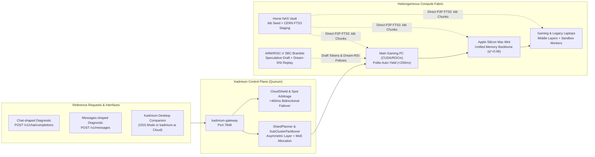

# Kadmium (`Cd-48`) Documentation

Welcome to the official documentation for **Kadmium** (`https://kadmium.ai`) — the open-source consolidated, aggregate, and distributed AI/ML compute fabric written in 100% Pure Rust.

Kadmium implements a heterogeneous compute control plane, planners, worker transport and reference workloads. Current model-related kernels run small reference tensors; the `/v1` routes return diagnostic text and vectors, not language-model generation. Architecture and roadmap documents also describe intended capabilities, so consult the [API contract](api-reference.md) and [execution status](MARKET_RESEARCH_REVIEW_2026-10.md#2-what-kadmium-is-from-the-code) before treating a feature as ready for a real model.

---

## Documentation Sitemap

### 1. Getting Started & Core Reference
| Guide | Description |
| :--- | :--- |
| [**Quickstart & Installation (`getting-started.md`)**](./getting-started.md) | Build the CLI, inspect setup, start the Control Room and connect LAN workers; checked release installers require published tagged assets. |
| [**Launch Guide (`guides/cli.md`)**](./guides/cli.md) | Additive `launch --plan`, non-overwriting configuration creation, unchanged coordinator behavior and the decision to keep existing dependencies. |
| [**CLI Command Reference (`cli-reference.md`)**](./cli-reference.md) | Complete reference for `kadmium probe`, `serve`, `plan`, `simulate`, `slice`, `dataflow`, `dream`, and `cloud-shield`. |
| [**HTTP & AI Gateway API (`api-reference.md`)**](./api-reference.md) | Reference diagnostics at `/v1/chat/completions`, `/v1/messages`, `/v1/embeddings` and `/v1/models`, plus the Cluster Control Plane REST API. |
| [**Technical Specsheet & Product Roadmap (`SPECSHEET_AND_ROADMAP.md`)**](./SPECSHEET_AND_ROADMAP.md) | Complete `Cd-48` engine specifications, 5-tier memory & hardware matrix, algorithmic guarantees, and phased `v0.1` $\to$ `v1.0 GA` roadmap. |
| [**Deep Technical Architecture (`ARCHITECTURE.md`)**](./ARCHITECTURE.md) | Mathematical foundations, 5-tier memory hierarchy, `.ktb` binary format spec, 1F1B pipeline scheduling, `DeMo` DCT math, and `Verde` verification. |

### 2. Operator & Developer Guides
| Guide | Description |
| :--- | :--- |
| [**Condenser Inference Workspace**](./guides/condenser-workspace.md) | Connect provider tasks to Kadmium placement previews, attach compute context, fork conversations, and control bounded runs. |
| [**Hardware Setup, Asymmetric Sharding & Polite Governance**](./guides/hardware-and-sharding.md) | Combine GPUs, Apple Silicon unified memory, NAS vaults, and SBCs; compile GGUF/Safetensors to `.ktb`; configure `<200ms` Gaming Auto-Yield and 3-Tier Trust Zones. |
| [**Distributed Training, RL & Dream-RSI Evolving Worlds**](./guides/training-and-dream-rsi.md) | Run Sharded-Island DiLoCo + `DeMo` training over consumer broadband, and use SBCs/legacy laptops to run **Dream-RSI** offline causal replay at zero GPU cost. |
| [**Sub-Cluster Slicing, Desktop Companion & CloudShield**](./guides/subclusters-and-cloud-shield.md) | Partition a 100-node pool into isolated sub-clusters (Prod, Staging, Training, RL), switch the Companion App between Self-Hosted OSS and `kadmium.ai` Cloud, and configure Bidirectional Failover Shield. |
| [**Hugging Face (`hf://`), GitHub (`gh://`) & Ecosystem Integrations**](./guides/integrations-hf-github.md) | Pull selective Safetensors/GGUF shards and datasets from Hugging Face Hub, mount commit-pinned RL/Dream-RSI worlds from GitHub, and configure `oci://`, `s3://`, and `wandb://` connectors. |
| [**Model Context Protocol (`kadmium-mcp`) Server**](./guides/mcp-server.md) | Connect Claude Code, Cursor, Antigravity, Windsurf, or any MCP client via `kadmium mcp` (stdio) or `POST /mcp` (Streamable HTTP) to inspect, shard, pull, and run distributed workloads. |

---

## How Kadmium Works at a Glance

---

## Open-Source Core vs. `kadmium.ai` Managed Cloud

Kadmium follows a **"Supabase for AI Compute"** philosophy:

1. **100% Open-Source & Self-Hostable Forever:** Every crate in this repository—asymmetric sharding, `.ktb` GGUF/Safetensors transcoding, CERN FTS3 P2P staging, `DeMo` + DiLoCo distributed training, Dream-RSI offline replay, sub-cluster pool slicing, and the local web dashboard—is open-source and runs offline on your own hardware with zero cloud account required.
2. **Optional `kadmium.ai` Managed Hybrid Cloud:** Link your self-hosted cluster or Desktop Companion App to `kadmium.ai` whenever you want:
   - **Zero-Config WAN Mesh & Managed Coordinator:** Cross-NAT QUIC relays without port forwarding.
   - **Multi-Datacenter Spot Arbitrage:** Burst capacity across RunPod, Vast.ai, Lambda, AWS, and GCP at **~62% lower cost** than single-cloud on-demand GPUs.
   - **Bidirectional Downtime Protection (`CloudShield`):** Seamless `<400ms` failover from Local $\to$ Cloud if your home power/internet drops, or Cloud $\to$ Local if a cloud spot instance is preempted.
3. **Kadmium Supply Grid & "No Additional Datacenters Required":**
   - **Harvest Dormant Local Silicon First (`--cadmium`):** Aggregate already-manufactured GPUs, Apple Silicon Macs, laptops, and SBCs sitting at `<10%` utilization (`0 L/hr` additional evaporative cooling water, `0 kg` new concrete or embodied silicon). Lease out your idle local hardware via `kadmium lease` to earn direct USD or `1.25x` Kadmium Cloud burst credits with `<200ms` Polite Auto-Yield and blind middle-shard privacy (`Layer 0` and `Layer N-1` stay on the renter).
   - **Absorb Existing Datacenter Spot Surplus (`--cherenkov`):** Rather than building new 500 MW hyperscale datacenters that strain municipal power grids and watersheds, Kadmium soaks up fragmented spot slots sitting idle inside *already-built* datacenters only when a workload overflows local hardware.
