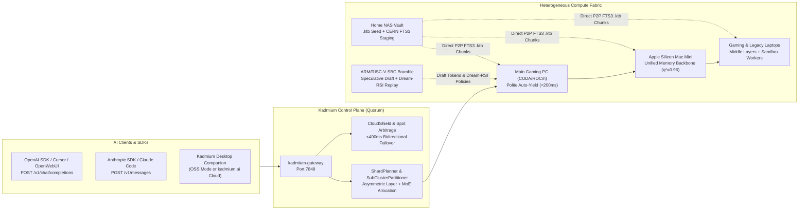

# Kadmium (`Cd-48`) Documentation

Welcome to the official documentation for **Kadmium** (`https://kadmium.ai`) — the open-source consolidated, aggregate, and distributed AI/ML compute fabric written in 100% Pure Rust.

Kadmium turns every piece of silicon you can reach—your main gaming desktop, Apple Silicon Mac Minis, gaming laptops, old laptops in a drawer, Linux ARM/RISC-V single-board computers (SBCs), a Home NAS storage vault, friends' idle PCs, and optional burst cloud GPUs—into a single elastic supercomputer for **LLM/MoE Inference**, **Fault-Tolerant Distributed Training**, and **Disaggregated RL + Dream-RSI**.

---

## Documentation Sitemap

### 1. Getting Started & Core Reference
| Guide | Description |
| :--- | :--- |
| [**Quickstart & Installation (`getting-started.md`)**](./getting-started.md) | Install the single-binary `kadmium` CLI or Desktop Companion App, probe your hardware, launch a local cluster in 60 seconds, and connect LAN or remote nodes. |
| [**CLI Command Reference (`cli-reference.md`)**](./cli-reference.md) | Complete reference for `kadmium probe`, `serve`, `plan`, `simulate`, `slice`, `dataflow`, `dream`, and `cloud-shield`. |
| [**HTTP & AI Gateway API (`api-reference.md`)**](./api-reference.md) | Drop-in OpenAI (`/v1/chat/completions`) & Anthropic (`/v1/messages`) endpoints plus the full Cluster Control Plane REST API. |
| [**Deep Technical Architecture (`ARCHITECTURE.md`)**](./ARCHITECTURE.md) | Mathematical foundations, 5-tier memory hierarchy, `.ktb` binary format spec, 1F1B pipeline scheduling, `DeMo` DCT math, and `Verde` verification. |

### 2. Operator & Developer Guides
| Guide | Description |
| :--- | :--- |
| [**Hardware Setup, Asymmetric Sharding & Polite Governance**](./guides/hardware-and-sharding.md) | Combine GPUs, Apple Silicon unified memory, NAS vaults, and SBCs; compile GGUF/Safetensors to `.ktb`; configure `<200ms` Gaming Auto-Yield and 3-Tier Trust Zones. |
| [**Distributed Training, RL & Dream-RSI Evolving Worlds**](./guides/training-and-dream-rsi.md) | Run Sharded-Island DiLoCo + `DeMo` training over consumer broadband, and use SBCs/legacy laptops to run **Dream-RSI** offline causal replay at zero GPU cost. |
| [**Sub-Cluster Slicing, Desktop Companion & CloudShield**](./guides/subclusters-and-cloud-shield.md) | Partition a 100-node pool into isolated sub-clusters (Prod, Staging, Training, RL), switch the Companion App between Self-Hosted OSS and `kadmium.ai` Cloud, and configure Bidirectional Failover Shield. |

---

## How Kadmium Works at a Glance

---

## Open-Source Core vs. `kadmium.ai` Managed Cloud

Kadmium follows a **"Supabase for AI Compute"** philosophy:

1. **100% Open-Source & Self-Hostable Forever:** Every crate in this repository—asymmetric sharding, `.ktb` GGUF/Safetensors transcoding, CERN FTS3 P2P staging, `DeMo` + DiLoCo distributed training, Dream-RSI offline replay, sub-cluster pool slicing, and the local web dashboard—is open-source and runs offline on your own hardware with zero cloud account required.
2. **Optional `kadmium.ai` Managed Hybrid Cloud:** Link your self-hosted cluster or Desktop Companion App to `kadmium.ai` whenever you want:
   - **Zero-Config WAN Mesh & Managed Coordinator:** Cross-NAT QUIC relays without port forwarding.
   - **Multi-Datacenter Spot Arbitrage:** Burst capacity across RunPod, Vast.ai, Lambda, AWS, and GCP at **~62% lower cost** than single-cloud on-demand GPUs.
   - **Bidirectional Downtime Protection (`CloudShield`):** Seamless `<400ms` failover from Local $\to$ Cloud if your home power/internet drops, or Cloud $\to$ Local if a cloud spot instance is preempted.
