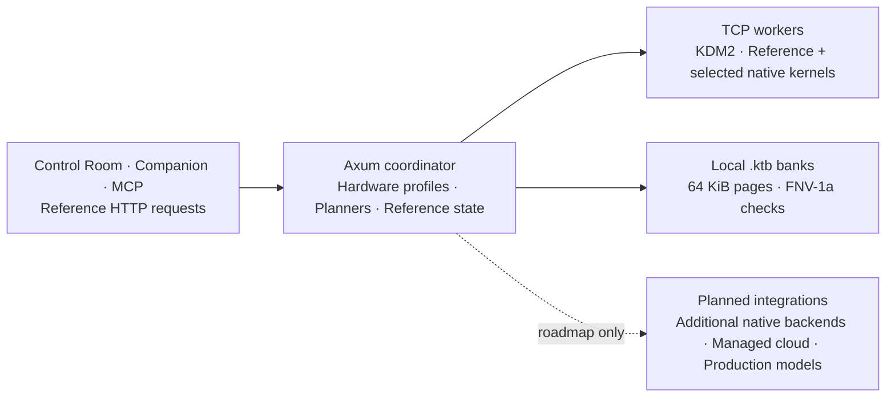

# Kadmium (`Cd-48`) Documentation

Kadmium is an open-source Rust compute-fabric project for heterogeneous machines. The repository contains a control plane, TCP worker transport, planners, and reference workloads. Current model-related kernels run small synthetic tensors; `/v1` routes return diagnostic text and vectors, not language-model generation.

Documents distinguish **implemented reference behavior**, **modelled/simulated output**, and **target architecture**. Roadmap labels are not release-readiness or performance guarantees. See the [API contract](api-reference.md) and [benchmark ledger](BENCHMARKS_2026-10.md) before relying on a capability or number.

---

## Documentation sitemap

### Getting started and core reference

| Guide | Description |
| :--- | :--- |
| [Quickstart and installation](getting-started.md) | Build with the pinned toolchain, launch the Control Room, connect reachable workers, and manage versioned installs. |
| [Launch guide](guides/cli.md) | `launch --plan`, configuration preservation, listeners, and demo/live behavior. |
| [CLI command reference](cli-reference.md) | Every current CLI subcommand, flag, default, and execution qualification. |
| [HTTP and gateway API](api-reference.md) | Reference `/v1` diagnostics, cluster control plane, DiLoCo sessions, MCP, and grid endpoints. |
| [Technical specsheet and roadmap](SPECSHEET_AND_ROADMAP.md) | Current formats, algorithms, execution support, and planned production work. |
| [Deep technical architecture](ARCHITECTURE.md) | Current mechanisms and explicitly labelled target designs. |
| [Measured benchmark ledger](BENCHMARKS_2026-10.md) | Dated measurements, derived arithmetic, provenance, and harness limitations. |

### Operator and developer guides

| Guide | Description |
| :--- | :--- |
| [Condenser inference workspace](guides/condenser-workspace.md) | Provider tasks, placement previews, compute context, bounded runs, and cancellation. |
| [Hardware, sharding, and governance](guides/hardware-and-sharding.md) | Hardware profiles, constrained local `.ktb` import, transfer references, and trust/polite policies. |
| [Training, RL, and Dream-RSI](guides/training-and-dream-rsi.md) | Stateless stage previews, stateful small-replica DiLoCo, synthetic GRPO, and in-memory replay. |
| [Subclusters and CloudShield](guides/subclusters-and-cloud-shield.md) | Pool partitioning, local Companion mode state, and fixed cloud/failover scenarios. |
| [Ecosystem integration planners](guides/integrations-hf-github.md) | HF pull planning, simulated GitHub evaluation, and unimplemented remote connectors. |
| [Model Context Protocol](guides/mcp-server.md) | Seven tools over isolated stdio or shared HTTP coordinator state. |
| [USB-C delta bridges](guides/usbc-delta-bridge.md) | Multi-lane ordered transport, authenticated resume, unplug behavior, measurements, and security limits. |
| [Intel NPU kernels](../crates/kadmium-npu/README.md) | Level Zero MatMul setup, approximate-FP16 contract, hardware validation, and resource-lifetime limits. |
| [Release runbook](guides/release.md) | Version/tag checks, release artifacts, CI requirements, and installer verification. |
| [Contributing](../CONTRIBUTING.md) | Formatting, linting, Rust/Node/UI/Python/installer checks, and documentation conventions. |

### Business and marketing review

The commercial plan is a proposal for review. It does not establish managed compute, revenue, payouts, charter status, or compliance readiness.

| Document | Purpose |
| :--- | :--- |
| [Marketing and business review — 2026-10-30](MARKETING_BUSINESS_REVIEW_2026-10-30.md) | Evidence, competitors, objections, and publication blockers. |
| [Business plan and stance](BUSINESS_PLAN_AND_STANCE.md) | Proposed pilot, stewardship, economics, and evidence gates. |
| [Marketing and launch plan](MARKET_RESEARCH_AND_LAUNCH_PLAN.md) | Experiments, draft copy, budgets, and measurement. |
| [Operating plan](OPERATING_PLAN.md) | Ownership, delivery, release claims, treasury, and stop rules. |
| [Reproducible economics](business/ECONOMICS.md) | Cohorts, redemption stress, and cash/liability calculations. |
| [Historical engineering numbers](NUMBERS_2026-10.md) | Dated model inputs, not live prices or measured supply. |

---

## Current execution at a glance

## Open-source core and planned managed services

The repository's planners, reference runtimes, local dashboard, Companion, and simulations can run without a cloud account. That does not make every target integration operational.

The following are **planned or simulated**, not current managed offerings:

- Managed WAN relays and automatic NAT traversal.
- Real cloud-provider order books, procurement, billing, and spend-cap enforcement.
- Production CloudShield failover and measured zero-dropped-request migration.
- Paid Supply Grid leases, USD/credit settlement, and enforceable tenant isolation.
- Public registries and real Hugging Face/GitHub/OCI/S3/W&B network connectors.

`--cadmium` and `--cherenkov` are design-token names, not CLI options. Local hardware and cloud-burst sample reports must not be presented as actual earnings, savings, privacy guarantees, or service-level agreements.
