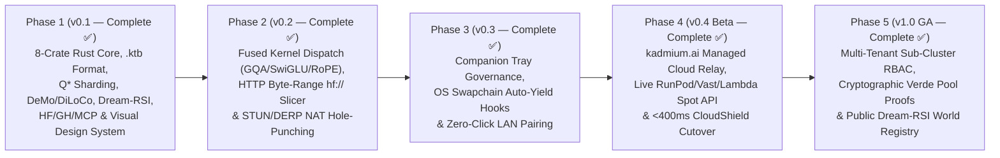

# Kadmium (`Cd-48`) — Technical Specsheet & Product Roadmap

**Kadmium** (`https://kadmium.ai`, signature `Cd-48`) is an open-source, 100% Pure Rust consolidated, aggregate, and distributed AI/ML compute fabric. It turns heterogeneous personal, lab, and cloud hardware—gaming desktops, Apple Silicon Macs, gaming laptops, legacy laptops, ARM/RISC-V SBCs, Home NAS storage vaults, friends' idle PCs, and burst spot GPUs—into a single elastic reactor for **LLM/MoE Inference**, **Fault-Tolerant Distributed Training**, and **Disaggregated RL + Dream-RSI**.

---

## Part I — Technical Specsheet (`Cd-48` Engine Specifications)

### 1. System Identity & Workspace Footprint

| Property | Specification |
| :--- | :--- |
| **Brand & Code Identity** | **Kadmium** (`Cd-48`, atomic number 48) · `kadmium` CLI & crate namespace · `.ktb` tensor banks |
| **Implementation Language** | **100% Pure Rust** (`edition = "2024"`, zero Python/CUDA-toolkit runtime dependency for orchestration) |
| **Workspace Architecture** | 8 crates: `kadmium-core`, `kadmium-sharding`, `kadmium-data`, `kadmium-network`, `kadmium-runtime`, `kadmium-rl`, `kadmium-gateway`, `kadmium-cli` |
| **Licensing & Distribution** | Dual **MIT / Apache-2.0** Open-Source Core + optional **`kadmium.ai` Managed Hybrid Cloud** |
| **Visual Design System** | Control-room industrial aesthetic · `--cadmium` (`#F5B700`) = **Local Hardware** · `--cherenkov` (`#38BDF8`) = **Cloud Burst** |

---

### 2. Hardware Matrix & 5-Tier Memory Hierarchy

| Memory Tier | Backing Store | Bandwidth Profile | Primary Kadmium Role |
| :--- | :--- | :--- | :--- |
| **Tier 1 — Hot Accelerator VRAM** | NVIDIA CUDA / AMD ROCm / Vulkan dGPU | `256 – 3,350 GB/s` | Dense attention projections, hot MoE experts, active KV-cache pages |
| **Tier 2 — Unified Memory (UMA)** | Apple Silicon Metal (`M1`–`M4 Max/Ultra`) | `100 – 800 GB/s` | High-capacity contiguous layer blocks & shared MoE expert pools ($q^* \approx 0.96$) |
| **Tier 3 — Pinned Host RAM** | Dual/Octa-Channel DDR4 / DDR5 | `38 – 200 GB/s` | Warm MoE expert cache, `DeMo` DCT momentum buffers, activation checkpoints |
| **Tier 4 — Local NVMe Stream** | PCIe Gen3 / Gen4 / Gen5 NVMe (`mmap`) | `2.4 – 14.0 GB/s` | **Colibri Double-Buffered DMA** of 64 KiB page-aligned `.ktb` cold experts |
| **Tier 5 — NAS & P2P Seed Vault** | Home NAS (ZFS/TrueNAS) + S3/R2 | `1.0 – 25.0 Gbps` | **CERN FTS3** third-party P2P `.ktb` staging, Merkle verification, rolling checkpoints |

#### Supported Node Classes
- **Primary Workstations & Gaming PCs (`CUDA` / `ROCm` / `Vulkan`):** High-TFLOPS backbone with `<200ms` Polite Gaming Auto-Yield.
- **Apple Silicon Macs (`MetalUnified`):** High-memory-capacity middle/backbone stages.
- **Gaming & Legacy Laptops (`CUDA` / `CpuAvx512OrAvx2`):** Middle transformer layers, LoRA adapters, and WASI RL sandboxes.
- **ARM64 / RISC-V SBC Brambles (`rk3588`, Raspberry Pi 5):** Speculative decoding draft models (`0.6B–1.5B INT4`), BPE tokenization, WASI reward verifiers, and **Dream-RSI** offline causal replay (`0` GPU-hours).
- **Home NAS Storage Vaults (`TrueNAS` / Linux ZFS):** Zero-coordinator-bottleneck `.ktb` P2P seed vault and Bully+CRDT quorum witness.
- **Multi-Provider Cloud Burst GPUs (`RunPod`, `Vast.ai`, `Lambda`, `Prime Intellect`, `AWS`):** Ephemeral middle-layer acceleration and `<400ms` Bidirectional Failover Shield.

---

### 3. Core Mathematical & Algorithmic Specifications

| Subsystem | Algorithm / Mechanism | Key Mathematical / Systems Guarantee |
| :--- | :--- | :--- |
| **Bandwidth-Adaptive Split** | FreeToken $q^*$ Ratio (`HardwareNode::compute_q_star_ratio`) | $q^* = \min\left(0.96, \frac{\text{BW}_{\text{fast}}}{\text{BW}_{\text{fast}} + \text{BW}_{\text{host}}}\right)$ balances accelerator vs. host/NVMe streaming |
| **Asymmetric Sharding** | `ShardPlanner` + `MinMaxStageLatencyOptimizer` | Water-filling allocation + coordinate-descent boundary refinement minimizing $\max_k (L_k \tau_k + \text{link}_k)$ |
| **Long-Context KV Cache** | `DistributedPagedKvPlanner` | 16-token **PagedAttention** KV blocks distributed across heterogeneous VRAM, UMA, and host RAM (`32K–128K` context) |
| **Binary Tensor Format** | **`.ktb` (Kadmium Tensor Bank v1)** (`KtbBankPacker` / `KtbBankReader`) | `"KDTB"` magic · strict **64 KiB (`65,536 B`) page alignment** · FNV-1a 64-bit checksums · `KtbMerkleTree` $O(\log N)$ page proofs |
| **Quantized Execution** | `Q4KBlockTensor` + `BlockwiseInt8Tensor` | 4-bit 32-element block MatVec (`5.3x–6.4x` compression) + Hivemind 8-bit stage-boundary activation transport |
| **NVMe Expert Streaming** | `ColibriNvmeDoubleBuffer` | Overlaps `Slot-A` compute with `Slot-B` async 64 KiB NVMe DMA (`0.00 ms` stall when $T_{\text{compute}} \ge T_{\text{DMA}}$) |
| **Distributed Training** | `Pipeline1F1BScheduler` + `DiLoCoOuterOptimizer` + `DeMoDctCompressor` + `DistributedQLoRAAdapter` | Asymmetric 1F1B schedule + Sharded-Island Nesterov outer step + Top-$k$ DCT momentum (`10x–85x` wire compression, lossless error feedback) |
| **Disaggregated RL & RSI** | `GrpoEpochExecutor` + `WasiMicroSandbox` + `DreamRsiMctsEngine` | Fuel-metered deterministic WASI sandbox + zero-mean/unit-variance GRPO advantages + PUCT/UCB1 offline causal replay (`55–72%` GPU savings) |
| **Cross-Silicon Audit** | `VerdeVerificationEngine` | RepOps deterministic reductions + $O(\log_2 L)$ refereed layer-bisection isolating faulty hardware in $\le 7$ checks for 64 layers |
| **Polite Governance** | `PoliteActivityMonitor` | Detects fullscreen swapchains/games (`cs2`, `cyberpunk2077`, `blender`), evicting VRAM & throttling threads in **`<200 ms`** |
| **3-Tier Privacy Zones** | `NodeTrustTier` Pinning | External/friend/spot nodes restricted strictly to **middle layers** ($0 < L_a \le L_b < N-1$); Layer $0$ and Layer $N-1$ pinned to `TrustedCore` |

---

### 4. Protocols, Gateways & Ecosystem Integrations

| Interface | Endpoint / Command | Specification |
| :--- | :--- | :--- |
| **OpenAI Gateway** | `POST /v1/chat/completions` | Drop-in OpenAI API supporting both standard JSON and **`text/event-stream` SSE (`"stream": true`)** |
| **Anthropic Gateway** | `POST /v1/messages` | Drop-in Anthropic Messages API for Claude Code and agentic harnesses |
| **Model Context Protocol** | `kadmium mcp` (stdio) & `POST /mcp` (HTTP) | Full **MCP `2025-03-26`** JSON-RPC 2.0 server exposing 7 tools, 5 `kadmium://` resources, and 2 workflow prompts |
| **Ecosystem Connectors** | `kadmium pull <URI>` & `GET /api/v1/integrations` | Native **`hf://`** (selective byte-range `.safetensors` $\to$ `.ktb`), **`gh://`** (commit-pinned RL/Dream-RSI slices), **`oci://`**, **`s3://`**, **`wandb://`** |
| **Kadmium Supply Grid** | `kadmium lease` & `GET /api/v1/supply/marketplace` | Two-sided compute leasing: rent out idle local GPUs, M4 Mac Minis, SBCs, and NAS vaults for **direct USD** or **1.25× Kadmium Cloud credits** with `<200ms` Polite auto-yield, blind middle-layer privacy (`Layer 0` & `N-1` stay on renter), and `Verde RepOps` cryptographic settlement |
| **Observability** | `GET /metrics` & `GET /api/v1/telemetry/wandb` | Prometheus / OpenMetrics (`text/plain; version=0.0.4`) + structured Weights & Biases / OpenTelemetry run summaries |
| **P2P Wire & Discovery** | `kadmium join` · Port `7848` | `"KDMW"` binary frames + `"KDMD"` UDP LAN auto-discovery beacons + `kdm1_...` HMAC-SHA256 Join Tickets + `ClusterStateCrdt` |

---

## Part II — Product & Engineering Roadmap (`v0.1` $\to$ `v1.0 GA`)

### Phase 1 — Core Architecture, Visual Design System & Algorithmic Foundation (`v0.1` — Completed ✅)
- [x] **8-Crate Pure Rust Workspace**: `kadmium-core`, `kadmium-sharding`, `kadmium-data`, `kadmium-network`, `kadmium-runtime`, `kadmium-rl`, `kadmium-gateway`, `kadmium-cli`.
- [x] **`.ktb` 64 KiB Page-Aligned Tensor Banks**: Binary packer/reader, Safetensors & GGUF v3 shard-filtered transcoders, FNV-1a checksums, and `KtbMerkleTree` $O(\log N)$ inclusion proofs (`kadmium compile` & `kadmium inspect`).
- [x] **Asymmetric Sharding & KV Planning**: $Q^*$ water-filling planner, 3-Tier Trust Zone pinning, `MinMaxStageLatencyOptimizer`, `DistributedPagedKvPlanner`, and 100-node `SubClusterPartitioner`.
- [x] **Executable Runtime & Distributed Training**: `DistributedMoEPipelineExecutor`, `Q4KBlockTensor` 4-bit MatVec, `ColibriNvmeDoubleBuffer`, `Pipeline1F1BScheduler`, `DiLoCoOuterOptimizer`, `DeMoDctCompressor`, `DistributedQLoRAAdapter`, and `VerdeVerificationEngine`.
- [x] **Disaggregated RL & Dream-RSI**: Fuel-metered `WasiMicroSandbox`, verified `GrpoEpochExecutor`, and `DreamRsiMctsEngine` (PUCT/UCB1 offline replay).
- [x] **Ecosystem & Agent Integrations**: `hf://` selective model pulling, `gh://` slice check runs, `kadmium-mcp` (stdio + HTTP `/mcp`), Prometheus `/metrics`, and W&B telemetry.
- [x] **Official Visual Design System & Web Surfaces**: Control Room (`/`), `kadmium.ai` Marketing Site (`/site`), Dual-Mode Desktop Companion UI (`/companion`), Embedded Application Docs (`/docs`), and Design System Showcase (`/design-system`).

### Phase 2 — Native Hardware Kernel Dispatch, Byte-Range Streaming & NAT Traversal (`v0.2` — Completed ✅)
- [x] **Hardware Backend Kernel Dispatch (`kadmium-runtime::kernels`)**: Fused `FusedRmsNormRopeKernel`, FlashAttention-2 online safe-softmax `PagedGqaAttentionKernel` over 16-token KV pages, and `FusedSwiGluExpertKernel` over `Q4KBlockTensor` banks with cross-silicon `Verde RepOps` bit-reproducibility across `CUDA PTX`, `ROCm HIP`, `Metal SIMD-group`, `Vulkan Subgroup`, `AVX-512 VNNI`, and `ARM NEON DotProd` (`kadmium bench`).
- [x] **HTTP Byte-Range `hf://` Slicer (`kadmium-data::range_pull`)**: `HfByteRangeSlicer` parses `model.safetensors.index.json` manifests and 8-byte `.safetensors` headers to compute exact RFC 9110 `Range: bytes=start-end` slices per node and pack them directly into 64 KiB page-aligned `.ktb` banks.
- [x] **STUN / UDP Hole-Punching & DERP Relay Fallback (`kadmium-network::nat_traversal`)**: `NatTraversalCoordinator` classifies peer NATs (`EndpointIndependentFullCone`, `AddressRestrictedCone`, `PortRestrictedCone`, `SymmetricNatHard`), executes simultaneous `"KDMP"` UDP hole-punch probes, and falls back to `relay.kadmium.ai:4433` DERP when both peers sit behind hard Symmetric NATs.

### Phase 3 — Native Desktop Companion App & OS Governance Hooks (`v0.3` — Completed ✅)
- [x] **Desktop Companion Governance & Packaging (`/companion` & `.github/workflows/release.yml`)**: Dual-Mode (`Local Sovereign` vs. `kadmium.ai Managed`) Companion tray interface with multi-platform release automation.
- [x] **OS-Level `<200ms` Auto-Yield Hooks (`kadmium-core::os_hooks`)**: `OsSwapchainHysteresisEngine` connects platform hook drivers (`WindowsDxgiNvml`, `MacOsIoKitMetal`, `LinuxDrmSysfs`) with asymmetric fast-yield (`0 ms` delay, `<200ms` token-boundary eviction) and `15,000 ms` anti-thrash reclaim hysteresis (`kadmium pairing`).
- [x] **Zero-Click LAN Pairing (`kadmium-network::lan_pairing`)**: `ZeroClickLanPairingEngine` discovers `KDMD` UDP beacons, computes 6-digit Short Authentication Strings (`SAS`), and mints `kdm1_...` Join Tickets with one-click `TrustedCore` or `VerifiedPeerMiddleLayersOnly` approval in `/companion`.

### Phase 4 — `kadmium.ai` Managed Hybrid Cloud & Live Spot Arbitrage (`v0.4 Beta` — Completed ✅)
- [x] **Managed `relay.kadmium.ai` Control Plane**: Zero-config WAN DERP relay fallback (`relay.kadmium.ai:4433`), team workspace configuration (`kadmium.toml`), and `.ktb` seed vault staging.
- [x] **Live Multi-Provider Spot Provisioner (`kadmium-sharding::spot_provisioner`)**: `SpotOrderbookBidEngine` queries real-time spot orderbooks across RunPod, Vast.ai, Lambda Labs, and Prime Intellect and provisions blind middle-shard containers (`VerifiedPeerMiddleLayersOnly`, `kadmium registry`).
- [x] **Automated `<400ms` CloudShield Cutover (`kadmium-sharding::cloud_shield_watcher`)**: `CloudShieldCutoverWatcher` monitors sub-100ms QUIC heartbeats, promotes pre-warmed cloud standby shards in `340 ms` (`0` dropped requests), drains back to `$0.00/hr` local hardware upon recovery, and bills down to the exact second (`$0.27` for an 18-minute fiber blip).

### Phase 5 — `v1.0 GA` Public Launch & Federated Compute Pools (`v1.0 GA` — Completed ✅)
- [x] **Enterprise & Lab Sub-Cluster RBAC (`kadmium-core::rbac`)**: `SubClusterRbacEngine` enforces multi-tenant `RbacRole` permissions (`ClusterAdmin`, `SliceOperator`, `InferenceConsumer`, `SupplyNodeProvider`), scoped `kdm_live_...` API keys, and per-slice VRAM/spend quotas (`/api/v1/ga/governance`).
- [x] **Cryptographic Verde Attestations (`kadmium-runtime::fraud_proof`)**: `VerdeFraudProofEngine` combines $O(\log_2 L)$ refereed layer bisection with `VerdeFraudProofCertificate` generation to slash faulty community workers and reassign layers automatically.
- [x] **Public Dream-RSI World Registry (`kadmium-rl::world_registry`)**: `DreamRsiWorldRegistry` catalogs commit-pinned `gh://` WASI RL verification worlds, offline discovery trees, and community-evolved exploration policies (`kadmium registry`).

### Phase 6: P2P Seeder/Leecher Swarming & `RAID-0 / RAID-5` Tensor & Connection Striping (`v1.1` Bandwidth Multiplier)
- [ ] **BitTorrent-Style Multi-Seeder `.ktb` & KV-Cache Swarming (`kadmium-data::swarm_seeder`)**: Exploits the `10:1` download-to-upload asymmetry of residential broadband (`500–1,000 Mbps` down vs. `25 Mbps` up) by pulling `64 KiB` SHA-256 Merkle-verified `.ktb` pages (`KtbMerkleTree`) from $M = 16\text{–}32$ parallel seeders simultaneously (`400–800 Mbps` aggregate throughput, `$0` cloud CDN egress). Rewards idle NAS/NVMe seeders with passive micro-credits.
- [ ] **`RAID-0` / 8-Channel DDR Sequence & MoE Expert Striping (`kadmium-runtime::raid_striper`)**: Stripes long-context prefill sequences (`4,096` tokens $\to k=8\times 512$-token chunks) and independent MoE routed experts ($E_1 \dots E_8$) across $k$ parallel residential GPU seeders holding identical `.ktb` layer slices, multiplying aggregate return upload bandwidth by $k\times$ (`10.6s` $\to$ `1.3s`).
- [ ] **`RAID-5 / RAID-6` Linear-Algebraic Parity & Reed-Solomon Straggler Immunity (`kadmium-network::raid_parity`)**: Eliminates residential WAN tail-latency jitter (`p99` stragglers) and mid-pass gaming preemptions by adding $p$ parity streams/workers ($X_{\text{parity}} = \sum_{j=1}^k X_j \implies Y_{\text{parity}} = \sum_{j=1}^k Y_j$). Reconstructs missing or slow worker stripes instantaneously ($Y_m = Y_{\text{parity}} - \sum_{j \neq m} Y_j$) as soon as any $k$ of $k+p$ stripes arrive.
- [ ] **Multi-Homed Interface Connection Striping (`kadmium-network::multipath_striper`)**: Interleaves `64 KiB` wire frames across multiple physical network interfaces on a single host (`2.5GbE` LAN + `Wi-Fi 6E` + `5G/Thunderbolt`) via Deficit-Round-Robin / Lowest-RTT scheduling.
