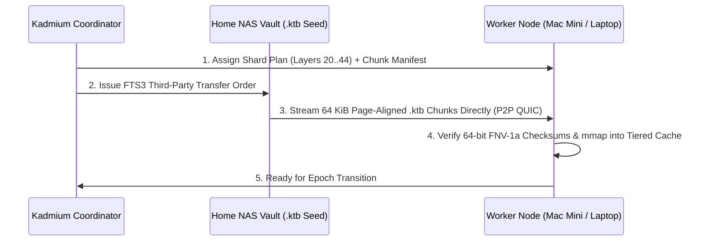

# Guide: Hardware Setup, Asymmetric Sharding & Polite Host Governance

Unlike datacenter frameworks that require identical $8 \times \text{H100}$ nodes on InfiniBand, **Kadmium** is built from the ground up for **extreme hardware asymmetry** across rooms, homes, and continents.

---

## 1. Supported Hardware Tiers & Roles

Every node in a Kadmium cluster is profiled across a **5-Tier Memory Hierarchy** (`VRAM` $\to$ `Unified RAM` $\to$ `System DDR4/DDR5` $\to$ `NVMe Gen4/Gen5 Cache` $\to$ `Peer Network Staging`) and automatically assigned a specialized role:

| Device Class | Example Hardware | Primary Kadmium Role |
| :--- | :--- | :--- |
| **Main Gaming Desktop** | RTX 4090 (24 GB VRAM) + 64 GB DDR5 + Gen4 NVMe | Heavy transformer layers, Layer $0$ ingress, `Colibri` NVMe MoE expert streaming, and DiLoCo GPU learner. |
| **Apple Silicon Mini / Studio** | Mac Mini M4 Pro (64 GB Unified Memory, $q^* = 0.96$) | High-memory-capacity backbone holding the largest contiguous block of transformer layers & hot MoE experts. |
| **Gaming Laptop** | RTX 4070 Mobile (8 GB VRAM) + 32 GB DDR5 | Middle pipeline layers (`1F1B` stage) + battery-aware elastic worker. |
| **Home NAS Storage Vault** | TrueNAS / Synology (64 TB ZFS + 2 TB NVMe Cache, 10 GbE) | **Primary Seed Vault** storing canonical `.ktb` model banks & datasets; serves chunks directly to workers via CERN FTS3; standby Coordinator Quorum leader. |
| **Legacy Laptop** | ThinkPad T480 (16 GB DDR4, iGPU) | Lightweight tail layers, Layer $N-1$ egress (if `TrustedCore`), or CPU RL environment sandbox. |
| **ARM / RISC-V SBC Bramble** | 4x Orange Pi 5 Plus (RK3588 NPU, 32 GB LPDDR4x) | **Speculative Decoding Draft Head** (`0.6B` draft model) & **Dream-RSI** offline causal replay workers. |
| **Friend's Remote PC** | RTX 3080 (10 GB VRAM) over 300 Mbps WAN | Middle hidden-state layers ($1 \dots N-2$) over `Hivemind` 8-bit blockwise quantized QUIC links. |

---

## 2. Zero-Conversion Model Ingestion (`.ktb` Kadmium Tensor Banks)

You never have to manually convert or pre-slice models before launching a cluster:

1. Point Kadmium at any standard **HuggingFace Safetensors** repository or **GGUF v3** file stored on your Home NAS or primary workstation.
2. [`SafetensorsToKtbTranscoder`](../../crates/kadmium-data/src/lib.rs) or [`GgufToKtbTranscoder`](../../crates/kadmium-data/src/lib.rs) automatically compiles each node's assigned layer range (`start_layer..=end_layer`) and routed MoE experts into **64 KiB (`65,536`-byte) page-aligned `.ktb` (`"KDTB"` magic)** shard banks.
3. Why `64 KiB` page alignment?
   - Matches OS virtual memory granularity on Windows (`64 KiB`), Apple Silicon (`16 KiB` $\times 4$), and Linux (`4 KiB` $\times 16$).
   - Enables zero-copy `mmap` and `io_uring` / DirectStorage NVMe expert streaming (`Colibri` pattern) without heap allocations or unaligned read amplification.

---

## 3. CERN FTS3 Third-Party P2P Data Staging

When a new node joins or a live responsibility shift occurs, **the coordinator never relays gigabytes of model weights through itself**:

If a worker already has an earlier epoch's `.ktb` bank cached on NVMe, [`Fts3ChunkSlicer::compute_delta_chunks`](../../crates/kadmium-data/src/lib.rs) diffs the 64-bit chunk hashes so **only modified or newly assigned 64 MiB chunks** cross the network.

---

## 4. Polite Host Governance (`<200ms` Gaming & Battery Auto-Yield)

Kadmium borrows BOINC's polite volunteer computing philosophy and modernizes it for interactive gaming PCs and laptops:

- **`PoliteState::IdleDedicated` (`100%` Capacity):** Full GPU VRAM, Tensor Cores, and NVMe streaming bandwidth are dedicated to the cluster.
- **`PoliteState::LightDesktopUse` (`65%` Capacity):** Reserves 25% of VRAM and caps GPU duty cycle so desktop responsiveness stays locked at 120 Hz.
- **`PoliteState::GamingOrHeavyApp` (`<200ms` Auto-Yield to `15%` Background Budget):**
  1. As soon as a fullscreen DirectX/Vulkan/Metal game or heavy creative app launches on `main-gaming-pc`, Kadmium's hardware governor detects the foreground context switch in `<200ms`.
  2. [`ShardPlanner::plan_responsibility_shift`](../../crates/kadmium-sharding/src/lib.rs) immediately shifts heavy transformer layers and MoE experts off the Gaming PC onto `mac-mini-m4-pro` and `gaming-laptop-rtx4070`.
  3. Only the tiny live KV-cache / LoRA boundary delta is handed off over the LAN while static `.ktb` weights are pre-staged from the Home NAS.
- **`PoliteState::OnBatteryPowerSaver` (`25%` Capacity):** Automatically throttles TDP and shifts compute-heavy layers off unplugged laptops.

---

## 5. 3-Tier Trust Model & Prompt Privacy

When pooling hardware with friends, university lab mates, or a public swarm, [`NodeTrustTier`](../../crates/kadmium-core/src/lib.rs) enforces strict cryptographic and topological boundaries:

1. **`NodeTrustTier::TrustedCore` (Your Owned Devices):**
   - **Exclusively** allowed to hold **Layer $0$ (Token Embedding Ingress)** and **Layer $N-1$ (LM Head / Output Logits Egress)**.
   - Raw user prompts and decoded output tokens never leave your `TrustedCore` hardware.
2. **`NodeTrustTier::VerifiedPeerMiddleLayersOnly` (Friends & Lab Peers):**
   - Restricted to middle transformer layers ($1 \le \ell \le N-2$).
   - Only receives intermediate floating-point/int8 hidden-state activation tensors (`BlockwiseInt8Tensor`).
3. **`NodeTrustTier::UntrustedPublicSwarm` (Open Volunteer Nodes):**
   - Restricted to middle layers AND continuously audited via **Gensyn `Verde` Refereed Delegation** ([`VerdeVerificationEngine`](../../crates/kadmium-runtime/src/lib.rs)), using `RepOps` deterministic pairwise tree reductions and $O(\log_2 L)$ binary layer bisection to pinpoint any faulty or malicious worker in logarithmic steps.
