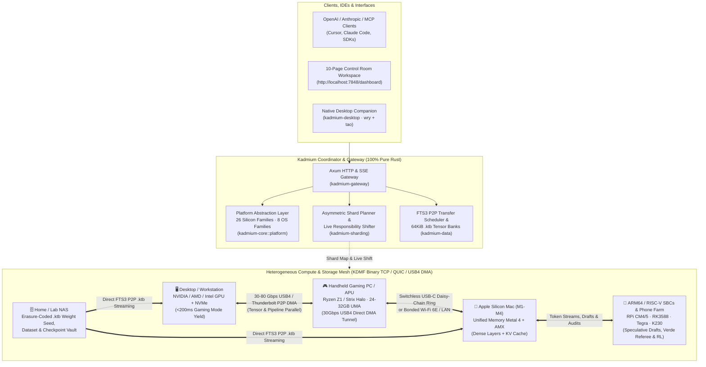

# 🧪 Kadmium (`Cd-48`) — Consolidated & Distributed AI/ML Compute Fabric

> **"In a nuclear reactor, cadmium control rods regulate, balance, and direct high-energy reactions. In AI/ML, Kadmium ([kadmium.ai](https://kadmium.ai)) aggregates, shards, and orchestrates frontier training, reinforcement learning, and inference across all the compute you already own."**

[](https://kadmium.ai)
[](#current-development-phase--roadmap)
[](https://www.rust-lang.org/)
[](#license)
[](#core-capabilities)

---

## 🌍 What is Kadmium?

The modern AI industry operates on a convenient assumption: *frontier model training, fine-tuning, reinforcement learning, and high-throughput inference require hundreds of thousands of dollars in identical datacenter GPUs wired over InfiniBand.*

Meanwhile, vast amounts of capable silicon sit underutilized in homes, dorms, studios, engineering labs, and universities:
- **Desktop workstations & gaming laptops** with discrete NVIDIA, AMD, or Intel GPUs
- **Handheld gaming PCs & high-memory APUs** with fast LPDDR5X unified memory and 30–40 Gbps USB4 / Thunderbolt ports
- **Apple Silicon Macs (M1–M4)** with high-bandwidth Unified Memory (`120–800 GB/s`)
- **Single-Board Computers & Edge SoCs** (Raspberry Pi CM4/5, RK3588, NVIDIA Tegra / Jetson, RISC-V RVV 1.0 boards)
- **Mobile phone arrays & 20-slot Phone Farm chassis** (`Snapdragon` / `Apple A-Series`)
- **Home & lab NAS appliances** with terabytes of storage for `.ktb` weight banks, datasets, and training checkpoints
- **On-demand burst cloud GPUs** rented for a few hours when a local cluster needs extra prefill or training FLOPs

Distributed scientific computing solved heterogeneous resource aggregation decades ago (**BOINC**, **CERN WLCG / FTS3 / Davix**), yet mainstream ML frameworks still crash or stall when one node is slower than another.

**Kadmium (`Cd-48`)** bridges that gap. Written in **100% Pure Rust** and compiled into a zero-dependency binary, Kadmium unifies any heterogeneous collection of machines into a single, self-balancing AI/ML compute fabric for **asymmetric sharded inference, distributed 1F1B / DiLoCo training, verifiable GRPO reinforcement learning, and Dream-RSI offline self-improvement**.

---

## 📍 Current Development Phase & Roadmap

Kadmium is currently in **Phase 4 (`v0.4` — Platform-Generalized Compute Fabric, Direct USB-C/USB4 Interconnect & Workspace Control Room)**. The core Rust control plane, live `KDMF` binary TCP wire protocol, multi-tier `.ktb` tensor bank format, 10-page Workspace Control Room UI, and native Desktop Companion (`wry` + `tao`) are implemented, tested (`81+` workspace test suites), and running against real multi-device hardware.

| Phase | Milestone | Status | Key Deliverables |
| :--- | :--- | :--- | :--- |
| **Phase 1 (`v0.1`)** | **Core Sharding, $q^*$ Policy & `.ktb` Tensor Banks** | ✅ **Complete** | Capability vector modeling, FreeToken $q^*$ bandwidth-adaptive split, `64 KiB` page-aligned `.ktb` weight banks with Merkle proofs, FTS3 third-party staging, GGUF v3 / SafeTensors transcoders, EXL3/QTIP trellis quantization. |
| **Phase 2 (`v0.2`)** | **Live WireFrame (`KDMF`) TCP Mesh & Verified Training** | ✅ **Complete** | Binary `KDMF` TCP wire framing, live multi-node inference & 1F1B training execution, Nous DeMo/DisTrO DCT gradient compression, Sharded-Island DiLoCo, Gensyn Verde `RepOps` + $O(\log L)$ layer-bisection auditing, RAID-5 algebraic straggler recovery. |
| **Phase 3 (`v0.3`)** | **Workspace Control Room, Native Desktop Companion & Ecosystem** | ✅ **Complete** | 10-page Control Room workspace UI (`dashboard.html`), native Desktop Companion window (`kadmium-desktop`), zero-click LAN pairing (6-digit SAS), Hugging Face byte-range slicer, MCP server (`stdio` + HTTP), OpenAI (`/v1/chat/completions`) & Anthropic (`/v1/messages`) gateways. |
| **Phase 4 (`v0.4`)** | **Platform-Level Generality & USB-C / USB4 Direct Interconnects** | 🟢 **Current Phase** | **Platform Abstraction Layer** (*Same Silicon $\to$ Supported; Same OS $\to$ Supported* across 26 silicon families & 8 OS families), **USB-C / USB4 / Thunderbolt (`30–80 Gbps`) & Dual-Role `USB-NCM` Direct Interconnect Engine**, switchless USB-C daisy-chain ring routing, live hardware verification across Windows, macOS (Apple M4), Linux ARM64, and RISC-V. |
| **Phase 5 (`v0.5`)** | **Zero-Copy Hardware Backend Bindings & RDMA / Thunderbolt DMA** | 🔜 **Next Up** | Direct native GPU kernel FFI dispatch (`Metal 4` command buffers, `CUDA` / `HIP` PTX driver API, `Vulkan` compute pipelines) replacing reference host buffers on large layer shards, plus OS-bypass Thunderbolt PCIe DMA ring buffers. |
| **Phase 6 (`v1.0 GA`)** | **Managed CloudShield, Supply Grid Clearinghouse & Public Registry** | 🗓️ **Planned** | Production multi-cloud spot arbitrage broker, `<400ms` bidirectional Local $\leftrightarrow$ Cloud failover shield, double-entry Supply Grid clearinghouse (`Grid-Zero`), and public Dream-RSI World Registry. |

---

## 🧩 Platform-Level Generality Philosophy

Kadmium never locks support to a single bespoke machine or SKU. Hardware and operating system support is engineered strictly at the **Platform Abstraction Layer** (`kadmium-core::platform`):

1. **Same Silicon $\to$ Supported by Kadmium:**
   Any two machines sharing a silicon architecture family automatically inherit the same [`HardwareKernelDispatcher`](crates/kadmium-runtime/src/kernels.rs) backend, precision matrix (`FP16`, `BF16`, `FP8`, `Q8_0`, `Q4_K`, `IQ2_XXS`), NPU co-processor path, and $q^*$ memory-bandwidth scheduler—regardless of whether that chip sits inside a desktop tower, a laptop, a mini-PC, a handheld gaming device, a tablet, or an industrial carrier board.
   - **Supported Silicon Families (26 Architectures):** Apple M-Series (`M1–M4 Ultra`) & A-Series, NVIDIA Blackwell / Hopper / Ada / Ampere / Turing / Tegra (`X1`, `Orin`, `Thor`), AMD RDNA 2/3/3.5/4 (`Strix Halo` UMA, `Ryzen Z1 Extreme / AI HX` Handheld APUs) & CDNA (`MI200/MI300`), Intel Arc (`Xe-HPG / Xe2`) & Core Ultra (`Lunar Lake / Arrow Lake`), Qualcomm Snapdragon (`8-Series` & `X Elite`), Broadcom VideoCore (`BCM2711 / BCM2712`), Rockchip (`RK3588`), Canaan Kendryte (`K230` RISC-V RVV 1.0 + KPU), Google TPU / Coral Edge, and generic `x86_64` / `ARM64` / `RISC-V` CPUs.
2. **Same Operating System $\to$ Supported by Kadmium:**
   Every device running the same OS family shares unified hardware discovery, Polite-Mode swapchain/thermal hysteresis hooks ([`OsHookBackend`](crates/kadmium-core/src/os_hooks.rs)), zero-copy `.ktb` memory-mapped weight loading, and network interface probing across **Windows**, **macOS**, **Linux**, **Android (Termux / Native NDK / ADB)**, **iOS / iPadOS**, **FreeBSD / TrueNAS**, and **Embedded RTOS (`rt-smart` / `FreeRTOS` / `Zephyr`)**.

---

## ⚡ Direct USB-C / USB4 / Thunderbolt Interconnect (`kadmium-network`)

Local clusters no longer need expensive 10GbE/40GbE switches. Kadmium includes a first-class **USB-C / USB4 / Thunderbolt & Dual-Role (`USB-NCM`) Direct Interconnect Engine** ([`usbc_interconnect.rs`](crates/kadmium-network/src/usbc_interconnect.rs)) that lets you daisy-chain desktops, laptops, handheld gaming PCs, Mac Minis, and SBCs directly with USB-C cables:

- **Tier 1 — Symmetric Host-to-Host USB4 / Thunderbolt 3, 4 & 5 (`30 Gbps` to `80–120 Gbps`, `80–120 µs` RTT):**
  Connects two hosts (e.g., Main PC $\leftrightarrow$ **30 Gbps USB4 Handheld Gaming PC** $\leftrightarrow$ M4 Mac Mini) over PCIe-tunneled DMA point-to-point links.
- **Tier 2 — Asymmetric Dual-Role-Data (`DRD` / OTG) USB 3.2 Gen 2 / Gen 2x2 (`5–20 Gbps`, `180–300 µs` RTT):**
  Connects a host PC/Mac to USB-C `USB-NCM` (`cdc_ncm`) / `FunctionFS` gadget nodes such as Linux ARM64 SBCs (`RK3588`, `RPi 5`, `CM4`) or Android devices.
- **Tier 3 — USB 2.0 High-Speed CDC-ACM / Bulk (`480 Mbps`):**
  Drives ultra-low-power RISC-V / MCU sidecars (e.g., Kendryte K230 6-TOPS KPU) for draft verification and Verde referee auditing.
- **Multi-Stream DMA Striping (`6x–8x` Lanes + `64 KiB` Jumbo Frames):**
  Standard single-stream `1500 B` MTU TCP over USB4 bottlenecks around `~10 Gbps` due to per-packet OS interrupt overhead. Kadmium stripes `64 KiB` frames across `6–8` parallel socket lanes over zero-config link-local (`169.254.78.x/30` & `fe80::`) interfaces, saturating **`27.6 Gbps` (`3.45 GB/s`)** on a 30 Gbps handheld cable (**`29.4x` faster than 1GbE** and **`11.7x` faster than 2.5GbE**).
- **Tensor Parallelism Unlock & `<150 ms` Handheld Unplug / Gaming Drain:**
  Because a `64 KiB` FP16 activation crosses a 30 Gbps USB4 cable in **`~79 µs`**, Kadmium promotes USB4/Thunderbolt links from pipeline-only links to **intra-layer Tensor Parallelism (`TP`) and MoE Expert All-to-All interconnects**. Bonding USB-C with Wi-Fi 6E / Ethernet via [`MultiPathInterfaceStriper`](crates/kadmium-network/src/raid_striper.rs) ensures that unplugging a handheld cable or launching a game drains a `512 MB` active KV window in **`<150 ms`** and fails over to Wi-Fi with zero dropped tokens.

---

## 🏛️ Architectural Inspirations & Heritage

Kadmium synthesizes proven breakthroughs from local edge AI engines and battle-tested scientific grid computing:

| Inspiration | Key Concept Adopted in Kadmium |
| :--- | :--- |
| **[FlashML-org/FreeToken](https://github.com/FlashML-org/FreeToken)** | **Bandwidth-Adaptive Execution ($q^*$ Policy) & Pre-Merged Weight Banks:** Dynamically splits token/tensor computation across CPU, RAM, PCIe, NPU, and GPU VRAM based on real-time interconnect throughput, backed by zero-copy memory-mapped tensor banks (`.ktb`). |
| **[JustVugg/colibri](https://github.com/JustVugg/colibri) & [lumabri](https://github.com/JustVugg/lumabri)** | **NVMe MoE Expert Streaming & P2P Swarm Execution:** Pins dense attention layers in fast memory while streaming sparse Mixture-of-Experts (MoE) weights on demand from local NVMe or across a peer-to-peer swarm. |
| **[niko1221/strata](https://github.com/niko1221/strata)** | **Zero-Friction Consumer Hardware Setup & Drop-In API Gateway:** One-command deployment across Windows/macOS/Linux with built-in OpenAI (`/v1/chat/completions`, `/v1/embeddings`) and Anthropic (`/v1/messages`) compatible endpoints. |
| **[BOINC/boinc](https://github.com/BOINC/boinc)** | **Polite Host Resource Harvesting & Workunit Verification:** Non-intrusive background execution that respects user activity (`<200 ms` Gaming Mode yield, 15s swapchain cooldown, battery/thermal envelopes) and spot-verifies untrusted peers. |
| **[cern-fts/fts3](https://github.com/cern-fts/fts3) & [davix](https://github.com/cern-fts/davix)** | **Third-Party Peer-to-Peer Data Staging:** The coordinator never bottlenecks weight or dataset transfers. Nodes stream shards, datasets, and checkpoints directly peer-to-peer with bandwidth-aware retry state machines. |
| **[NousResearch/DisTrO](https://github.com/NousResearch/DisTrO) & Psyche** | **DeMo (Decoupled Momentum) DCT Compression:** Compresses inter-node gradient synchronization by $1{,}000\times$–$3{,}000\times$ using Discrete Cosine Transform (DCT) fast-momentum extraction with local error-feedback accumulation. |
| **[PrimeIntellect-ai/OpenDiLoCo](https://github.com/PrimeIntellect-ai/OpenDiloco)** | **Sharded-Island DiLoCo & Async RL Post-Training:** Combines fast inner-loop local optimization on sharded LAN/USB4 islands with periodic outer-loop Nesterov pseudo-gradient sync across WAN peers. |
| **[learning-at-home/hivemind](https://github.com/learning-at-home/hivemind) & [petals](https://github.com/bigscience-workshop/petals)** | **SWARM Parallelism & 8-Bit Blockwise Quantization:** Latency-weighted micro-batch routing around slow/churning peers and compressed boundary activations. |
| **[gensyn-ai/rl-swarm](https://github.com/gensyn-ai/rl-swarm) & [ree](https://github.com/gensyn-ai/ree)** | **Reproducible Cross-Silicon Execution (`RepOps`) & Verde Verification:** Solves floating-point drift across mixed CUDA, Metal, Vulkan, and CPU nodes using deterministic reductions and $O(\log L)$ refereed layer-bisection audits. |
| **[Dream-RSI](https://www.dream-rsi.com/) ([zhengkid/Dream-RSI](https://github.com/zhengkid/Dream-RSI))** | **Recursive Self-Improvement through Evolving Worlds:** Converts agent discovery trajectories into an offline **Replay Simulator ("Dreaming")** run on low-power SBCs/CPUs/NAS to evolve superior exploration policies at zero live GPU cost. |

---

## ⚡ Core Capabilities

### 1. Custom Asymmetric Model Sharding (`kadmium-sharding`)
- **Proportional Pipeline & Tensor Sharding:** Slices transformer blocks proportionally to each node's real-time compute-to-memory envelope and interconnect tier (promoting `30–80 Gbps` USB4/Thunderbolt links to Tensor Parallelism while using Pipeline Parallelism across Ethernet/Wi-Fi).
- **MoE Affinity Tiering:** Pins dense attention trunks and "hot" experts in GPU VRAM / Unified Memory, places "warm" experts in System RAM, and streams "cold" experts from NVMe/NAS via `.ktb` tensor banks.
- **Utility & Draft Offloading:** Routes tokenization, speculative decoding draft trees, embedding lookups, and Verde referee audits to low-power ARM/RISC-V SBCs and NPUs.

### 2. Dynamic Compute Responsibility Shifting (Live Rebalancing)
When you launch a game on your desktop or handheld, unplug a laptop, or attach a cloud burst GPU:
1. **Shadow Prefetch:** Relief nodes prefetch static base weights from the NAS or peer cache via FTS3 third-party transfers.
2. **Boundary Handoff:** At the next token step or micro-batch boundary, only the compact mutable state (KV-cache slice or LoRA/optimizer delta) transfers directly between peers (`<150 ms` over 30 Gbps USB4).
3. **Zero-Downtime Reroute:** The cluster routing table atomically switches to the new shard map without dropping active requests or aborting training runs.

### 3. Distributed & Decentralized Training Engine (`kadmium-runtime`)
- **Asymmetric 1F1B & Zero-Bubble (`ZBH1`) Pipeline Training:** Schedules forward, backward-input, and backward-weight passes across heterogeneous nodes with FWHT INT8 activation checkpointing.
- **GaLore + Muon Newton-Schulz & Hadamard FP8 Training:** Orthogonalized low-rank gradient projection and block-Hadamard outlier suppression for memory-efficient fine-tuning on consumer GPUs/APUs.
- **Sharded-Island DiLoCo + DeMo DCT Compression:** Shards large models across local consumer devices as a single logical island and syncs outer-loop updates over WAN with $1{,}000\times$ bandwidth reduction.
- **Decentralized RL Post-Training (`kadmium-rl`):** Runs GRPO/PPO policy rollouts on GPU/Metal/APU nodes while Linux SBCs and CPUs execute parallel WASI / code-verification reward sandboxes.

### 4. Control Room Workspace App, Native Desktop Companion & Drop-In AI Gateway (`kadmium-gateway` & `kadmium-desktop`)
- **10-Page Workspace Control Room (`/dashboard`):** Built-in single-binary web workspace organized into **Fabric** (*Overview, Nodes, Models & Shards, Data & Transfers*), **Work** (*Training, RL & Dream-RSI, Gateway & API, Slices*), and **Account** (*Kadmium Cloud, Settings*) with live 5-second cluster polling, node hardware/mesh inspection drawers, and an interactive chat/MCP playground.
- **Native Desktop Companion (`kadmium-desktop`):** Runs the local coordinator and tray/window Companion in a native OS WebView (`WebView2` on Windows, `WKWebView` on macOS, `WebKitGTK` on Linux).
- **Drop-In OpenAI, Anthropic & MCP Gateway:** Point Cursor, Claude Code, OpenWebUI, or custom Python scripts directly at `http://localhost:7848/v1` (`/v1/chat/completions`, `/v1/embeddings`, `/v1/messages`, `/mcp`).

---

## 🏗️ System Architecture



---

## 📦 Workspace Structure

Kadmium is organized as a modular **9-crate Pure Rust** Cargo workspace:

```text
kadmium/
├── Cargo.toml                  # Workspace manifest & shared dependencies
├── README.md                   # Project overview, current phase & quickstart
├── docs/
│   └── ARCHITECTURE.md         # Deep-dive technical specification
└── crates/
    ├── kadmium-core/           # Platform abstraction (26 silicon / 8 OS families), q* policy, OS hooks
    ├── kadmium-sharding/       # Asymmetric sharding, TPU/CIM dataflow modes, live responsibility shifting, CloudShield
    ├── kadmium-data/           # 64 KiB page-aligned .ktb tensor banks, FTS3 staging, GGUF/SafeTensors/HF importers
    ├── kadmium-runtime/        # Multi-silicon kernel dispatcher, live TCP pipeline, 1F1B/DiLoCo/GaLore training, EXL3, Verde
    ├── kadmium-rl/             # Disaggregated RL fabric, WASI reward sandboxes, GRPO/PPO & Dream-RSI MCTS simulator
    ├── kadmium-network/        # USB-C/USB4/TB 30-80Gbps direct DMA engine, KDMF wire framing, RAID-5 striper, NAT hole-punching
    ├── kadmium-gateway/        # Axum server, 10-page Control Room, Marketing Site, Docs Portal, OpenAI/Anthropic/MCP APIs
    ├── kadmium-cli/            # Single-binary `kadmium` CLI (serve, join, desktop, probe, plan, bench, import, exl3)
    └── kadmium-desktop/        # Native Desktop Companion window (WebView2 / WKWebView / WebKitGTK)
```

---

## 🚀 Quickstart

### Prerequisites
- **Rust 1.85+** (`cargo` and `rustc`)

### 1. Launch the Control Room Workspace & Drop-In AI Gateway
Start the local coordinator probing your live host hardware (add `--demo` to include the simulated multi-node fleet or `--spawn-fleet` to launch 5 live local TCP worker daemons):
```bash
cargo run --bin kadmium -- serve --port 7848
```
Then open **`http://localhost:7848`** in your browser to access the 10-page **Control Room**, or point any OpenAI/Anthropic client at `http://localhost:7848/v1`.

### 2. Open the Native Desktop Companion App
```bash
cargo build -p kadmium-desktop
cargo run --bin kadmium -- desktop
```
Opens the Kadmium Companion in its own native OS window with an embedded coordinator.

### 3. Join Additional Machines (Over LAN, Wi-Fi, WAN, or Direct USB-C / USB4 Cable)
Plug two systems together with a USB4 / Thunderbolt cable (auto-configured via `169.254.x.x` link-local) or connect over LAN, and run on the worker machine:
```bash
cargo run --bin kadmium -- join
```

### 4. Probe Hardware, Benchmark Kernels & Inspect Shard Plans
```bash
# Probe local CPU/GPU/NPU/UMA topology, platform family, and 64 KiB .ktb packing speed
cargo run --bin kadmium -- probe

# Benchmark fused Transformer/MoE kernels, EXL3 trellis quantization, and NAT/USB-C links
cargo run --bin kadmium -- bench
cargo run --bin kadmium -- exl3 --model deepseek-v3-671b-exl3-2.5bpw --bpw 2.55

# Compute custom asymmetric shard plans for Inference, Training, RL, and Dream-RSI
cargo run --bin kadmium -- plan --model deepseek-v3-671b-moe --workload inference
cargo run --bin kadmium -- plan --model llama-3-70b-lora --workload training
cargo run --bin kadmium -- dream
```

### 5. Run the Full Workspace Verification Suite
```bash
cargo test --workspace
```

---

## 📖 Documentation

- [**`docs/ARCHITECTURE.md`**](docs/ARCHITECTURE.md) — Deep-dive mathematical and systems specification covering capability vectors, $q^*$ bandwidth-adaptive routing, live responsibility shifting, asymmetric 1F1B & Sharded-Island DiLoCo training, `.ktb` tensor banks, and Verde reproducible verification.
- [**`docs/BUSINESS_PLAN_AND_STANCE.md`**](docs/BUSINESS_PLAN_AND_STANCE.md) — Master Business Plan, Pay-In & Pay-Out Pricing Model, `75 / 20 / 5` Steward-Ownership Charter, and Moral/Ethical Stance.
- **Interactive Docs Portal** — Run `cargo run --bin kadmium -- serve` and visit **`http://localhost:7848/docs`**.

---

## 📜 License

Dual-licensed under **MIT** or **Apache-2.0** at your option.
