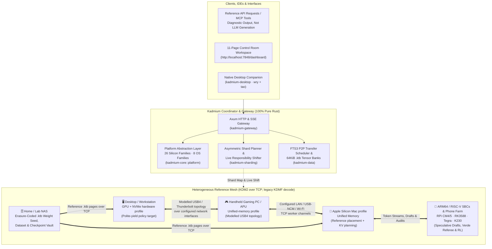

# 🧪 Kadmium (`Cd-48`) — Consolidated & Distributed AI/ML Compute Fabric

> **"In a nuclear reactor, cadmium control rods regulate, balance, and direct high-energy reactions. In AI/ML, Kadmium ([kadmium.ai](https://kadmium.ai)) aggregates, shards, and orchestrates frontier training, reinforcement learning, and inference across all the compute you already own."**

[](https://kadmium.ai)
[](#-current-development-phase--roadmap)
[](https://www.rust-lang.org/)
[](#-license)
[](#-core-capabilities)

> **Commercial status — 30 October 2026:** The [marketing and business review](docs/MARKETING_BUSINESS_REVIEW_2026-10-30.md) proposes a focused design-partner pilot with product and financial gates. Managed burst, host payouts, regulated-office packages and hardware are not established as live offerings by this repository. Consult the current API and guides for execution boundaries.

---

## 🌍 What is Kadmium?

The modern AI industry operates on a convenient assumption: *frontier model training, fine-tuning, reinforcement learning, and high-throughput inference require hundreds of thousands of dollars in identical datacenter GPUs wired over InfiniBand.*

Meanwhile, vast amounts of capable silicon sit underutilized in homes, dorms, studios, engineering labs, and universities:
- **Desktop workstations & gaming laptops** with discrete NVIDIA, AMD, or Intel GPUs
- **Handheld gaming PCs & high-memory APUs** with fast LPDDR5X unified memory and 30–40 Gbps USB4 / Thunderbolt ports
- **Apple Silicon Macs (M1–M4)** with high-bandwidth Unified Memory (`120–800 GB/s`)
- **Single-Board Computers & Edge SoCs** (Raspberry Pi CM4/5, RK3588, NVIDIA Tegra / Jetson, RISC-V RVV 1.0 boards)
- **Mobile phone arrays & 20-slot Phone Farm chassis** (`Snapdragon` / `Apple A-Series`)
- **Home & lab NAS appliances** with terabytes of storage for `.ktb` weight banks, datasets, and training checkpoints
- **On-demand burst cloud GPUs** rented for a few hours when a local cluster needs extra prefill or training FLOPs

Distributed scientific computing solved heterogeneous resource aggregation decades ago (**BOINC**, **CERN WLCG / FTS3 / Davix**), yet mainstream ML frameworks still crash or stall when one node is slower than another.

**Kadmium (`Cd-48`)** is a Rust compute-fabric project for heterogeneous machines, with a working control plane, worker transport, planners and reference workloads for inference, training and RL. Native model kernels run small reference tensors; gateway `/v1` routes return diagnostic text and vectors. Condenser's [local checkpoint workflow](docs/guides/local-checkpoints.md) preserves GGUF/SafeTensors sources and explicitly loads compatible models through local Ollama for generation. The [distributed compute guide](docs/guides/distributed-compute.md) covers user-supplied FP32 matrix jobs on TCP workers and stateful DiLoCo learner integration. Kadmium's own [native decoder](crates/kadmium-runtime/src/native_decoder/mod.rs) runs Llama, Mistral, Qwen2 and dense Qwen3 SafeTensors checkpoints at their stored precision, any range of layers per slice, matching Hugging Face transformers' float32 logits on test checkpoints and giving bit-identical output wherever the layers are cut (**Proved (model)**: `Kadmium.Native.runChain_eq_runLayers`). It runs on the CPU in one process today; carrying activations between machines, placement and the Condenser route are the remaining integration work for distributed production-model inference. Rust crates and platform components are dependencies; a packaged CLI does not require a Python environment.

---

## 📍 Current Development Phase & Roadmap

Kadmium is currently in **Phase 4 (`v0.4` — platform profiles, interconnect planning & Workspace Control Room)**. The repository implements the Rust control plane, **KDM2** binary TCP framing (with legacy KDMF decode), 64 KiB `.ktb` banks, Control Room, Companion, Condenser, and reference workloads. Six CUDA kernels also have a separate native parity harness.

Phase labels describe code milestones, not release or model-serving readiness. Gateway scaffolding does not establish full OpenAI/Anthropic SDK compatibility, real LLM output, production distributed training, or managed services. See the [current API contract](docs/api-reference.md) and [technical specsheet](docs/SPECSHEET_AND_ROADMAP.md).

| Phase | Milestone | Status | Scope |
| :--- | :--- | :--- | :--- |
| **Phases 1–2** | **Core planners, `.ktb`, TCP workers & reference runtimes** | ✅ **Reference mechanisms landed** | $q^*$ and shard planning, FNV-1a Merkle/checksum verification, constrained local transcoders, synthetic inference/training, small stateful DiLoCo sessions, DeMo, RepOps/Verde, and grid work graphs. |
| **Phases 3–4** | **Control Room, Companion & platform/interconnect work** | 🟢 **Current development** | Web/native interfaces, MCP, LAN discovery/pairing references, hardware classification, USB topology models, multi-lane delta bridges, and platform probes. Remote connectors and cloud outputs are plans or simulations. |
| **Phase 5** | **Native backends & real model integration** | 🔜 **Next** | General native GPU/NPU dispatch beyond the specific CUDA kernels and Intel MatMul, actual mmap/io_uring file paths, persistent model/optimizer state, and measured native OS/interconnect behavior. |
| **Phase 6** | **Managed CloudShield, Supply Grid & Public Registry** | 🗓️ **Planned** | Authenticated multi-tenancy, real provider procurement, production failover, financial settlement, managed WAN traversal, and public registry services. |

---

## 🧩 Platform Profiles and Execution Support

The Platform Abstraction Layer (`kadmium-core::platform`) classifies 26 silicon families and 8 OS families for discovery and planning. **Classification is not automatic execution support.** A profile does not prove a native backend, precision path, NPU integration, mmap loader, or OS hook exists for that device.

Current execution falls into four categories:

1. **Host reference math:** synthetic tensors and deterministic reference kernels used by the planner, gateway, and tests.
2. **Native CUDA:** six specific kernels with a separate device parity harness; see [`kadmium-cuda`](crates/kadmium-cuda/README.md) for exact kernels and measured hardware caveats.
3. **Native Intel NPU:** one Level Zero MatMul kernel with FP32 I/O and explicitly approximate FP16 arithmetic, outside RepOps verification and automatic scheduling; see [`kadmium-npu`](crates/kadmium-npu/README.md).
4. **Planned native backends:** general ROCm, Metal, Vulkan, additional NPU operators/vendors, and large-model GPU execution remain future integration work.

The host CI matrix covers Windows, macOS, and Linux. Other OS/platform profiles and bridge commands must not be read as equally validated support. Actual `.ktb` import currently reads a whole local file; zero-copy slices into loaded buffers are implemented, while mmap/io_uring/IoRing file loading is planned.

---

## ⚡ USB-C / USB4 / Thunderbolt Interconnects (`kadmium-network`)

[`usbc_interconnect.rs`](crates/kadmium-network/src/usbc_interconnect.rs) models host-to-host USB4/Thunderbolt, dual-role USB-NCM gadget, and low-speed sidecar topologies. [`MultiPathInterfaceStriper`](crates/kadmium-network/src/raid_striper.rs) computes chunk schedules across configured interfaces.

Displayed scanner figures such as 27.6 Gbps goodput, ~79 µs transfer time, and sub-150 ms drain are **derived from rated link bandwidth and scenario inputs**. Those planning functions do not perform corresponding DMA I/O, cable auto-configuration, or model-state migration. Workers still require reachable, configured network interfaces.

[`UsbCBridge`](crates/kadmium-network/src/usbc_bridge.rs) is a separate implemented transport: it carries one ordered stream over multiple TCP lanes, retransmits unacknowledged segments when a lane fails, and resumes authenticated sessions while preserving delta-link stores. Reported Wi-Fi-only unplug tests measured 12.5× fewer post-loss bytes and 2.0–2.2× faster decode-step completion than redialing; no USB cable connected the test machines, so these are not USB4 throughput results. See the [bridge guide and limits](docs/guides/usbc-delta-bridge.md) and [benchmark ledger](docs/BENCHMARKS_2026-10.md).

---

## 🏛️ Architectural Inspirations & Heritage

Kadmium synthesizes proven breakthroughs from local edge AI engines and battle-tested scientific grid computing:

| Inspiration | Key Concept Adopted in Kadmium |
| :--- | :--- |
| **[FlashML-org/FreeToken](https://github.com/FlashML-org/FreeToken)** | **Adaptive Placement ($q^*$) & Tensor Banks:** Inspires Kadmium's compute/memory placement heuristic and 64 KiB `.ktb` format. Current $q^*$ is a profile heuristic; actual mmap file loading is planned. |
| **[JustVugg/colibri](https://github.com/JustVugg/colibri) & [lumabri](https://github.com/JustVugg/lumabri)** | **Expert-Tiering & Allocation Design:** The planner models hot/warm/cold expert placement, owner offers, measured calibration records, and hysteresis-gated re-pinning. Current measurements are from synthetic reference kernels, not production model serving. |
| **[wici-ai/inferssd](https://github.com/wici-ai/inferssd)** | **Expert Cache, Learned Cost Lines & the Host Envelope:** A count-decay RAM expert cache on every worker, an optional speculative next-layer prefetch that never changes the selection, hop cost lines learned from the coordinator's own dispatch timings, opt-in payback-gated re-pins, coalesced aligned reads, a per-model prompt cache, and a host memory ledger the caches give room back to. Reference workloads only; bit-identical to the uncached path. See [ARCHITECTURE 9.19](docs/ARCHITECTURE.md#919-inferssd-expert-cache-next-layer-prefetch-learned-cost-lines-coalesced-reads-the-prompt-cache-and-the-host-envelope). |
| **[niko1221/strata](https://github.com/niko1221/strata/tree/7ddc17a38fe7f31637e895ecfba58c2cd43d65ec)** | **Consumer Setup Inspiration:** Hardware-aware setup informs the additive `launch --plan` and configuration-creation workflow. Kadmium's existing API-shaped diagnostics are not Strata's inference engine or a full OpenAI/Anthropic integration. |
| **[BOINC/boinc](https://github.com/BOINC/boinc)** | **Polite Host Governance & Workunit Verification:** Resource-offer policies, activity state machines, and canary references. Sub-200 ms yield is a target/estimate, not a measured cross-platform SLA. |
| **[cern-fts/fts3](https://github.com/cern-fts/fts3) & [davix](https://github.com/cern-fts/davix)** | **Third-Party Staging Design:** Chunk manifests, delta planning, and transfer schedules are present. Current live reference pages flow from coordinator to worker over TCP; direct NAS-to-worker FTS3/QUIC staging is target work. |
| **[NousResearch/DisTrO](https://github.com/NousResearch/DisTrO) & Psyche** | **DeMo DCT Compression:** DCT-II top-k momentum extraction with residual error feedback. Ratio depends on tensor size and `top_k`; no universal compression or convergence guarantee is claimed. |
| **[PrimeIntellect-ai/OpenDiLoCo](https://github.com/PrimeIntellect-ai/OpenDiloco)** | **Stateful Outer Synchronization:** Small complete-replica sessions and a deterministic CPU regression example use persistent Nesterov outer state. Pipeline-sharded islands and WAN membership recovery are target designs. |
| **[learning-at-home/hivemind](https://github.com/learning-at-home/hivemind) & [petals](https://github.com/bigscience-workshop/petals)** | **SWARM Parallelism & 8-Bit Blockwise Quantization:** Latency-weighted micro-batch routing around slow/churning peers and compressed boundary activations. |
| **[gensyn-ai/rl-swarm](https://github.com/gensyn-ai/rl-swarm) & [ree](https://github.com/gensyn-ai/ree)** | **Reproducible Reference Execution (`RepOps`) & Verde:** Deterministic reductions and digest/bisection references check defined computations. They do not establish native parity across every labelled backend or cryptographic settlement. |
| **[Dream-RSI](https://www.dream-rsi.com/) ([zhengkid/Dream-RSI](https://github.com/zhengkid/Dream-RSI))** | **Offline Replay Design:** Current code traverses an in-memory sample discovery tree without new GPU evaluations. Persistent trajectory recording, distributed replay, and policy injection into online training are target work. |

---

## ⚡ Core Capabilities

### 1. Custom Asymmetric Model Sharding (`kadmium-sharding`)
- **Proportional Pipeline & Tensor Sharding:** Plans transformer-block assignments from each node's profiled compute/memory envelope and interconnect tier. USB4/Thunderbolt tensor-parallel choices are planner outputs until native execution and link benchmarks validate them.
- **MoE Affinity Tiering:** Plans dense/hot expert placement in fast memory, warm experts in System RAM, and cold-expert streaming from NVMe/NAS `.ktb` banks. Actual execution remains on reference paths unless a native backend is named.
- **Utility & Draft Placement:** Plans tokenization, modelled draft, embedding, and Verde audit roles for low-power ARM/RISC-V SBCs and NPUs.

### 2. Dynamic Compute Responsibility Planning
`ShardPlanner::plan_responsibility_shift` computes a new placement for gaming, node-change, and cloud-burst scenarios. Transfer volumes, handoff times, and zero-downtime fields in sample reports are modelled. They do not establish live weight prefetch, uninterrupted KV/optimizer migration, or production failover.

### 3. Training and RL Reference Mechanisms (`kadmium-runtime` & `kadmium-rl`)
- **Pipeline and optimization references:** 1F1B/zero-bubble schedulers, GaLore/Muon, FWHT/FP8, and related kernels operate on defined reference inputs; their sample performance figures are not measured model-training results.
- **Stateless stage previews:** legacy training endpoints start from synthetic per-stage baselines on every request and do not persist learner weights.
- **Stateful small-replica DiLoCo:** the session API and `kadmium diloco` maintain outer state for complete caller-supplied replicas. They do not provide integrated pipeline-sharded large-model training.
- **Synthetic GRPO and custom sandbox:** current GRPO verifies fixed polynomial programs in a fuel-metered stack machine. It is not PPO/online policy training or a general WASI/code compiler.
- **Dream-RSI replay:** the CLI traverses an in-memory sample tree; it does not persist discovery trees or inject policies into online training.

### 4. Control Room Workspace App, Native Desktop Companion & Reference API (`kadmium-gateway` & `kadmium-desktop`)
- **11-Page Workspace Control Room (`/dashboard`):** Built-in single-binary web workspace organized into **Cluster** (*Overview, Machines, Boards & devices, Models, Storage*), **Work** (*Training, Reinforcement learning, API & playground, Slices*), and **Account** (*Kadmium Cloud, Settings*) with live 5-second cluster polling, node hardware/mesh inspection drawers, and an interactive chat/MCP playground.
- **Native Desktop Companion (`kadmium-desktop`):** Runs the local coordinator and Companion in WebView2 on Windows and WKWebView on macOS. Linux defaults to the browser; native WebKitGTK requires the `linux-native` feature and GTK/WebKit development packages.
- **Reference HTTP API & MCP:** `/v1/chat/completions` and `/v1/messages` return fixed diagnostic messages; `/v1/embeddings` returns reference vectors and `/v1/models` lists planning presets. These are not drop-in chat/agent SDK endpoints. MCP tools use the separate `/mcp` endpoint or `kadmium mcp`.

---

## 🏗️ System Architecture



---

## 📦 Workspace Structure

Kadmium is organized as a modular **13-crate Pure Rust** Cargo workspace. The CUDA device harness under `crates/kadmium-cuda/device` is separately excluded. The `kadmium-grid` crate is the generic distributed-compute substrate underneath the AI workloads: work units with a BOINC-style lifecycle, work graphs, a replica catalog with placement rules, a locality-aware scheduler with quorum validation, and a credit ledger. Inference steps, training steps, Dream-RSI replay batches and Verde audits are work graphs scheduled on it; a pipeline is a chain graph and expert parallelism is a fan-out graph, and the two produce identical bytes.

```text
kadmium/
├── Cargo.toml                  # Workspace manifest & shared dependencies
├── README.md                   # Project overview, current phase & quickstart
├── docs/
│   └── ARCHITECTURE.md         # Deep-dive technical specification
└── crates/
    ├── kadmium-core/           # Platform abstraction (26 silicon / 8 OS families), q* policy, OS hooks
    ├── kadmium-sharding/       # Asymmetric sharding, TPU/CIM dataflow modes, live responsibility shifting, CloudShield
    ├── kadmium-data/           # 64 KiB .ktb banks, transfer/range planners, constrained local GGUF/SafeTensors import
    ├── kadmium-grid/           # Compute substrate: work units & graphs, replica catalog, locality scheduler, quorum validation, credit ledger
    ├── kadmium-runtime/        # Host/CUDA references, grid executor, TCP pipeline, training previews, small DiLoCo sessions, EXL3, Verde
    ├── kadmium-rl/             # RL topology, synthetic GRPO, custom stack-machine sandbox & Dream-RSI replay
    ├── kadmium-network/        # KDM2/KDMF framing, TCP mesh, interconnect models, RAID scheduling, NAT route planning
    ├── kadmium-gateway/        # Axum server, Control Room, Docs Portal, reference API diagnostics and MCP
    ├── kadmium-cli/            # Single-binary `kadmium` CLI (serve, join, desktop, probe, plan, bench, import, exl3)
    ├── kadmium-desktop/        # Native Desktop Companion window (WebView2 / WKWebView / WebKitGTK)
    ├── kadmium-condenser/      # Kadmium Power Plant inference harness library: provider adapters, bounded tool turns, process plugins (GUI-free)
    ├── kadmium-condenser-app/  # `kadmium-condenser` command and native window
    ├── kadmium-cuda/           # Pure-Rust CUDA kernels (NVIDIA cuda-oxide), bit-identical to the RepOps reference; GPU harness in device/
    └── kadmium-npu/            # Vendor-neutral NPU traits and Intel Level Zero approximate-FP16 MatMul
```

---

## 🚀 Quickstart

### Prerequisites
- **`rustup`**; the repository selects its pinned **Rust 1.99.0** toolchain automatically.

### 1. Inspect and launch the Control Room
Inspect a plan, then start the existing coordinator (add `--demo` for the simulated fleet or `--spawn-fleet` for local worker testing):
```bash
cargo run --bin kadmium -- launch --plan
cargo run --bin kadmium -- launch
```
Then open **`http://localhost:7848`** for the **Control Room**. `launch` creates `kadmium.toml` only if missing; its preset recommendation is informational and does not load a model. The existing all-interface listener, `serve`, `desktop` and configuration-parser behavior remain unchanged. Use trusted-network or external access controls. See the [launch guide](docs/guides/cli.md) and [checked installers for the next tagged release](docs/getting-started.md#1-installation).

**Dependency decision: keep the existing dependencies.** This setup change adds no direct or transitive Rust dependencies and changes no Cargo manifests or lockfile. An external inference relay is deferred, with no optional relay code included; it requires a future owner decision and a downstream access/authentication design. The existing diagnostic `/v1` behavior remains in place.

### 2. Open the Desktop Companion App
```bash
cargo build -p kadmium-desktop
cargo run --bin kadmium -- desktop
```
Opens the Companion with an embedded or existing local coordinator. Windows/macOS use native WebViews. Linux opens the browser by default; for a native window, install WebKitGTK 4.1/GTK 3 development packages and build `kadmium-desktop` with `--features linux-native`.

In either the Companion or browser Control Room, choose **Models**, then **Prepare a local model** or **Send to a coordinator**. Condenser prepares GGUF/SafeTensors without changing a weight, writes 4 KiB-aligned shards with verified 16 MiB transport chunks, and runs the model through local Ollama or the Ollama of a Kadmium coordinator you run. **Launch Condenser** opens the included workspace at `/condenser/` without a separate process. Context and output default to model maximums; lower them per task in **Model & quality**, where each limit explains its tradeoff. See [bring your own model](docs/guides/local-checkpoints.md) and [model transport](docs/guides/model-transport.md).

### 3. Join Additional Machines
On the worker, use the coordinator's reachable LAN/VPN address:
```bash
cargo run --bin kadmium -- join --coordinator http://192.168.1.10:7848
```
Replace the example address. The coordinator HTTP port and worker TCP listener must be reachable; remote networks need a VPN or explicit port forwarding and external access controls. USB network interfaces must already be configured. Join tickets are FNV-checksummed endpoint metadata, not authentication, and the current path does not provide managed NAT traversal.

### 4. Probe Hardware, Benchmark Kernels & Inspect Shard Plans
```bash
# Probe local hardware profiles and reference page/packing behavior
cargo run --bin kadmium -- probe

# Run synthetic kernel/quantization and NAT/interconnect model reports
cargo run --bin kadmium -- bench
cargo run --bin kadmium -- exl3 --model deepseek-v3-671b-exl3-2.5bpw --bpw 2.55

# Compute shard and RL topology plans over sample node profiles
cargo run --bin kadmium -- plan --model deepseek-v3-671b-moe --workload inference
cargo run --bin kadmium -- plan --model llama-3-70b-lora --workload training
cargo run --bin kadmium -- plan --workload batch
cargo run --bin kadmium -- plan --workload rl
cargo run --bin kadmium -- dream
```

### 5. Run the Full Workspace Verification Suite

The repository and CI pin Rust **1.99.0** in `rust-toolchain.toml` and `.github/workflows/ci.yml`. Update both together when upgrading, and run formatting, Clippy and tests before changing the pin.

```bash
cargo fmt --all -- --check
cargo clippy --workspace --all-targets --locked -- -D warnings
cargo test --workspace --locked
```
This covers host Rust tests only. CI separately runs formatting, Clippy (including Linux native WebView), Condenser Node tests, Playwright workflows, installer fixtures, and Python business-model checks. The CUDA device harness is excluded from the host workspace. See [CONTRIBUTING.md](CONTRIBUTING.md).

Control Room browser regressions run on Ubuntu CI. To run locally (Chromium on Linux/macOS, installed Edge on Windows):

```bash
npm install --prefix target/ui-test --no-package-lock --no-audit --no-fund playwright@1.64.1
node target/ui-test/node_modules/playwright/cli.js install chromium
cargo build -p kadmium-gateway --example control_room_fixture
node --test crates/kadmium-gateway/tests/control_room.test.cjs
```

The fixture uses an ephemeral loopback port and a disposable working directory, without discovering or contacting live workers.

---

## 📖 Documentation

- [**User and developer documentation**](docs/README.md) — Sitemap for setup, complete CLI/API references, operator guides, release process, and evidence ledgers.
- [**`docs/ARCHITECTURE.md`**](docs/ARCHITECTURE.md) — Deep-dive into current mechanisms and explicitly labelled target designs.
- [**Contributing**](CONTRIBUTING.md) and [**release runbook**](docs/guides/release.md) — Required checks, documentation conventions, artifacts, and release gates.
- [**Historical engineering numbers**](docs/NUMBERS_2026-10.md) — Dated model inputs paired with [`canonical_numbers.rs`](crates/kadmium-core/src/canonical_numbers.rs); not live prices, measured available supply or approved financial policy.
- [**Marketing and business evidence review**](docs/MARKETING_BUSINESS_REVIEW_2026-10-30.md) — Repository findings, primary-source research, strongest case and objections.
- [**Business plan and stance**](docs/BUSINESS_PLAN_AND_STANCE.md) — Proposed pilot strategy, economic gates and stewardship commitments.
- [**Marketing and launch experiments**](docs/MARKET_RESEARCH_AND_LAUNCH_PLAN.md) — Channels, draft copy, budgets and measurement.
- [**Operating plan**](docs/OPERATING_PLAN.md) and [**reproducible economics**](docs/business/ECONOMICS.md) — Delivery, support, cash controls and calculations.
- [**Historical R4 research**](docs/MARKET_RESEARCH_REVIEW_2026-10.md) — Earlier technical research; current commercial recommendations supersede it.
- **Interactive Docs Portal** — Run `cargo run --bin kadmium -- serve` and visit **`http://localhost:7848/docs`**.

---

## 📜 License

Dual-licensed under **MIT** or **Apache-2.0** at your option.
