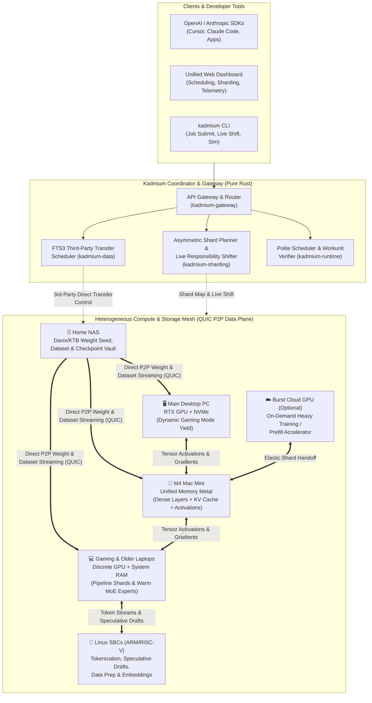

# 🧪 Kadmium / Kadmium.ai (`Cd-48`) — Consolidated & Distributed AI/ML Compute Fabric

> **"In a nuclear reactor, Kadmium control rods regulate, balance, and direct high-energy reactions. In AI/ML, Kadmium ([kadmium.ai](https://kadmium.ai)) aggregates, shards, and orchestrates frontier training, RL, and inference across all the compute you already own."**

[](https://kadmium.ai)
[](https://www.rust-lang.org/)
[](#license)
[](#core-capabilities)

---

## 🌍 The Problem

The modern AI industry promotes a convenient myth: *frontier model training, fine-tuning, and high-throughput inference require hundreds of thousands of dollars in homogeneous datacenter GPUs.*

Meanwhile, huge amounts of capable silicon sit idle in homes, dorms, homelabs, and underfunded academic institutions:
- Desktop workstations and gaming laptops with discrete GPUs
- Apple Silicon Macs (M1–M4) with high-bandwidth Unified Memory
- Older laptops and desktops with spare system RAM and NVMe bandwidth
- Single-Board Computers (Linux ARM/RISC-V SBCs)
- Home NAS boxes with terabytes of fast storage for datasets, checkpoints, and model weights
- Friends' or family members' idle PCs across the internet
- Occasional short-term cloud GPU rentals hired for a few hours to boost a heavy training run

Distributed scientific computing solved this problem decades ago (**BOINC**, **CERN WLCG / FTS3 / Davix**), yet modern AI frameworks assume every node is an identical datacenter server connected over InfiniBand.

**Kadmium** bridges that gap. Written in **100% Pure Rust** and distributed as a zero-dependency single binary, Kadmium turns any heterogeneous collection of devices into a unified, self-balancing AI/ML supercomputer for **distributed training, custom-sharded inference, and batch pipelines**.

---

## 🏛️ Architectural Inspirations & Heritage

Kadmium synthesizes proven breakthroughs from local edge AI engines and battle-tested scientific grid computing:

| Inspiration | Key Concept Adopted in Kadmium |
| :--- | :--- |
| **[FlashML-org/FreeToken](https://github.com/FlashML-org/FreeToken)** | **Bandwidth-Adaptive Execution ($q^*$ Policy) & Pre-Merged Weight Banks:** Dynamically splits token/tensor computation across CPU, RAM, PCIe, and GPU VRAM based on real-time interconnect throughput, backed by zero-copy memory-mapped tensor banks (`KTB`). |
| **[JustVugg/colibri](https://github.com/JustVugg/colibri) & [lumabri](https://github.com/JustVugg/lumabri)** | **NVMe MoE Expert Streaming & P2P Swarm Execution:** Keeps lightweight dense layers resident in fast memory while streaming sparse Mixture-of-Experts (MoE) weights on demand from local NVMe or across a peer-to-peer swarm of ordinary machines. |
| **[niko1221/strata](https://github.com/niko1221/strata)** | **Zero-Friction Consumer Hardware Setup & Drop-In API Gateway:** One-command deployment across Windows/macOS/Linux with built-in OpenAI (`/v1/chat/completions`, `/v1/embeddings`) and Anthropic (`/v1/messages`) compatible endpoints + multimodal vision offloading. |
| **[BOINC/boinc](https://github.com/BOINC/boinc)** | **Polite Host Resource Harvesting & Workunit Verification:** Non-intrusive background execution that respects user activity (instant "Gaming Mode" yield, battery/thermal envelopes), credit accounting, and deterministic spot-verification for untrusted peers. |
| **[cern-fts/fts3](https://github.com/cern-fts/fts3) & [davix](https://github.com/cern-fts/davix)** | **Third-Party Peer-to-Peer Data Staging:** The coordinator never bottlenecks weight or dataset transfers. Nodes stream shards, datasets, and checkpoints directly peer-to-peer (e.g., NAS $\to$ Mac Mini & Gaming Laptop) with bandwidth-aware retry state machines. |
| **[NousResearch/DisTrO](https://github.com/NousResearch/DisTrO) & Psyche** | **DeMo (Decoupled Momentum) DCT Compression:** Compresses inter-node gradient synchronization by $1{,}000\times$–$3{,}000\times$ using Discrete Cosine Transform (DCT) fast-momentum extraction with local error-feedback accumulation—enabling full training over home internet and Wi-Fi. |
| **[PrimeIntellect-ai/OpenDiLoCo](https://github.com/PrimeIntellect-ai/OpenDiloco) & [prime-diloco](https://github.com/PrimeIntellect-ai/prime-diloco)** | **Sharded-Island DiLoCo & Async RL Post-Training:** Combines fast inner-loop local optimization on sharded LAN islands with periodic outer-loop Nesterov pseudo-gradient sync across WAN peers, plus asynchronous RL rollout generation. |
| **[learning-at-home/hivemind](https://github.com/learning-at-home/hivemind) & [petals](https://github.com/bigscience-workshop/petals)** | **SWARM Parallelism & 8-Bit Blockwise Quantization:** DHT-backed peer discovery, stochastic latency-weighted micro-batch routing around slow/churning peers, and compressed boundary activations. |
| **[gensyn-ai/rl-swarm](https://github.com/gensyn-ai/rl-swarm) & [ree](https://github.com/gensyn-ai/ree)** | **Reproducible Cross-Silicon Execution (`RepOps`) & Verde Verification:** Solves floating-point drift across mixed CUDA, Apple Metal, and CPU nodes using deterministic reductions and $O(\log L)$ refereed layer-bisection audits, plus **SkipPipe** fault-tolerant pipeline routing. |
| **[Dream-RSI](https://www.dream-rsi.com/) ([zhengkid/Dream-RSI](https://github.com/zhengkid/Dream-RSI))** | **Recursive Self-Improvement through Evolving Worlds (arXiv:2609.14858):** Converts accumulated agent discovery history into an offline **Replay Simulator ("Dreaming")** run on low-power SBCs/CPUs/NAS to evolve superior exploration policies at zero live GPU cost before redeploying online. |

---

## ⚡ Core Capabilities

### 1. Custom Asymmetric Model Sharding (`kadmium-sharding`)
Standard frameworks split models evenly, causing the fastest GPU to wait on the slowest node. Kadmium continuously profiles each node's FLOPs, VRAM, Unified Memory, System RAM, NVMe speed, and pairwise network latency/bandwidth to compute an **Asymmetric Shard Plan**:
- **Proportional Pipeline & Tensor Sharding:** Slices transformer blocks proportionally to each node's compute-to-memory envelope.
- **MoE Affinity Tiering:** Pins dense attention trunks and "hot" experts in GPU VRAM / Apple Unified Memory, places "warm" experts in System RAM across older laptops, and streams "cold" experts from NVMe/NAS via `KTB` tensor banks.
- **Utility Offloading to SBCs & Low-Power Nodes:** Routes tokenization, BPE/dataset preprocessing, speculative decoding draft verification, embedding lookup tables, and telemetry aggregation to Linux SBCs and CPU-only nodes.

### 2. Dynamic Compute Responsibility Shifting (Live Rebalancing)
Hardware availability in the real world is dynamic. When you launch a game on your main PC, unplug a laptop, or attach a rented cloud GPU for a 3-hour boost:
1. **Shadow Prefetch:** Relief nodes prefetch static base weights from the NAS or peer cache via FTS3-style third-party transfers.
2. **Boundary Handoff:** At the next token step (inference) or micro-batch boundary (training), only the compact mutable state (KV-cache slice or LoRA/optimizer delta) transfers directly between peers.
3. **Zero-Downtime Reroute:** The cluster routing table atomically switches to the new shard map without dropping active requests or aborting training runs.

### 3. Distributed & Decentralized Training Engine (`kadmium-runtime`)
Training is a first-class citizen in Kadmium alongside inference, combining LAN pipeline sharding with battle-tested decentralized training breakthroughs:
- **Asymmetric Pipeline-Parallel Training (1F1B + SWARM / SkipPipe):** Schedules forward and backward micro-batches across heterogeneous shards, using Hivemind-style 8-bit boundary activation compression and automatic per-node activation checkpointing (trading compute for VRAM on memory-constrained gaming laptops while caching activations on high-memory Mac Minis).
- **Sharded-Island DiLoCo + DeMo / DisTrO Compression:** Standard DiLoCo requires each node to hold a full model replica. Kadmium introduces **Sharded-Island DiLoCo**: your local heterogeneous mesh shards a 70B+ model across multiple consumer devices as a single logical "island" for inner-loop steps, and synchronizes outer-loop updates with remote friend/lab islands using **Nous DisTrO / DeMo DCT frequency compression** ($1{,}000\times$ bandwidth reduction).
- **Decentralized RL Post-Training Swarms (GRPO / PPO):** GPU/Metal nodes run policy & rollout shards while Linux SBCs and older laptops act as parallel **Verifiable Reward Sandboxes** (compiling/executing code rollouts, unit tests, and deterministic math/logic verifiers).
- **Cross-Silicon Verifiable Training (Gensyn Verde & RepOps):** Mixed CUDA, Apple Metal, and CPU nodes naturally exhibit floating-point non-associativity. Kadmium enforces reproducible tree reductions (`RepOps`) and uses $O(\log L)$ **Refereed Layer Bisection** to pinpoint faulty or corrupted nodes without re-running full steps.
- **Distributed LoRA / QLoRA / DoRA & Elastic Cloud GPU Bursting:** Freezes quantized `.ktb` base shards across consumer hardware while training compact adapters, and seamlessly shifts heavy pipeline stages onto a rented cloud GPU when attached.

### 4. TPU & Compute-in-Memory (CIM) Inspired Dataflow Modes (`kadmium-sharding`)
Inspired by Google TPU systolic dataflow and Compute-in-Memory (CIM) architectures, Kadmium lets users choose—or automatically switch—between dual streaming paradigms depending on arithmetic intensity:
- **Weight-Stationary / Compute-in-Memory Dynamic Token Streaming (`ComputeInMemoryTokenStreaming`):** Model weights stay permanently pinned in distributed VRAM, Apple Unified Memory, and DDR System RAM banks with zero weight movement. Compact token activation vectors ($x_t$) flow like a systolic wavefront directly to the memory controllers where the weights live. Ideal for low-latency single-stream decode ($B = 1..8$) and speculative decoding.
- **Token-Stationary Dynamic Weight Streaming (`TokenStationaryWeightStreaming`):** Large token activation batches remain stationary in fast GPU SRAM/VRAM while double-buffered `.ktb` weight tiles stream continuously through the compute units from local NVMe, NAS, or peer RAM banks. Ideal for high-throughput batch prefill, evaluations, or running 400B–671B models on 1–2 GPUs.
- **Disaggregated Dual-Stream (`DisaggregatedDualStream`):** Combines Weight-Streamed Prefill on high-FLOP GPUs with Compute-in-Memory Token-Streamed Decode across memory-rich nodes.

### 5. Sub-Compute Environment Slicing (`SubClusterPartitioner`)
When managing larger pools (e.g., **100 nodes** across an academic department, lab, or community grid), Kadmium can section the global pool into isolated **Sub-Compute Environments** (e.g., **5 sub-clusters of 20 nodes each**):
- Each sub-cluster (`slice-01-prod-deploy`, `slice-02-staging-test`, `slice-03-train-diloco`, `slice-04-rl-dream-rsi`, `slice-05-batch-eval`) receives a capability-balanced mix of hardware, its own isolated `ShardPlanner`, FTS3 transfer queue, `DataflowMode`, and a dedicated API Gateway namespace (`/v1/slices/{slice_id}/...`), with optional elastic node borrowing when a slice is idle.

### 6. Open-Core Hybrid Cloud & Downtime Protection Shield (`HybridCloudArbitragePlanner`)
Designed around a **Supabase / Tailscale style Open-Core model**:
- **100% Open-Source & Self-Hostable:** Anyone can run the single `kadmium` binary on their own local hardware, home lab, or university cluster for free forever.
- **Managed Control Plane & Multi-Datacenter Spot Arbitrage:** Because Kadmium natively supports **Asymmetric Model Sharding**, **DeMo 1,000x Gradient Compression**, and **Live Compute Responsibility Shifting**, Kadmium Cloud can stitch together fragmented, low-cost single-GPU spot instances and high-RAM bare-metal servers across multiple providers (RunPod, Vast, Lambda, Hetzner, Crusoe, AWS/GCP Spot)—delivering frontier compute at a **60%–85% discount** compared to monolithic hyperscaler clusters.
- **Bidirectional Downtime Protection (`Local <-> Cloud Failover Shield`):**
  - **Local Outage $\to$ Cloud Standby:** If a user's self-hosted home lab or on-prem server loses power/internet, Kadmium's pre-warmed cloud `.ktb` vault automatically absorbs the affected layer shards within milliseconds so production APIs and training runs experience zero downtime, then **fails back to local hardware** ($0/hr) as soon as the local node recovers.
  - **Cloud Spot Eviction / Outage $\to$ Local + Multi-Cloud Fallback:** If a cloud provider experiences an outage or sends a 30-second spot preemption notice, Kadmium shifts those shards seamlessly onto alternate providers or back onto the user's local hardware.

### 7. Unified Web Dashboard & API Gateway (`kadmium-gateway`)
- **Real-Time Cluster Topology & Shard Visualizer:** Monitor node utilization, VRAM/RAM/NVMe tier pressure, pairwise link throughput, active FTS3 data transfers, and live shard migrations.
- **Drop-In AI Gateway:** Point Cursor, Claude Code, OpenWebUI, or custom Python training scripts directly at `http://localhost:7848/v1`.

---

## 🏗️ System Architecture



---

## 📦 Workspace Structure

Kadmium is architected as a modular **100% Pure Rust** Cargo workspace:

```text
kadmium/
├── Cargo.toml                  # Workspace manifest & shared dependencies
├── README.md                   # Project overview & quickstart
├── docs/
│   └── ARCHITECTURE.md         # Deep-dive technical specification
└── crates/
    ├── kadmium-core/           # Hardware profiles, model topologies, job specs, memory tiers
    ├── kadmium-sharding/       # Asymmetric model sharding, q* policy, live responsibility shifting
    ├── kadmium-data/           # FTS3/Davix third-party transfer engine & KTB weight bank format
    ├── kadmium-runtime/        # Inference pipeline, 1F1B/DiLoCo training loop, BOINC polite worker
    ├── kadmium-rl/             # First-class RL Environment fabric, WASM/code sandboxes & GRPO/PPO planner
    ├── kadmium-network/        # QUIC P2P mesh discovery, telemetry heartbeats, link matrix probing
    ├── kadmium-gateway/        # Axum Unified Dashboard UI + OpenAI/Anthropic compatible HTTP API
    └── kadmium-cli/            # Single-binary `kadmium` CLI (node, coordinator, simulator)
```

---

## 🚀 Quickstart

### Prerequisites
- **Rust 1.85+** (`cargo` and `rustc`)

### 1. Run the Heterogeneous Cluster & Sharding Simulation
See Kadmium profile a realistic personal hardware cluster (Main Desktop PC, M4 Mac Mini, 2 Gaming Laptops, Older Laptop, Linux SBCs, and a Home NAS), compute an asymmetric shard plan for both a **405B MoE Inference Model** and a **70B Distributed Fine-Tuning Job**, and perform a **live compute responsibility shift** when the Main PC starts a game and a Burst Cloud GPU joins:

```bash
cargo run --bin kadmium -- simulate
```

### 2. Inspect Custom Shard, RL, Dream-RSI, Dataflow, & Sub-Cluster Slice Plans
```bash
cargo run --bin kadmium -- plan --model deepseek-v3-671b-moe --workload inference
cargo run --bin kadmium -- plan --model llama-3-70b-lora --workload training
cargo run --bin kadmium -- plan --model llama-3-70b-lora --workload rl
cargo run --bin kadmium -- dream
cargo run --bin kadmium -- dataflow --model deepseek-v3-671b-moe --batch-tokens 512
cargo run --bin kadmium -- slice --pool-size 100 --slices 5
cargo run --bin kadmium -- cloud-shield
```

### 3. Launch the Unified Dashboard & API Gateway
```bash
cargo run --bin kadmium -- serve --port 7848
```
Then open **`http://localhost:7848`** in your browser to explore the live cluster topology, shard allocation map, FTS3 transfer queue, and training/inference telemetry, or query `/v1/chat/completions` and `/v1/messages`.

### 4. Run the Test Suite
```bash
cargo test --workspace
```

---

## 📖 Documentation

Read the full technical design in [**docs/ARCHITECTURE.md**](docs/ARCHITECTURE.md), covering:
- **Section 1:** Hardware Capability Vector & Memory Hierarchy Modeling
- **Section 2:** Custom Asymmetric Sharding Algorithm & $q^*$ Bandwidth-Adaptive Routing
- **Section 3:** Live Compute Responsibility Shifting Protocol
- **Section 4:** Distributed Training Architecture (Asymmetric 1F1B, QLoRA, DiLoCo, Cloud Burst)
- **Section 5:** FTS3/Davix Third-Party Data Plane & Kadmium Tensor Bank (`KTB`) Format
- **Section 6:** BOINC-Style Polite Resource Governance & Verification

---

## 📜 License

Dual-licensed under **MIT** or **Apache-2.0** at your option.
